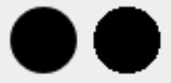
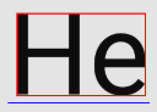
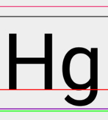
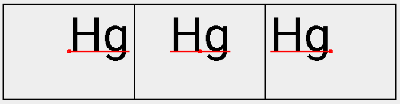

在Android的繪製過程中，相較Path更為重要的物件；沒有Paint，Canvas無法正常繪製出任何東西。

Paint，就是如畫筆一般的角色。你可以指定Paint的型態，這會決定在繪製結果會是以線條、色塊等的方式呈現。同時也可以指定顏色，甚至也可如現實生活中的一些特殊畫筆，指定漸層顏色。

除了畫筆的特性，Paint也負責處理繪製字串時的參數，因此Paint的使用層面比較廣。

以下將從畫筆和字串控制兩種不同的特性，來介紹函示。

### 使用方式

```Java
paint.setColor(android.R.color.black);
paint.setAntiAlias(true);
paint.setStrokeWidth(5);
canvas.drawPath(path, paint);
```

就算沒有前面的設定，Paint依然有預設值可以正常使用。詳細設定可參照Paint原始碼。

### 畫筆

#### setAntiAlias()

* *參數：**boolean** aa*，預設false。

是否開啟反鋸齒，效果如下圖：



左為開啟後，又為開啟前

#### setColor()

* *參數：**int** Color*，預設黑色。

可決定繪製出來的字串顏色。

#### setStyle()

* *參數：**Style** style，預設是FILL。*

 ```Java
public enum Style {
    FILL (0), // 填滿
    STROKE (1), // 線條
    FILL_AND_STROKE (2); // 填滿加線條
    ...
}
 ```

可以決定Path繪製的方式，效果如下圖：


由左至右分別是：FILL、STROKE和FILL_AND_STROKE。

#### setStrokeWidth()

* *參數：**float** width*

與Style.STROKE和Style.FILL_AND_STROKE搭配使用，可以決定線條的寬度。

STOKE的繪製是依照路徑，往內和往外延伸，所以STROKE的寬度會影響圖樣最後呈現的大小。示意圖可參考`setStyle()`段落。

### 字串控制

#### setTextSize()

* *參數：**float** textSize*

可以決定繪製的字串的字體大小

#### measureText()

* *參數：**CharSequence** text, **int** start, **int** end*

可計算傳入的字串(text)，其指定範圍(start - end)的字所佔用的寬度。

#### getTextBounds()

* *參數：**String** text, **int** start, **int** end, **Rect** bounds*

類似`measureText()`，唯一不同是得到範圍(bounds)會盡可能的切齊字串(text)的邊緣，比較圖如下：



紅框表示`getTextBounds()`回傳的範圍，藍線表示`measureText()`取得的寬度。

**值得一提的是如果用繪圖軟體如Sketch，畫出來的字串邊界會是`measureText()`的結果。**

#### getFontMetrics()

取得繪製字串時使用的FontMetrics，裡面的數值會因為`setTextSize()`而產生變化：

```Java
public static class FontMetrics {
    public float   top;
    public float   ascent;
    // baseline
    public float   descent;
    public float   bottom;
    public float   leading;
}
```

加上基準線(`baseline`)，參數由上(`top`)至下(`bottom`)，這些相對於實際上字體的位置如下：



要注意一點是，除了`leading`代表行距外，平常為0外。其他數值則是基準線往上或往下的相對值，所以`top`和`ascent`會是負數，而`bottom`和`descent`為正值。

### setTextAlign()

* *參數：**Align** align*，預設是LEFT。

```Java
public enum Align {
    LEFT    (0),
    CENTER  (1),
    RIGHT   (2);
    ...
}
```

Align用於指定字串繪製時，其位置的基準點。示意圖如下：



