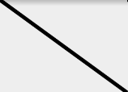
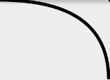
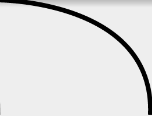
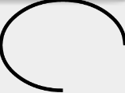

在Android的實作中，有時需要自行設計物件，並在適當的時機做額外的描繪。而談到繪製過程，其中一個重要的物件就是Path。

Path，顧名思義就是路徑，也可以當成是任何圖形的外。所以Path可以說是繪製的基礎，就像在繪圖軟件上做畫時大多需要操作貝茲曲線來制定選取範圍、製作圖型等。

在概念上，Path確實是可以當成貝茲曲線，其有各式繪製線條、曲線或幾何圖形的函示。搭配參數可以描繪出各式各樣的圖形。

以下將會用圖示搭配簡短的敘述介紹各個函式。

### 名詞解釋

在介紹函式，需要先介紹一些名詞，方便後續閱讀：

#### 起點

Path預設路徑的起點皆為(0, 0)，所以直接呼叫`lineTo()`等函示，會當作是從(0, 0)開始描繪。如希望從特定的位置當作起點，則可以用`moveTo()`來更換起點。

#### 控制點

如同繪製貝茲曲線時，用來決定曲度的控制點。控制點都會對應到一個點，可能是起點或是一段Path的終點，控制點離其對應的點越遠，則曲度越大。

### 使用方式

```Java
path.reset();
path.moveTo(rect.left, rect.top);
paint.setStyle(Paint.Style.STROKE);
path.lineTo(rect.right, rect.bottom);
```

Path決定好路徑後，還需透過Paint來畫在Canvas上。Paint預設為FILL(填滿)，必須設為STROKE才能正確繪出代表線條的Path。Paint的詳細用法可以參閱Paint章節。

### 函示

#### reset()

將已透過Path繪製的路徑全部清空，重置Path的狀態。

#### moveTo()

* *參數：(**int** x, **int** y)*

將描繪的起點移動到指定的位置(x, y)。

#### lineTo()

* *參數：(**int** x, **int** y)*

描繪當前位置到(x, y)的直線。



#### quadTo()

* *參數：(**int** x1, **int** y1), (**int** x2, **int** y2)*

繪製當前位置到(x2, y2)的曲線，(x1, y1)是(x, y)控制點的位置。



#### cubicTo()

* *參數：(**float** x1, **float** y1), (**float** x2, **float** y2), (**float** x3, **float** y3)*

繪製當前位置到(x3, y3)的曲線，(x1, y1)是(x, y)控制點的位置，(x2, y2)是(x3, y3)控制點的位置。



#### arcTo()

* *參數：**RectF** oval, **float** startAngle, **float** sweepAngle, **boolean** forceMoveTo*

在給定的範圍(oval)內，順時針繪製從起始角度(startAngle)，至終點角度(sweepAngle)的曲線。並可移動下一個Path的起點到曲線終點。


