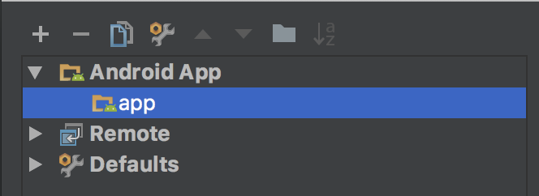
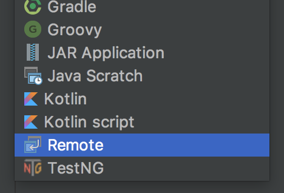
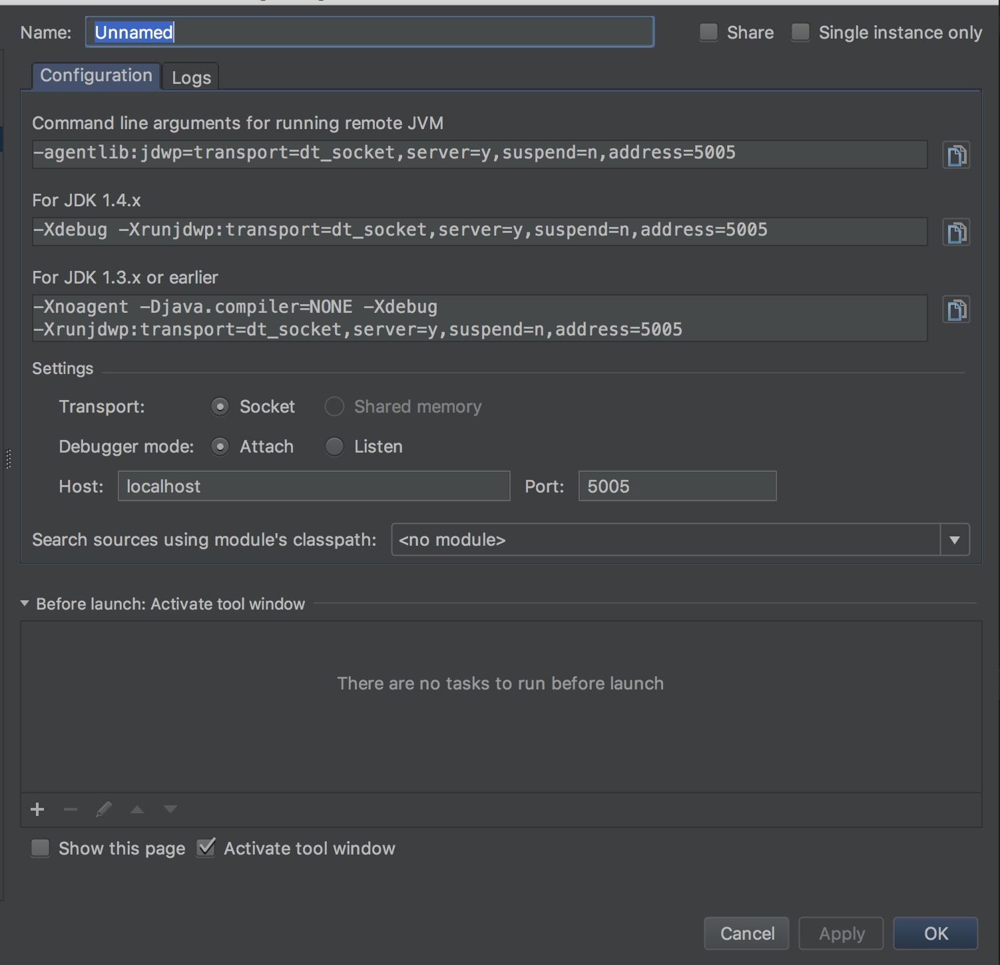
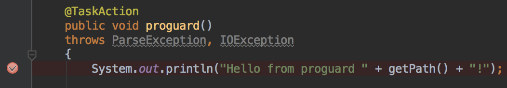
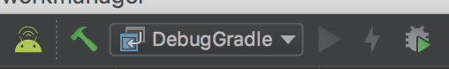
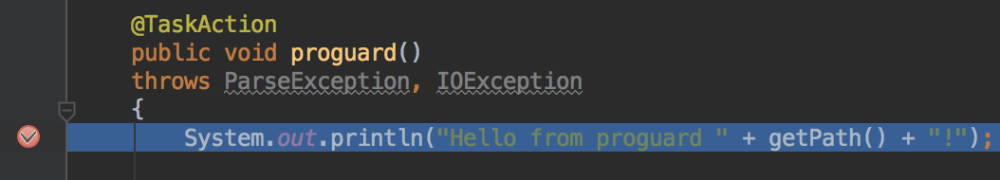
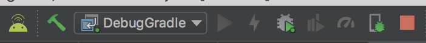

Android Studio是由Google官方提供，用於開發Google手機專用的APK或Library，詳細可以直接參照[官方網站](https://developer.android.com/studio/)。

以下是記錄一些用法和問題解法。

### Usage

#### Exclude log

如果用USB接上實機時，常常會有一堆雜亂的log訊息出現在Logcat中，可以**Logcat console > Edit Filter Configuration > Log Tag(regex)**來透過以下規則去除大部分的規則：

```
^(?!(TransferManager|WifiMulticast|WifiHW|MtpService|PushClient|Tethering|SensorService|WifiStateMachine|hawaii.hwcomposer|AnyDo|PowerManagerService|Monitor|IconMerger|InputMethodManager|SignalClusterView_dual|StatusBar.NetworkController_dual|LocationManagerService|Provider|SurfaceTextureClient|ImageLoader|dalvikvm|OpenGLRenderer|skia|AbsListView|MediaPlayer|AudioManager|VelocityTracker|Drv|Jpeg|CdpDrv|IspDrv|TpipeDrv|iio|ImgScaler|IMG_MMU|ResMgrDrv|JpgDecComp|JpgDecPipe|mHalJpgDec|PipeMgstatrDrv|mHalJpgParser|jdwp|libEGL|Zygote|Trace|InputEventReceiver|SpannableStringBuilder|IInputConnectionWrapper|MotionRecognitionManager|LoadedApk|Settings|PhoneWindow|Choreographer|v_galz|SensorManager|Sensors|GC|LockPatternUtils|STATUSBAR*|SignalStrength|STATUSBAR-BatteryController|BatteryService|STATUSBAR-PhoneStatusBar|WifiP2pStateTracker|Watchdog|AlarmManager|BatteryStatsImpl|STATUSBAR-Clock|NetworkIdentityqdlights))
```

#### Debug Gradle Task

AS除了提供開發者在程式碼內下斷點來debug，也有提供在gradle下斷點的方式，適合拿來觀察gradle的task內容。

步驟順序如下：

##### 建立Remote Debugger

* 進Run -> Edit Configurations，從左上角選單點擊"+"。



* 選擇Remote



* 看到如下選單，設定都可以不用調整，可依照需求改名，點選OK建立。



##### 在task內設定斷點

一個task的進入點通常是有標記TaskAction的函式：



##### 透過指令啟動task

```Java
./gradlew <taskname> -Dorg.gradle.debug=true --no-daemon
```

如果沒有加上`--no-daemon`，則要在測試後關閉`daemon`：

```Java
./gradlew --stop
```

第一次執行時會停在以下訊息，執行下一步驟即可繼續：

```Java
> Starting Daemon
```

如果已經執行過則會直接跳到斷點的位置，不需要再另外執行下一步驟。

##### 執行Remote debugger

點選debug模式：



執行後就會停在剛剛設定的位置：



##### 關閉Remote debugger：

按紅框即可關閉：



### Reference

* [Gradle document - attaching_a_debugger_to_your_build](https://docs.gradle.org/current/userguide/troubleshooting.html#_attaching_a_debugger_to_your_build)