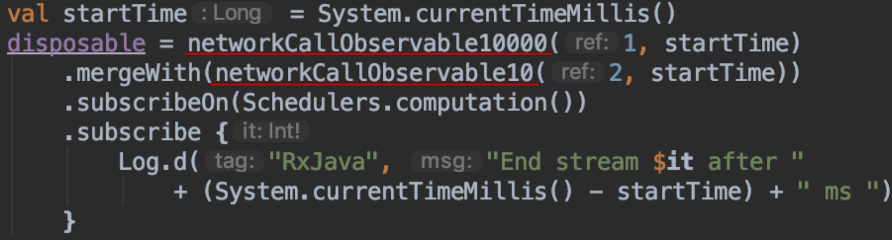
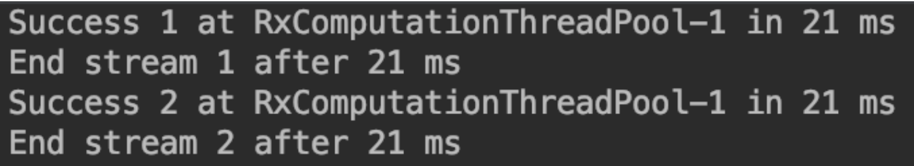
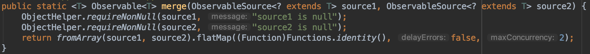
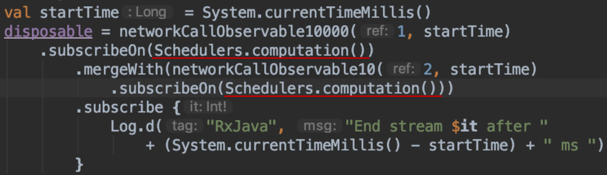
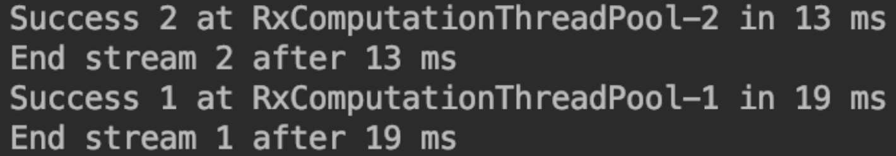
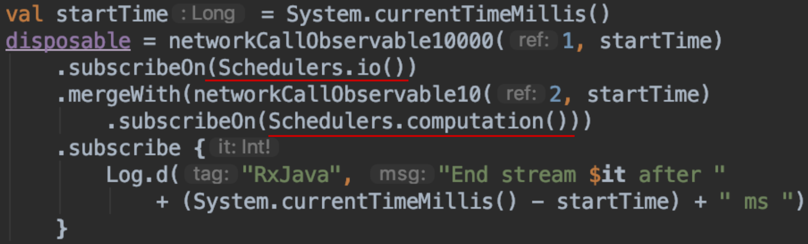
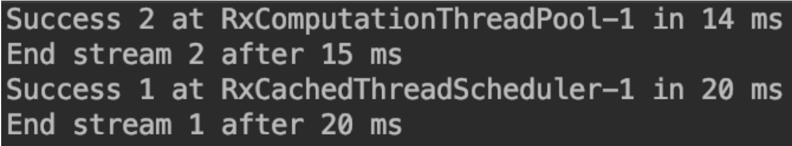

If you use [RxJava](https://github.com/ReactiveX/RxJava) as the primary library for handling multi-thread tasks. You must have many cases that will need to fetch the data from different sources and receive the result with a single downstream. 

In this case, we may use `mergeWith`. That's saying we got two upstreams, and the first one should run longer than the second one:

We also want them to run **asynchronizely**, so we can get a result as soon as possible. However, since we call `subscribeOn()` on `mergeWith()`, we simply force the two upstreams will be run on the main thread. Means the two upstream will be trigger synchronized, just like the result below:

The second one need to wait for the first one to complete, which is quite opposite to what we expect. 

### Why

According to the introduction on the official document: **[`subscribeOn`](http://reactivex.io/documentation/operators/subscribeon.html) is used to control on which thread that the upstream submit the data**. And also, `mergeWith()` will merge two upstream into one:

So if we use `subscribeOn()` after `mergeWith()`, we just decide on which thread that `mergeWith()` pass the data, and all the upstreams merged with `mergeWith()`.

### How

We can solve it by call `subscribeOn()` on each upstream:

Since **Computation Scheduler** has a thread pool to control the thread. Both upstreams will be run on different threads. Hence the result will be:

Now we can get the result from the second upstream immediately and don't need to wait for the first one.

### What's more

#### Use Schadulers

The next question is **will it be better to use different Scheduler?**

The result will change to:

As you can see, the result shows it may not be a better idea, since getting the thread from scheduler may consume more time.

#### Other merging methods

Actually, for the other operators, like `combineLatest()` or `zip()`, which can also be used to merge streams. If you wish the upstream to run synchronized, you also need to aware of this caveat.