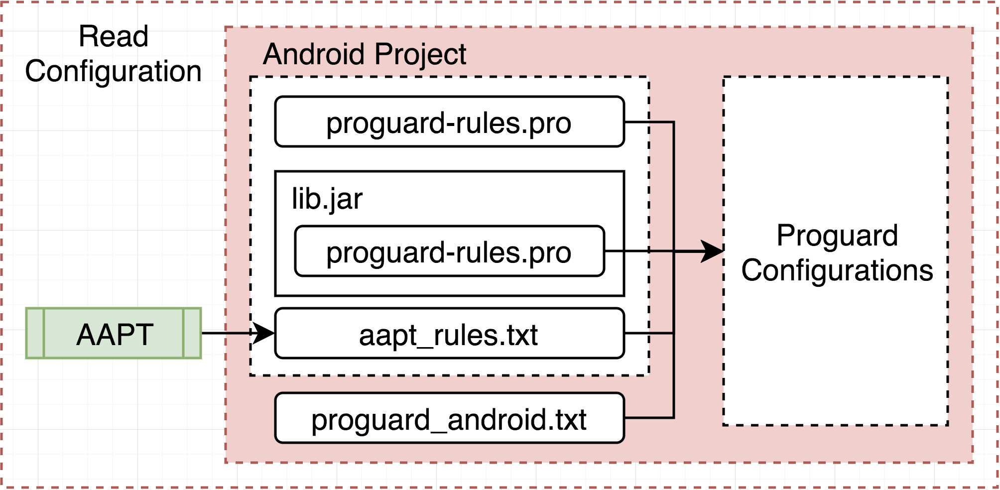
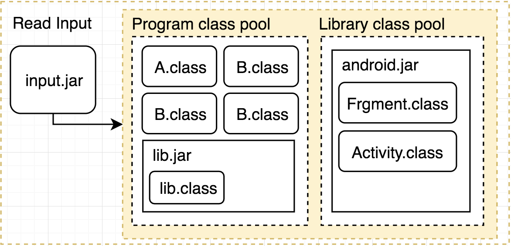
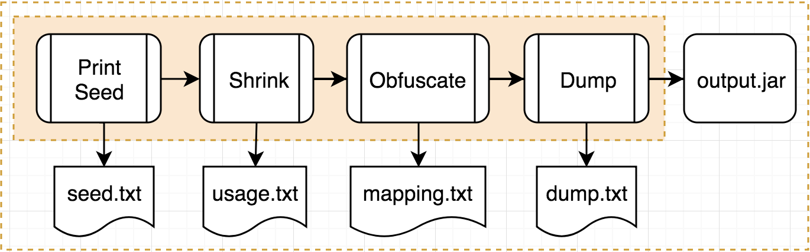
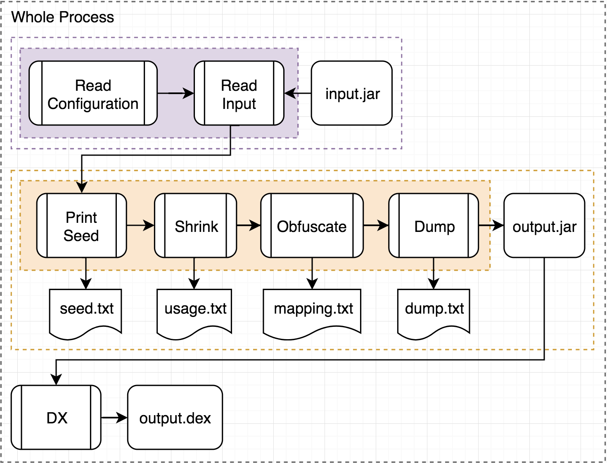
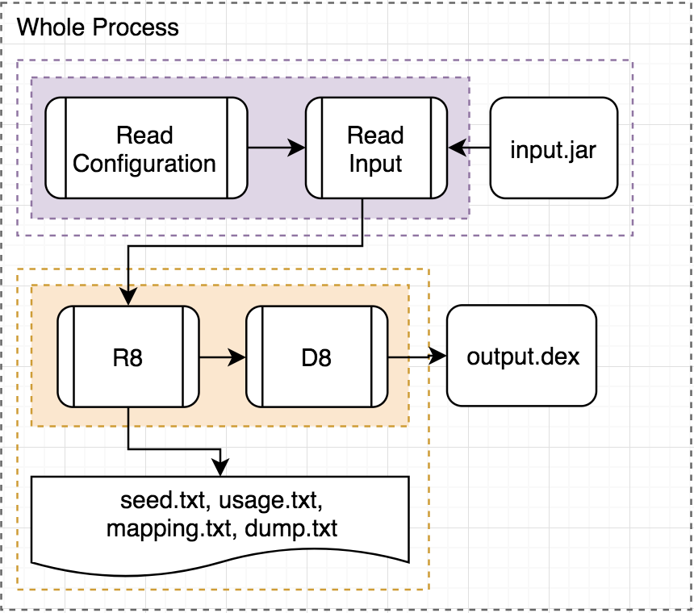

As engineers, we are always curious about how other people built their products, so we use tools to decompile them and take a peek inside. For developers of a company's product, this is the last thing they want, because the code may contain special business logic, so any chance of it being read is unacceptable.

In Java, ProGuard is usually the defense. ProGuard is an open-source tool that, just like Android, is written in and compiled from Java. ProGuard removes unnecessary code and, without affecting the program logic, replaces the names of classes, variables, etc. with shorter letters that carry no literal meaning, to lower the chance of the product being decompiled and understood.

Google lets developers turn on ProGuard during the build through Gradle. However, according to the [official document](https://developer.android.com/studio/build/shrink-code), Google treats ProGuard as a tool to reduce the APK size. In a recent Google I/O [talk](https://www.youtube.com/watch?v=x9T5EYE-QWQ&t=811s), the speaker also explained that the two actions above only make it slightly harder to decompile and understand the code.

Since I'm an Android engineer myself, the analysis is done through the IDE, which is a bit different from running the commands directly, but mostly the same. You can treat the following introduction as ProGuard for Android.

This series starts by introducing how ProGuard works. The whole ProGuard flow is divided into two major parts:

* Preparation
* The main ProGuard flow

### Preparation

In this part, ProGuard needs two materials ready. In the order they are obtained: the ProGuard configuration files and the class files.

#### ProGuard configuration files



Through the configuration files, ProGuard decides how to handle the imported code. Generally, they come from the following sources:

- **proguard-rules.pro**, your custom ProGuard configuration file.

- **lib/proguard-rules.pro**, the ProGuard configuration file inside a library.

- **aapt_rules.txt**, generated by AAPT (Android Asset Packaging Tool), which actively looks for references in the xml files of the project and outputs them.

  After building with Android Studio, it appears at the following path:

  ```
  <project_dir>/build/intermediates/proguard-rules/<flavor>/<buildType>/
  ```

  The content looks like this:

  ```java
  # Referenced at .../res/layout/custom_layout.xml:26
  -keep class android.support.design.internal.BaselineLayout { <init>(...); }
  ```

  This tells ProGuard: line 26 of the layout file custom_layout uses the View BaselineLayout, so its class name and all constructors need to be kept.

  Besides layout files, here are the other sources and their corresponding classes:

  - **AndroidManifest.xml**, provides the referenced Activity, Service, ContentProvider and BroadcastReceiver.
  - **Preference.xml**, provides the referenced Preference, PreferenceCategory and other related classes.
  - **Menu.xml**, provides the Views referenced by the Menu.
  - **Layout.xml**, provides any referenced View.

- **proguard-default.txt**, the configuration file that comes with Android, specified through Gradle. After building with Android Studio, you can find it at the following path:

  ```
  <project_dir>/build/intermediates/proguard-files/
  ```

  There are two other configuration files under the path:

  * **proguard-android.txt**, not much different from proguard-default.
  * **proguard-android-optimize.txt**, which turns on ProGuard's Java optimization. From this we can tell that Android turns optimization off by default.

#### Class files



Class files are what java files become after compilation. In ProGuard, they are divided into two major parts:

* **Program class pool**, mainly the program itself and the content of the referenced libraries.

* **Library class pool**, the underlying libraries needed at compile time, which the application we write is built on top of. For Android, it's the Framework layer, android.jar. Note that **ProGuard does not process any class inside the Library class pool**.


### The main ProGuard flow



#### Print Seed

After loading the class files and the ProGuard configuration, you can use `-printseeds` to ask ProGuard to output seed.txt, which contains the classes, methods or variables that match the rules of the keep configurations.

For example, if we have the following ProGuard configuration:

```java
-keep class com.example.MainEntry
```

Then seed.txt will only contain the following, without the methods and variables inside the class:

```java
// In seed.txt
com.example.MainEntry
```

After building, Android Studio puts it at the following path:

```java
<project_dir>/build/outputs/mapping/<flavor>/<buildType>/
```

Then comes the flow of analyzing and processing the code, which has the following steps in order:

* **Shrink**, removes the code that will never be executed.
* ~~Optimize~~, optimization for the JVM. As mentioned earlier, Android turns it off by default, so we won't go deeper into it.
* **Obfuscate**, replaces the names of classes, methods, variables, etc. with shorter letters that carry no literal meaning.
* ~~Preverify~~, the verification feature for Java. According to ProGuard's [official document](https://www.guardsquare.com/en/products/proguard/manual/usage#dontpreverify), if the target platform is Android, you don't need to turn it on, which reduces build time. So we won't go deeper into it either.

#### Shrink

In this stage, ProGuard uses the content of seed.txt as the entry points of the analysis, and gradually finds the classes, methods and variables that are used when the program runs.

Assume we have two classes, ClassA and ClassB, plus `main()` as the starting point of the program, which belongs to the class MainEntry. After `main()` is executed, it first declares ClassA and then calls `doWork()`, as listed below:

```java
class ClassA {
    void workA {};
}
class ClassB {
    void workB {};
}
class MainEntry {
    ClassA classA;
    void main {
        classA = new ClassA();
        doWork();
    }
    void doWork {
        int value = 0;
        classA.workA();
    }
}
```

Generally, the entry point of the program is recorded in seed.txt, so we can simply assume seed.txt has the following:

```Java
// In seed.txt
com.example.MainEntry: main()
```

Following Google's wording, we call the classes, methods or variables that need to be kept "life". The analysis goes as follows:

* According to seed.txt, the class MainEntry and `main()` are life, but not the variable classA or the method `doWork()`. Then the content of `main()` is checked line by line.
* ClassA is declared, so ClassA and the variable classA are life, but not `workA()`.
* `doWork()` is executed, so `doWork()` becomes life.
* `doWork()` calls `workA()` through classA, so `workA()` in ClassA becomes life.

Since `doWork()` has nothing more, the analysis ends here. Then the parts that didn't become life are removed, and what's left is:

```Java
class ClassA {
    void workA {};
}
class MainEntry {
    ClassA classA;
    void main {
        classA = new ClassA();
        doWork();
    }   
    void doWork {
        classA.workA();
    }
}
```

Here you can use `-printusage` to output the removed parts to usage.txt:

```Java
// In usage.txt
com.example.ClassB
```

After building, Android Studio puts it in the following directory:

```Java
<project_dir>/build/outputs/mapping/<flavor>/<buildType>/
```

#### Obfuscate

In this stage, the names of the remaining classes, methods and variables are replaced with shorter names. Earlier we mentioned that seed.txt comes from the content of the ProGuard configuration files, so we can infer that the ProGuard file must contain the following:

```Java
-keep class com.example.MainEntry { void main(); }
```

keep is a ProGuard-specific option. It provides the entry points used in the Shrink stage, and specifies the classes, methods or variables that must not be renamed in the Obfuscate stage.

So from the rule above, except for the class name MainEntry and the program's starting point `main()`, nothing else is restricted from being renamed, and the result is:

```Java
class A {
    void c {};
}
class MainEntry {
    A a;
    void main {
        a = new A();
        b();
    }   
    void b {
        a.c();
    }
}
```

The changed parts can be listed to mapping.txt with `-printmapping`:

```Java
// In mapping.txt
com.example.ClassA -> com.example.A:
	void workA() -> c
com.example.MainEntry -> com.example.MainEntry:
    com.example.ClassA classA -> a
    void main() -> main
    void doWork() -> b
```

After building, Android Studio puts it in the following directory:

```java
<project_dir>/build/outputs/mapping/<flavor>/<buildType>/
```

That completes all the steps ProGuard itself includes. Then it enters the wrap-up stage:

* Repackage the modified code into an output.jar file.
* Output the structure of the classes to dump.txt.
* Finally, DX converts the jar file into a dex file and optimizes at the same time, so there's no need to turn on ProGuard's Optimize feature.

Putting all the steps together, the whole flow can be summarized in one diagram:



### What's more

#### R8/D8

In 2017, Google started introducing [D8](https://android-developers.googleblog.com/2017/08/next-generation-dex-compiler-now-in.html) to replace DX, providing faster builds and more effective optimization. Then [this year](https://android-developers.googleblog.com/2018/04/android-studio-switching-to-d8-dexer.html) DX was deprecated, and D8 officially became part of Android Studio.

In a [talk](https://www.youtube.com/watch?v=gGOOkk2y_Ss) at this year's Google I/O, R8 was also introduced publicly for the first time. [R8](https://r8.googlesource.com/r8) is open-source software that provides the same features as ProGuard, so you can still use the same ProGuard configuration files. R8 also includes D8, so after R8 finishes, it outputs the dex file directly through D8. The flow introduced above can be further simplified as below:



By the way, Google uses new terms for ProGuard's original Shrink and Obfuscate, and uses them heavily in the source code:

* **Shrink -> Tree-Shaking**
* **Obfuscate -> Minification**

### Reference

* [ProGuard Introduction](https://www.guardsquare.com/en/products/proguard/manual/introduction)

* [Shrink your code and resources](https://developer.android.com/studio/build/shrink-code)


