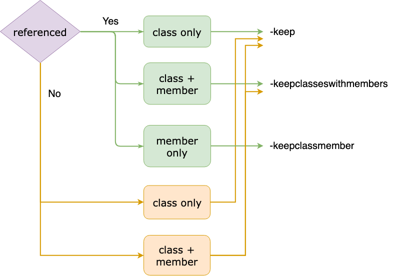

After understanding how ProGuard works, the next step is to actually use it. The following are some concepts, takeaways, and related discussions about ProGuard configuration that I picked up while analyzing and adjusting the ProGuard configuration of our project.

For the introduction and usage of keep rules, you can check the ProGuard chapter under the Android category, or go directly to the [official document](https://www.guardsquare.com/en/products/proguard/manual/usage).

### Concept

#### Keep rule is reference

When using ProGuard, you may run into classes that match a keep rule and are never used at runtime, yet still remain in the end. But keep only means "don't rename", so a class that isn't used should be removed.

The reason is simple: **a keep configuration also counts as a reference**. If you use `-whyareyoukeeping` to have ProGuard tell you why something is kept, you will get the following hint:

```java
is kept by a directive in the configuration.
```

So if you use a third-party library, be careful when using keep: you may unintentionally keep classes in the library that the library itself doesn't keep, simply because your side keeps them.

Here are two more intuitive ways to avoid this kind of situation:

* Add `allowshrinking`. It gives the flexibility to be removed.
* Use `-keepnames`. Adding `names` to any keep option is equal to adding `allowshrinking`.

#### Multiple layer extension

When you keep a subclass that extends another class, you will find that its parent class is also kept, all the way up the chain. When this happens, depending on the implementation, `-whyareyoukeeping` shows one of the following two messages.

- When the subclass implements a constructor without parameters, such as the default constructor, or has no constructor at all:

```java
is invoked by
```

This is because the default constructor calls the parent's constructor.

- When the subclass implements a constructor with parameters:

```java
is extended by
```

#### Method reference is extendable

So far everything is at the class level. What about methods? Following the general logic, even if the class isn't removed in the end, its methods are still removed if they aren't used.

But classes that extend a Library class are different. Assume we have a class that extends View:

```Java
public class CustomView extends View {
    public CustomView(Context context) {
        super(context);
    }

    @Override
    public void scrollBy(int x, int y) {
        super.scrollBy(x, y);
    }
}
```

If this class isn't removed, all the methods overriding View are kept, and they won't be renamed:

```Java
// In mapping.txt
com.example.CustomView -> com.example.CustomView:
    void scrollBy(int,int) -> scrollBy
```

This is because library classes aren't processed by ProGuard, so if a class extending one is kept, its methods follow the same rules as the library class.

### Keep Strategy

With all that said, based on the results so far, we can summarize the following simple rules to tell whether the current class or method will be removed or renamed. If it's referenced directly at runtime, you only need to look at the Obfuscate part.

#### Class

|           | keep            | No keep                                 |
| --------- | :-------------- | --------------------------------------- |
| Shrink    | X, keep counts as a reference | △, removed if it has no subclass; if it has subclasses, not removed when a subclass is kept |
| Obfuscate | X               | O                                       |

#### Method

If the class is kept, the methods that match the keep rules can't be removed or renamed either.

If they aren't kept, it depends on whether it's a program class or a library class:

|           | Program class | Library class (no @Override) | Library class (with  @Override) |
| --------- | ------------- | ---------------------------- | ------------------------------- |
| Shrink    | O             | O                            | X                               |
| Obfuscate | O             | O                            | X                               |

### Refinement Strategy

If you want to adjust existing rules but worry about breaking the original configuration, you can first replace the keep rule with `-whyareyoukeeping`, then add `-printconfiguration` to observe why things are kept.

Here's an example:

```Java
com.example.background.Blur
    is invoked by com.example.background.SelectImageActivity: void onCreate
    implements    android.app.Activity: void onCreate
    is a library method.
```

This means Blur is kept because:

* Blur is referenced in SelectImageActivity.
* SelectImageActivity is kept by a rule in aapt_rules.txt.
* Activity is a library class, so `Activity.onCreate()` isn't processed. Following the concept mentioned earlier, this means `SelectImageActivity.onCreate()` isn't processed either.

As a result, even if Blur isn't used after it's declared, it's still kept, because SelectImageActivity, which references it, is kept and extends a library class.

Besides the case above, there are a few other possible messages:

* **is kept by a directive in the configuration.**
* **is a library class.**
* **is a library field.**

Whichever one it is, the way to read it is the same. **If these messages still show up after the original `-keep` has been replaced by `-whyareyoukeeping`, it means the item is kept for some other reason; the current rule is redundant and can be removed directly.**

If you get the following message:

* **is not been kept.**

Then you need to go back to the program logic and confirm whether the originally kept content is really needed.

If there's no message at all, the rule itself is redundant: either it's not used at runtime at all, or it's referenced indirectly, such as through reflection. Likewise, you need to go back to the program logic to confirm.

#### Decision tree

Besides `-keep`, ProGuard provides two other keeps that are similar but work a bit differently.

* `-keepclassmembers <class name> { <members name> }`: if the specified class is kept in the Shrink stage, the specified members are kept.
* `-keepclasseswithmembers <class name> { <members name> }`: same effect as `-keep`, except that it only takes effect when both the class and the members match.

Looking at all three, here's a simple decision tree to help you decide faster which one to use:



First, decide whether it's referenced directly in the program. This means a reference, not a reference through Reflection:

* Yes: simply decide the scope that needs to be kept.
* No: it should be removed after the Shrink stage, unless `-keep` is used, because as introduced earlier, `-keep` also counts as a reference. The other one, `-keepclasseswithmembers`, is equal to `-keep` only when the conditions are met; you can see it as `-keep` plus `-keepclassmembers`.

Depending on how the keep rules are written, different types of keep may also end up with the same result. I suggest also referring to the [official document](https://www.guardsquare.com/en/products/proguard/manual/usage) to write the most concise rules.

