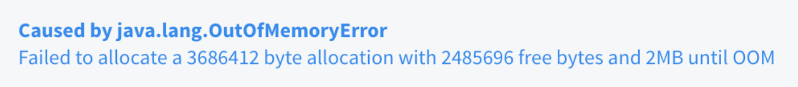
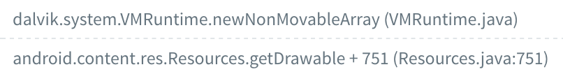
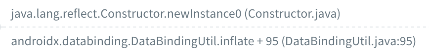
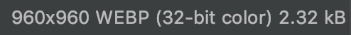
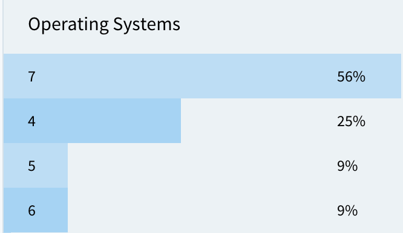

WebP is an image format which is both lossy and lossless compression. Widely used in all Android app, including us. If you wish to get more detail about WebP, please check the following link:

- [Google/WebP](https://developers.google.com/speed/webp/)
- [How WebP works (lossly mode)](https://medium.com/@duhroach/how-webp-works-lossly-mode-33bd2b1d0670)

### Why WebP

We use WebP heavily inside the project not just because it save the network bandwidth but also cut down size for all image resources to save APK size.

But if you don't pay attention to the bitmap size that it will become at Runtime, you may go into OOM error like us.



### How does it happen

#### Stacktrace

When we look at the crash log, it will start from the inflating process: 



and end up calling to `getDrawable`, which cause the system to allocate a bitmap for pixel data:



#### Suspect Image

Let's take a look at the size again. Because the system will use `ARGB_8888` to create a bitmap by default, we can divide the number by `4`:

```
3688412 / 4 = 921603 = 960 * 960
```

The result shows the image size is `960`. Luckily, there's only one `ImageView` inside the XML file, so we quickly identify the image which causes OOM error.

#### Targeting image resource

Since the `screenDensity` of the crashed device is `320`. We found the image inside `drawable-xhdpi`:



It’s a WebP with the size just the same as we expect, now we find the reason for the OOM.

### Lesson learn

WebP can be pretty small in size but may be very large in bitmap at Runtime. The bitmap size of a WebP will depend on the size of the image before the transformation. **Don't create a WebP from a PNG that the size is larger than you need.**

### What's more

If we look at the distribution on all OS version, you can see the crash more likely happens on OS version from 3 to 7:



The reason for this is because Google has changed the location to store bitmap. To be short, a bitmap will be stored inside the `Dalvik heap`, which is limited and mostly is very small; on the contrary, a bitmap will be placed inside the `Native heap`, which is expandable with a larger limit, sometimes the limit depends on the physical memory size.

With the difference above, you will more easily get OOM on Android 3 to 7, to check more detail about it, please refer to the official document:

- [Managing Bitmap Memory](https://developer.android.com/topic/performance/graphics/manage-memory)

If you curious about how this gonna influence the Bitmap Memory, please check:

- [OOM — Bitmap resource analysis](https://ansgarlin.github.io/en/news/2019/09/07/oom_bitmap_resource_analysis/)

