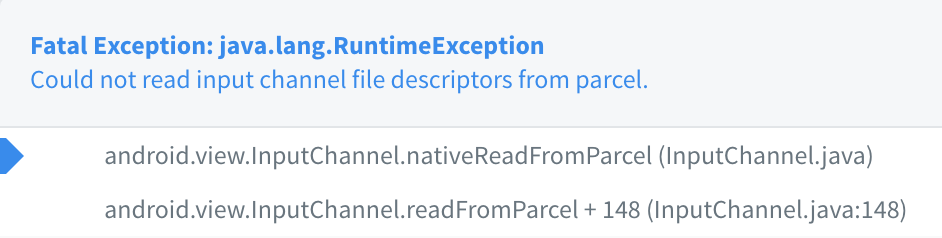
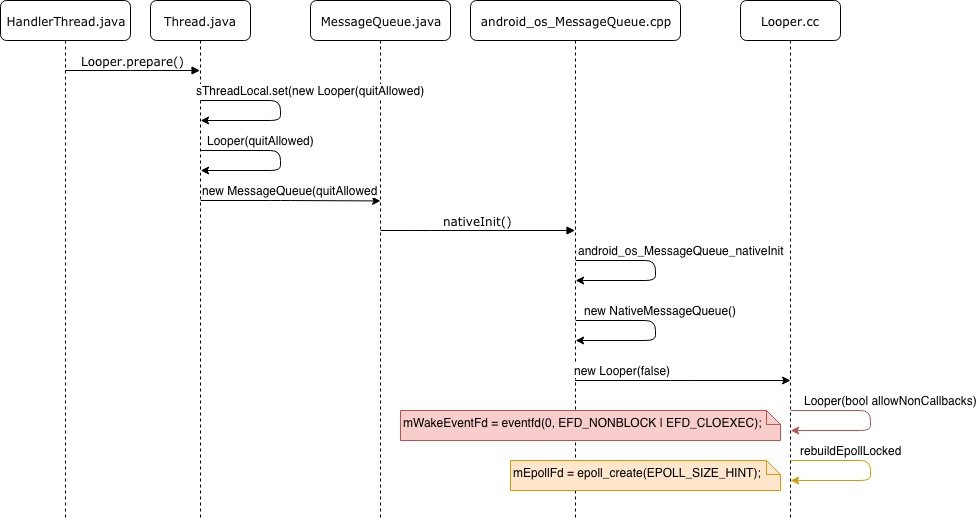

HandlerThread is a kind of Thread created by Google for Android specifically. It has its own `Looper` with a `Queue` to take `Runnable` tasks send through `Handler.post()`.

With HandlerThread, you can put the long-running tasks into the worker thread. For more detail, you can check the video from Google:

- [Getting a HandlerThread. (Android Performance Patterns Season 5, Ep. 5)](https://www.youtube.com/watch?v=adPLIAnx9og)

It seems pretty convenient because most of the time we all want to put tasks out of the Main thread as more as possible. But there is a crash will occur if you don't use it carefully:



After researching, we know that's because the abuse of HandlerThread: 

* **We create too many HandlerThread and never close it correctly, which make the number of file description reach the top limit of the system.**

### What happens

#### File description(fd)

If you are familiar with Linux, you will know for every socket, device, or file. When you use the system API to fetch data from them, you will get a number called file description or called  `fd`. Then you will use it to read or write from the file, and `fd` will be collected and reused when you close it.

And mostly, there will be a limit of the number of  `fd` inside a system. That means if you don't use the component that will use `fd` wisely, you may have a **file description leak**.

#### HandlerThread with fd

After creating a HandlerThread and call `start()`, it will call to `Looper.prepare()` to create a Looper for itself, which will end up creating two `fd` on its own:



### How to Solve

You can either call `HandlerThread.quit()`, or `quitSafely()` after Android 4.3 (OS v18). Both methods can quit the Looper of the HandlerThread.

### Lesson learn

Since we don’t know what’s the limit number of the file description, the crash is unpredictable and sometimes won’t happen at the place where the HandlerThread is created and used. 

So what we can do is:

- **Remember to `HandlerThread.quit()` whenever we don’t need it.**

### What’s more

If you are curious about how to get the file description at run time, here are the commands you can use, all under the shell mode:

- Find PID

```bash
adb shell ps | grep "<package name>"
```

- Find `fd` by PID, you will need to run as app identity

```bash
adb shell run-as "<package name>" ls -al /proc/<pid>/fd
```
