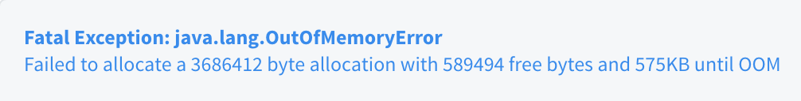
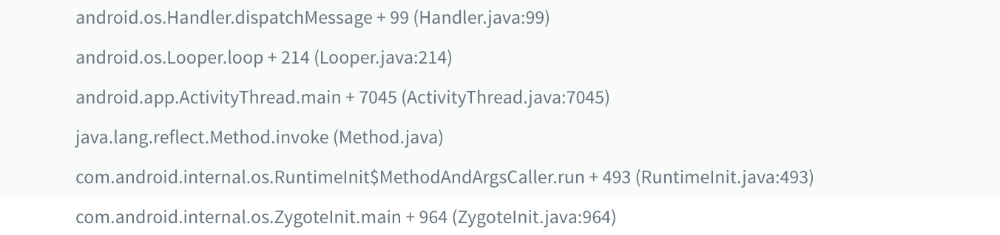

A crash can not just warn you that you've done something wrong with your code, but also makes you suffer if the message is ambiguous. What's worse is sometimes you won't get any message and there's nothing you can do but to hope that it will disappear eventually.

### Types of crash

If you categorize crashes that you will face, here's what you can get:

- **Ambiguous messages and solvable**
- **Ambiguous messages and solvable, but unpredictable**
- **No messages, and unsolvable**

#### Ambiguous messages and solvable



The message only tells you the system is run out of memory, and it's pretty ambiguous since memory issue is a random issue. You won't know where and when that your app will drain the memory, but it's still solvable with the following steps:

- **Figure out what's the size of the Bitmap that the system is trying to create.**
- **Find which lines of codes will create an image with the size.**
- **Make the system to load the image with a smaller Bitmap.**

#### No messages, and unsolvable

Sometimes there are framework related crashes, which may be caused by Google itself or the OEMs, then you may get a crash like:


That's really nothing you can do about it because you don't even know where to begin.

#### Ambiguous messages and solvable, but unpredictable


The intro of the category is put at the end on purpose. The crash will be the example throughout the article. Here's some context about the crash:

- Starting from Android 9(28+), WebView's data folder is not allowed to be shared between processes. If you do that, you will get a crash like this.

We can simply solve it by calling [`setDataDirectorySuffix(String suffix)`](https://developer.android.com/reference/android/webkit/WebView.html#setDataDirectorySuffix(java.lang.String)) to assign a suffix for each WebView's data folder in the process. The change is for security purpose, you can check the [official document](https://developer.android.com/about/versions/pie/android-9.0-changes-28#framework-security-changes) for more detail.

### A real case

In our scenario, we don't use multi processes explicitly. For some reason, we still get this crash occasionally. We don't want to call `setDataDirectorySuffix()` at very first place because the product is not a multi processes application.

Instead, we call only when we need to, which means we will call that only if the exception is thrown. So the solution is very straightforward:

- **Catch exception.**
- **Call setDataDirectorySuffix().**

#### Catch exception

When the app is started, the launch process will call  [`ActivityThread.main()`](http://androidxref.com/9.0.0_r3/xref/frameworks/base/core/java/android/app/ActivityThread.java#6623), and a few things will happen inside:

- **A Looper will be created and run.**
- **A ActivityThread will be created with a Handler.**

All of these will be run on a thread, so the mechanism behind them is like the  `HandlerThread`. You may quickly guess that everything happens on the main thread, will be passed through the `Handler`.

That's why when you look at the stacks of main thread exception, the beginning of the stacks will be like:



That means if we can just wrap `dispatchMessage()` with a try-catch, we can catch the exception and prevent our app from crashes. But as you can see, this part is inside the framework, which you can't modify.

##### Custom callback

But don't give up, let's look at the source code of [`dispatchMessage()`](<http://androidxref.com/9.0.0_r3/xref/frameworks/base/core/java/android/os/Handler.java#97>):

```java
// In Handler.java
public void dispatchMessage(Message msg) {
  if (msg.callback != null) {
    handleCallback(msg);
  } else {
    if (mCallback != null) {
      if (mCallback.handleMessage(msg)) {
        return;
      }
    }
    handleMessage(msg);
  }
}
```

You can see there is a `mCallback`, which means we can assign a custom callback:

```java
// In MainHandlerCallback.java
private class MainHandlerCallback(private val origin: Handler) : Handler.Callback {
  override fun handleMessage(msg: Message): Boolean {
    try {
      origin.handleMessage(msg)
    } catch (throwable: Throwable) {
      // ignore exception here or throw anyway
    }
    return true
  }
}
```

Now you have a callback which can not just help you to catch the exception, but also keep the original behavior since the message is still passed into the original `Handler`.

##### Hook callback

The next problem will be:

- how do you fetch the instance of the main thread `Handler`?

With Java, it will be no doubt that you can use reflection. So we need to find where to locate the `Handler`. Let's look back to the  [`AndroidThread.main()`](http://androidxref.com/9.0.0_r3/xref/frameworks/base/core/java/android/app/ActivityThread.java#6623) again:

```java
// In ActivityThread.java
...
final H mH = new H();
...
private static volatile ActivityThread sCurrentActivityThread;
...
public static void main(String[] args) {
  ...
  Looper.prepareMainLooper();
  ...
  ActivityThread thread = new ActivityThread();
  thread.attach(false, startSeq);
  ...
  Looper.loop();
  ...
}
private void attach(boolean system, long startSeq) {
  ...
  sCurrentActivityThread = this;
  ...
}
```

The field `sCurrentActivityThread` will keep an instance of `ActivityThread` before the Looper is running. It's defined as `static volatile` so the value is not just a class variable, but also guaranteed to have only one copy in a multithread application. The implementation will be like as follow:

```kotlin
val clazz = Class.forName("android.app.ActivityThread")
// ActivityThread instance
val activityThreadField = clazz.getDeclaredField("sCurrentActivityThread")
activityThreadField.isAccessible = true
val activityThread = requireNotNull(activityThreadField.get(null)) { "ActivityThread.sCurrentActivityThread is null." }
```

Once you get the instance of `ActivityThread`, the rest will be easy:

```kotlin
// ActivityThread mH
val handlerField = clazz.getDeclaredField("mH")
handlerField.isAccessible = true
val handler = requireNotNull(handlerField.get(activityThread)) { "ActivityThread.mH is null." }

// Handler mCallback 
val callbackField = Handler::class.java.getDeclaredField("mCallback")
callbackField.isAccessible = true
callbackField.set(handler, MainHandlerCallback(handler as Handler))
```

Now you have a custom callback, and also the way to hook the callback onto the main thread `Handler`. The next thing you need to know is when.

##### When to hook

The timing to hook the callback will differ from case to case. But normally you will want to hook as earlier as possible, so we can hook our callback in `Application.onCreate()`:

```kotlin
// In Application
override fun onCreate() {
  super.onCreate()
  hookMainHandler()
}
```

Now all the exceptions that throw on main thread will be caught by our custom callback.

#### **Call setDataDirectorySuffix to assign a specific suffix.**

Back to the case, now we can know when the exception is thrown, call `setDataDirectorySuffix()` explicitly, and then ignore the exception.

### Summary

Use reflection to hook a callback to monitor exception is not the best solution. Here's the caveat you need to know:

- The solution is unstable because it relies on the name and type of the field, Google can change it in any future version.
- If we overuse it, we may overlook some big problems.

We should use the solution wisely and always try to solve the issue before ignoring it.