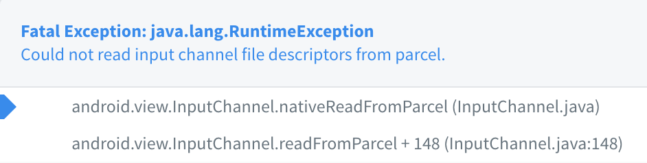
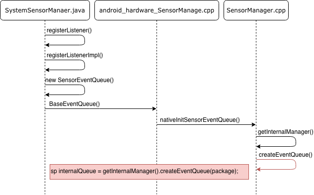
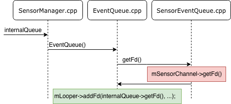

Last post, **File descriptor leak - HandlerThread**,  we've talked about how the `HandlerThread` could potentially cause file descriptor leak.

But we still see file descriptor leak and `RuntimeException` like before:



### What happens

We know that's because something keeps the `fd`, and we fail to remove it when we don't need it. After seeking for a while, we finally find that's because of the two reasons:

- **Misused Dagger while designing the class hierarchy, which will make Dagger inject the same dependencies for a few times.**
- **Dagger can guarantee the instance of the dependencies will be the same. But initializations after will still be triggered.**

So our problem should be:

- **The SensorManager inside one of the dependencies get initialized for a multiple time.**

#### SensorManager

We need `SensorManager` to assign a listener for handling event that sends back by the audio service. After debugging, we know the instance of `SensorManager` is a `SystemSensorManager`.

And we've noticed that if we don't use `registerListener()` to assign a listener, we won't have `fd` leak, so let's look at how it works.

- `registerListener()` will get an `SensorEventQueue` first:



- With the `SensorEventQueue`, the `internalQueue`, we can fetch an `fd` from a `SensorChannel`, and add into `Looper`. In here it should be the main `Looper`:



Until now, we know when every time we call the `registerListener()`, we will get a `fd` from it. And we don't need to dig into the source code to know the `fd` will be collected once you call the `unregisterListener()` with the same listener.

#### Listeners inside SensorManager

The whole process for registering/unregistering a listener to the `SensorManager` seems fine. But let's look at [`registerListener()`](http://androidxref.com/9.0.0_r3/xref/frameworks/base/core/java/android/hardware/SystemSensorManager.java#165) again:

```java
// In SystemSensorManager.java
// Invariants to preserve:
// - one Looper per SensorEventListener
// - one Looper per SensorEventQueue
// We map SensorEventListener to a SensorEventQueue, which holds the looper
synchronized (mSensorListeners) {
  SensorEventQueue queue = mSensorListeners.get(listener);
  if (queue == null) {
    ...
    queue = new SensorEventQueue(listener, looper, this, fullClassName);
    ...
    mSensorListeners.put(listener, queue);
    return true;
  } else {
    return queue.addSensor(sensor, delayUs, maxBatchReportLatencyUs);
  }
}
```

It's clear the listener will be used as the key in a `HashMap`, and the value is `SensorEventQueue`, which will get a `fd` inside.

And for `unregisterListener()` :

```Java
// In SystemSensorManager.java
@Override
protected void unregisterListenerImpl(SensorEventListener listener, Sensor sensor) {
  ...
  synchronized (mSensorListeners) {
    SensorEventQueue queue = mSensorListeners.get(listener);
    if (queue != null) {
      ...
      if (result && !queue.hasSensors()) {
        mSensorListeners.remove(listener);
        queue.dispose();
      }
    }
  }
}
```

You can see it only remove the listener and close the queue one at a time. If we call the method with different listener multiple times, just like our case, we will need to keep all the listeners by ourself. Or we may lose the references to the listeners and a few listeners will be left inside the `SensorManager`.

### How to solve

The solution is simple since it's wrong for Dagger to inject the same dependencies for a multiple times. Solve the injection issue, we solve the file descriptor leak.

### What's more

Even we don't get the exception caused by the `InputChannel`, we may encounter another exception since there is a limit for the number of listeners inside [`SensorManager`](http://androidxref.com/9.0.0_r3/xref/frameworks/base/core/java/android/hardware/SystemSensorManager.java#159):

```Java
// In SystemSensorManager.java
private static final int MAX_LISTENER_COUNT = 128;
@Override
protected boolean registerListenerImpl(SensorEventListener listener, Sensor sensor,int delayUs, Handler handler, int maxBatchReportLatencyUs, int reservedFlags) {
  ...
  if (mSensorListeners.size() >= MAX_LISTENER_COUNT) {
    throw new IllegalStateException("register failed, "
      + "the sensor listeners size has exceeded the maximum limit "
      + MAX_LISTENER_COUNT);
  }
  ...
}
```