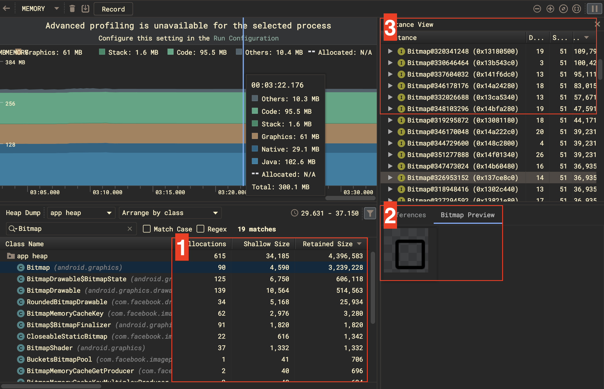
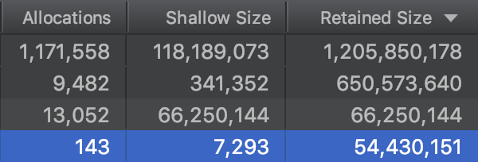
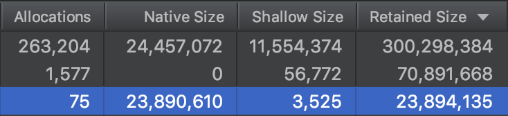
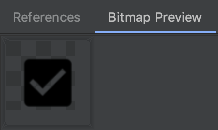
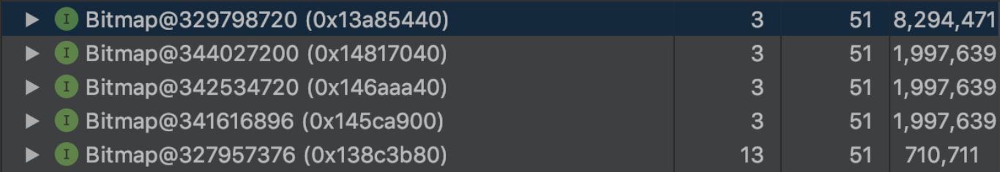

For every OOM you get in your app, mostly it's because there are large Bitmaps were created and kept inside memory at Runtime. 

Android Studio provides a handful tool, [Profile](https://developer.android.com/studio/profile/memory-profiler.html), which you can use for recording and browsing memory usage. You can easily find all the references that been kept. 



##1 - know your memory

If you use the tool on devices with different OS versions, you will see the columns of the results have one  different like below:





It's clear to see one more column call `Native Size` will be used on Android 8. This is because Google has changed the way to store the pixel data of a Bitmap, which you can check the [official document](https://developer.android.com/topic/performance/graphics/manage-memory) for more detail. To be short, the difference is:

- **Pre 8: store pixel data in Java Heap.**
- **Post 8: store pixel data in Native Heap.**

So even the pixel data size of Bitmap are both shown in `Retained Size`, they are stored in different places based on the OS version.

### 2 - Identify target Bitmap

This will also affect whether we can preview a Bitmap or not. If we profile on devices before 8, we can see the reference image like below:



This is pretty useful when you are just starting to find out what image the Bitmap is.

### 3 - what should we take more focus on

When you start analyzing the Bitmap memory, you may see the situation like this:



An **incredibly large** Bitmap exists at Runtime, consuming nearly **8.3MB** of memory. It's quite wasting since the Java heap on low-end devices may only have **16~32MB**. This kind of Bitmap will put a lot of pressure on memory and cause GC constantly.

AfterAfter looking into it, it turns out it's a square image that we use to show the placeholder. And if you do some math on the number, you will find out the size of the image is:

    // Since Android will load an image with flag ARGB_8888, we will need 4byte 
    // to represent the color of a pixel.
    8294471 ≈ 1440 x 1440 x 4 

### Potential way out

Except using 3rd party library or tools to shrink image size before importing. Android also provides  ways to deal with big image:

- **Enable `cruncherEnabled`, so the `AAPT` will shrink the images at compile time.**
- **Use `WebP` instead of PNG, JPG.**
- **Use `VectorDrawable` for graphic icon or symbols.**

For more details, you can check the [official document](https://developer.android.com/topic/performance/reduce-apk-size). 

None of these is a silver bullet to solve the memory issue of Bitmap, because:

- **`cruncherEnabled` and WebP can only help to shrink the APK size**. The Image will still turn into an enormous Bitmap if the original size is big. If you are curious about why WebP doesn't help, please check [OutOfMemoryError - WebP](https://ansgarlin.github.io/en/news/2019/07/04/oom_webp/).
- **VectorDrawable is only fully supported by the system with OS version is above 21(Lollipop)**.  The support library can help to [support down to 7(Eclair)](https://android-developers.googleblog.com/2016/02/android-support-library-232.html), but instead of using VectorDrawable, it will become [VectorDrawableCompat](https://developer.android.com/reference/android/support/graphics/drawable/VectorDrawableCompat).

### How we gonna do

 In the end, we choose to use VectorDrawable with the following reason:

- **We've already turned to use WebP to shrink APK size, there's no reason to use PNG again.**
- **Most use cases in the project are easy to replace with VectorDrawable.**

What we have to do is:

- **Add the `vectorDrawables.useSupportLibrary = true` in `defaultConfig`.**
- **Replace `android:src` with `app:srcCompat` in xml.**
- **`setImageResource` can be kept.**

After replacing with **VectorDrawable**, the size of the largest Bitmap at Runtime will become only **600K**:


And **2KB** in **VectorDrawableComapt** on pre 21:


### What's more

####caveat

Even VectorDrawable seems powerful, you should use it wisely because:

- **VectorDrawable** works like drawing graph at Runtime, the calculation and drawing command must-have performance impact.
- On **pre 21**. The system will cache VectorDrawableCompat by size, which means if you apply an individual  VectorDrawableCompat into Views with different sizes, it will need to **recreate** and **redraw** every time. Check [official document](https://developer.android.com/reference/android/support/graphics/drawable/VectorDrawableCompat) for more detail.
- Enable [`setCompatVectorFromResourcesEnabled(boolean)`](https://developer.android.com/reference/android/support/v7/app/AppCompatDelegate.html#setCompatVectorFromResourcesEnabled(boolean)) to have support on original settings of ImageView or TextView should be careful about OOM issue.

  As I said, none of the solutions is a silver bullet, choose a suitable solution based on the use case. And always remember: "**Perf matters**".

#### Useful command

With devices **pre 21**, you can't use Profile to check the memory usage. Instead, you have to dump the heap manually:

- Find PID

```bash
adb shell ps | grep "<package name>"
```

- Dump the heap

```bash
adb shell am dumpheap <pid> /data/local/tmp/android.hprof
```

* Pull the heap file

```bash
adb pull /data/local/tmp/android.hprof
```

