When we first starting using Coroutine, it's not always easy to figure out how an exception is propagated through a constructed Coroutine. 

Even there is already an article, [Kotlin Coroutine Job Hierarchy — Succeed, Fail, and Cancel](https://proandroiddev.com/kotlin-coroutine-job-hierarchy-finish-cancel-and-fail-2d3d42a768a9), which shows a bunch of combinations of jobs, launch, and async, etc. It's still seems no pattern for that, or maybe just because we don’t understand enough to see it. 

After digging into the source code, it turns out that it's quite simple and can be summarized into a few key points, which you need to know to write an **"exception free constructed Coroutine"**.

### Basic concept

#### CoroutineContext

To put it simply, [`CoroutineContext`](https://kotlinlang.org/api/latest/jvm/stdlib/kotlin.coroutines.experimental/-coroutine-context/index.html) is like Collection. That's why there are methods like `get`, `fold` and `plus`. And also the [`CoroutineContext.Element`](https://kotlinlang.org/api/latest/jvm/stdlib/kotlin.coroutines.experimental/-coroutine-context/-element/index.html).

Since `CoroutineContext` is an interface, there is a `CombinedContext` as the implementation. It's the class that Coroutine will use to chain the Elements together.

`Job` like `StandardCoroutine`, `CoroutineDispatcher` like `Dispatcher.Default`, and `Handler` like `CoroutineExceptionHandler` are all considered as `CoroutineContext.Element`.

#### Class Hierarchy

Almost every Coroutine class is from `CoroutineContext`:

    StandaloneCoroutine → AbstractCoroutine → JobSupport → Job → 
    CoroutineContext.Element → CoroutineContext

Because they are all the same, so in the following content, I will use:

- **Coroutine** as normal Coroutine.
- **Scope** as `ScopeCoroutine`.
- **Handler** as `CoroutineExceptionHandler`.

### Key methods

In this section, I will talk about some key methods used during the exception propagation path. The method call in order would be like: 

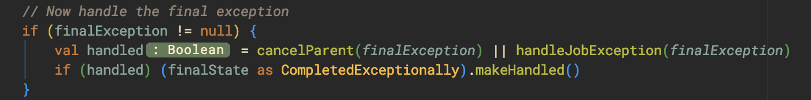

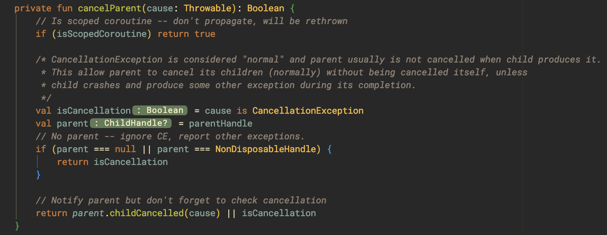

#### tryFinalizeFinishingState → cancelParent

Being called when a Coroutine is about to be completed for any reason.

#### cancelParent → childCancelled

The method will call to the parent Coroutine with `parent.childCancelled` to see whether its parent can handle the exception or not. If not, **it means the current Coroutine needs to handle it by calling to `handleJobException`.**

The key points of the method are:

- **Return true or false?**
    - **false,** **the current Coroutine needs to handle it by calling to `handleJobException`.**
    - **true, the exception is handled by the parents.**

#### childCancelled

`childCancelled` is called from child Coroutine to see whether an exception is handled by parent Coroutine. It is overrided by:

* `ChildHandleNode`, which will call to `job.childCancelled` that is defined in `JobSupport`.

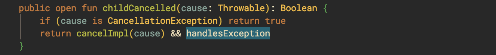

*  `NonDisposableHandle`, which will always return `false` and be used in a Coroutine chain as the top-most parent.

Normally, all coroutines will use the first implementation, **which will call from `cancelImpl` then `notifyCancelling` eventually to cancel both parent and child coroutines.** 

In the meanwhile, it will also call to  `handlesException` to check whether there is any parent that can handle  the Exception, in which **the return value will be false if the parent Coroutine is the top-most**.

The key points of the method are:

- **Been override or not?**
    - **No, it will call to `notifyCancelling` to cancel all the others.**
    - **Yes, mostly will return false directly and won't do any cancellation.**
- **Return true or false?**
    - **false, the child may be forced to handle exception**
    - **true, the parent claims to handle it.**

#### handlesException

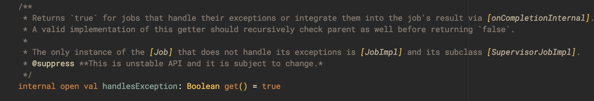

It is clear from the comment that all `Job` should be able to handle the exception. But not for 	it's subclass `JobImpl`:

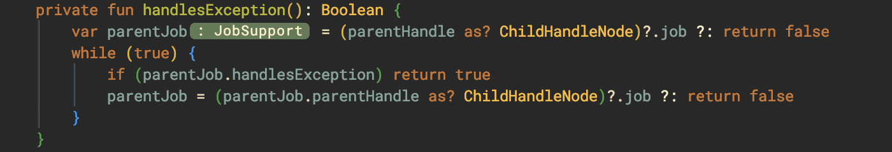

As you can see, if the current Coroutine's parent is not `ChildHandleNode`, then it should be `NonDisposableHandle`, for which `false` will be returned directly. Otherwise, it will try to ask a parent for handling exception.

The key points of the method are:

- **Basic Job will handle the exception by default.**
- `Job` created by `Job()` and `SupervisorJob()`:
    - **Won't handle the exception if it is the top-most in a coroutine chain.**
    - **Ask the parent to handle if there is one.**

#### handleJobException

The method is used to indicate whether an exception is handled by the current Coroutine and **returns false by default.**

The key points of the method are:

- **Only override by `StandaloneCoroutine` or `ActorCoroutine`, meaning only the two classes will handle exceptions with Handler and throw an exception if they fail to handle.**

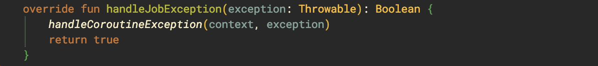

#### completeStateFinalization

The method will be called at the end of `tryFinalizeFinishingState`, calling `notifyCompletion` from `ChildCompletion` to invoke all Coroutines to go into completion and call `tryFinalizeFinishingState` again eventually.

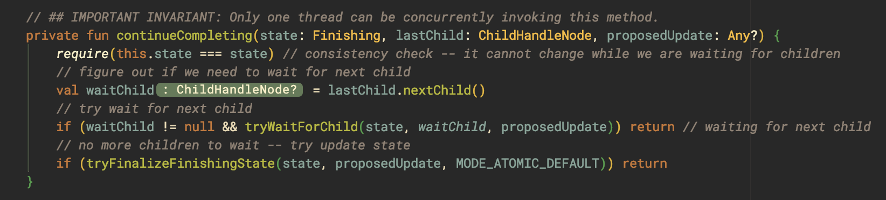

Before running into `tryFinalizeFinishingState`, it will wait for the child. **That's why a parent Coroutine won't complete itself immediately.**

### ScopeCoroutine

The three kinds of classes are `ScopedCoroutine`:

- `BlockingCoroutine` → `runBlocking`
- `TimeoutCoroutine` → `withTime`
- Subclasses of `ScopeCoroutine`:
    - `DispatchedCoroutine` → `CoroutineScopes` in launch, `async`
    - `UndispatechedCoroutine` → `coroutineScope`, `supervisorScope`
    - `FlowCoroutine`
    - `SupervisorCoroutine`

#### handleException

Since Scope doesn't override `childCancelled` and `handleException`. **A scope will return `true ` from `childCancelled`, which claim to handle the exception.**

#### isScopedCoroutine

All Scopes will have this field as true, meaning it will early return true in `cancelParent`:

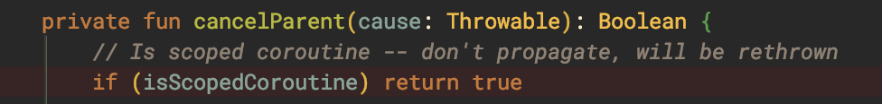

This means that **it won't propagate the exception to the parent or any others but will rethrow the exception.**

To see where it rethrows the exception, let's use `coroutineScope` as an example:

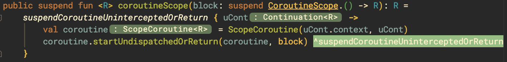

The function will lead us to `undispatchedResult` and you will see the block is executed inside a `try-catch`:

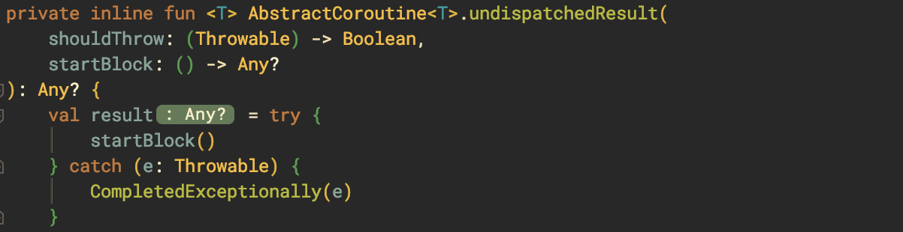

And it rethrows if the final `state` we got is `CompleteExceptionally`:

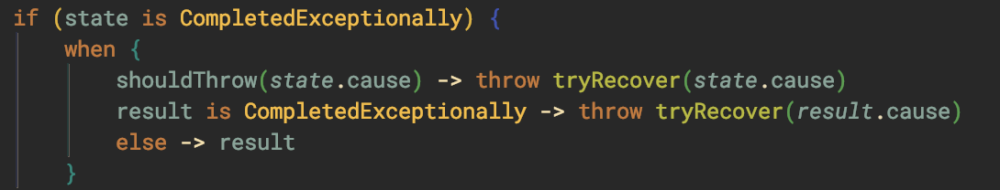

**In this way, we can catch the exception with try-catch without setting the Handler on parent.**

### Supervisors

The only difference between `SuperviorCoroutine/SupervisorJob` and `Coroutine/Job` are that they override `childCancelled`. Both will return `false` directly:

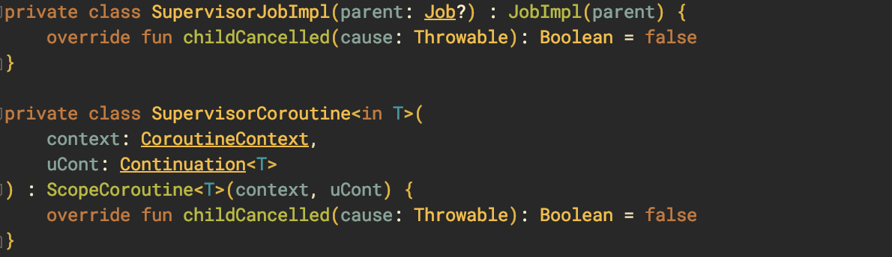

Without calling to `cancelParent` as well, it means when there is an exception that comes up, they won't perform any cancellation nor propagate `notifyCancelling` to cancel the others.

The key points here are:

- **SupervisorJob/SupervisorCoroutine will silence exceptions.**
- **Their child will be forced to handle the exception.**

### Summary

Let's use the most commonly used component as an example and categorize them into three characteristics:

- **Override `handleJobException`?** Yes means that it can use Handler to handle the exception.
- **Override `childCancelled`?** Yes means that it won't notify others to cancel. 
- **Override `handlesException`?** Yes means that it won't claim to handle exception by default.

And the result will be as below:

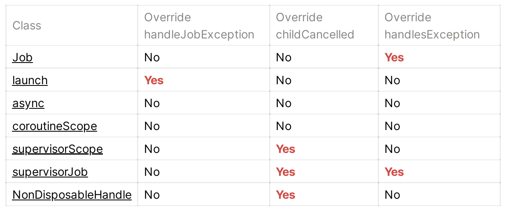

It obvious that only coroutines from `launch` will use Handler to handle the exception. And only members of  the `supervisor` family won't propagate the exception to others.

Even at the end of this article, I think it might still confusing how the exception gets propagated. In the next part, I will show you how to find the propagation path graphically:

- [**Crack Coroutine Exception Propagation — Part 2**](https://ansgarlin.github.io/en/news/2020/01/25/crack_coroutine_exception_propagation_2/)