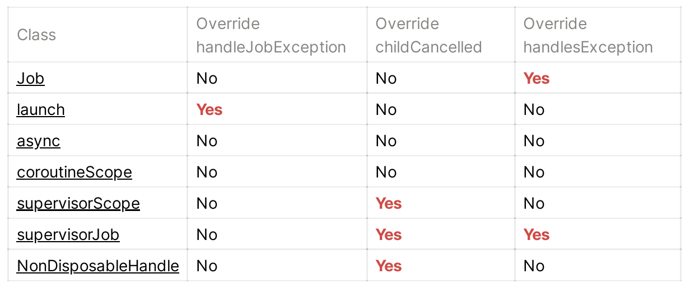
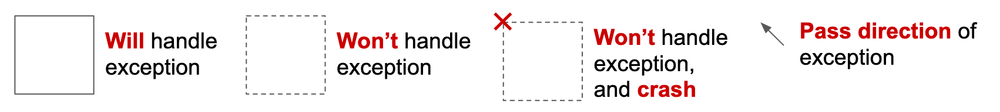
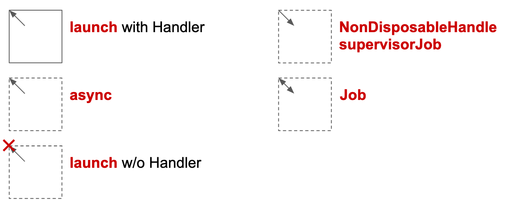
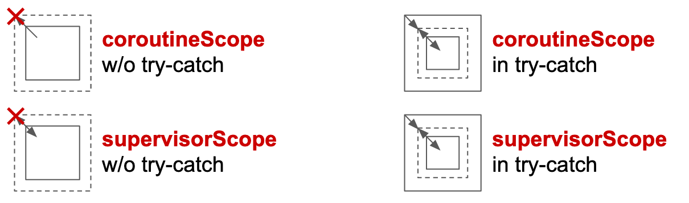
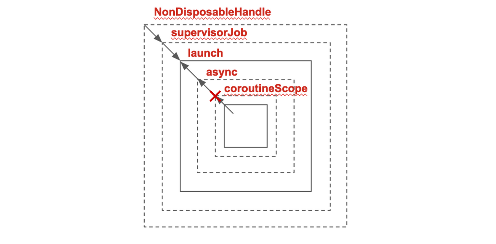

In [Part 1](https://ansgarlin.github.io/en/news/2020/01/24/crack_coroutine_exception_propagation_1/), we've talked about the concept to know how a constructed Coroutine propagates and handles the exception and cancel the others. 

In Part 2, we are going to talk about how to use the knowledge and write an exception free constructed Coroutine.

Before digging into cases, we need to know how to read a constructed Coroutine. In the beginning, we've said that `CoroutineContext` is like a Collection. So when you have a constructed Coroutine like below:

    val handler = CoroutineExceptionHandler { ... }
    launch(SupervisorJob() + handler) { async { throw Exception } }

The connection between each one is:

    NonDisposableHandle -> SupervisorJob() -> launch -> async -> coroutineScope

Then when there is an exception, the following things will happen:

- `async` will use `cancelParent` to ask whether there is a parent can handle the exception.
- `launch` will return true on `handleException` by default. So `async` won't need to call to `handleJobException`.
- `SupervisorJob` will return false on `cancelChild` directly, hence `launch` will need to use Handler to handle the exception.
- All the default parent for the top parent is `NonDisposableHandle`, which will return false on `cancelChild` by default.

By summarizing the information, we can for sure if we don't assign a Handler to `launch`, any exception inside will crash the app.

### Case study

Now we can use samples in [Kotlin Coroutine Job Hierarchy — Succeed, Fail, and Cancel](https://proandroiddev.com/kotlin-coroutine-job-hierarchy-finish-cancel-and-fail-2d3d42a768a9) to justify  whether the table will misguide us.

I only pick some of them as an example to demonstrate how to analyze different kinds of constructed Coroutine based on what we've learned:

- **`launch { throw }`**：The parent of `launch` is `NonDIsposableHandle`, which will force it to handler exception. **Without a Handler, the result will fail.**
- **`launch { launch { throw } }`**：The same reason, the top parent will be forced to handle exception. **Without a Handler, the result will fail.**
- **`launch { launch(Handler) { throw } }`**：Only the top parent will need to handler the exception. **Since the Handler only exists inside the child launch, hence the result will fail.**
- **`async { throw }`**：`async` doesn't override `handleJobException`, so **it won't handle the exception, the result will pass.**
- **`launch { async { throw } }`**：Exception will pass to parent `launch`. **Without a Handler, the result will fail.**
- **`launch(Job) { throw }`**：`Job` will return `false` on `handleException`, which will force the  child to handle. **Without a Handler, the result will fail.**
- **`coroutineScope { throw }`**：Scope will throw exception once. **Without `try-catch`, the result will fail.**
- **`coroutineScope { launch(Handler) { throw } }`**：claim to handle exception, make Handler won't be used. **Without `try-catch`, the result will fail.**

#### Supervisor

With supervisor, almost behave in the same way.

- **`launch(SupervisorJob) { throw }`**：`SupervisorJob` will return `false` on `handleException`, which will force the child to handle. **Without a Handler, the result will fail.**
- **`supervisorScope { launch(Handler) { throw } }`**：override `childCancelled` to return `false`, which will force child to handle. **Without a Handler, the result will fail.**

### Diagram

Maybe the cases above still pretty confusing, then let's try another way: **through the graph**.

#### Definition

Let's see the table from [Part 1](https://ansgarlin.github.io/en/news/2020/01/24/crack_coroutine_exception_propagation_1/) again:

And then we use rectangular to represent the boundary of exception:

##### Solid line

Means the exception will be handled:

* **Coroutines** that override `handleJobException` with Handler
* **Scopes** that return `true` on `isScopeCoroutine`. 
* **`try-catch`** block.

##### Dot line

* **Coroutines** that don't override `handleJobException`.
* **Coroutines** that override `handleJobException` without Handler.

##### Dot line with error

* **Coroutines** or **Scopes** that claim to handle exception but failed to handle. **In some operators that can cause crash.**

##### Arrow

Means to propagate exception **out** or **push back.**

* **out:** **Coroutines** that don't override `childCancelled`.
* **push back:** **Coroutines** that override `childCancelled` or `handleException`.

And here's the combination of the above to represent the basic functions:

#### Scopes

Since **Scopes** will return `true` on `isScopeCoroutine`, which makes **Scopes** claims to handle exception by default, and rethrow exception in other way. The graph of **Scopes** are quite different:

The **dot line means to rethrow exception.** But it's not like propagating exception between **Coroutine**, so we can use **`try-catch`** to handle exception.

Now, let's use the example above:

    NonDisposableHandle -> SupervisorJob() -> launch -> async -> coroutineScope

The graph that you'll get is:

**The arrow will meet at the `launch`, which means the `launch` will handle the exception. If not, the whole constructed Coroutine will just crash.**

### Summary

Exception is important because it will crash the app and cause bad use experiences. Hope this article can help you to write a exception free constructed Coroutine easily.