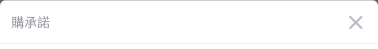
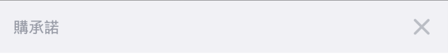

近期在設計畫面時遇到一個特殊的問題：

* **使用`<layer-list>`當背景，在android版本為22之前的機器上執行會與預期的不同**。

在這直接以我們使用的實作作為範例：第一層是白色背景，搭配左上和右上的圓角。第二層則是貼齊第一層底部，高度為1dp的灰色線條：

```Xml
<layer-list xmlns:android="http://schemas.android.com/apk/res/android">
    <item>
        <shape>
            <solid android:color="@color/bgWhite" />
            <corners
                android:topLeftRadius="6dp"
                android:topRightRadius="6dp" />
        </shape>
    </item>
    <item android:gravity="bottom">
        <shape>
            <solid android:color="@color/bgGray" />
            <size android:height="1dp" />
        </shape>
    </item>
</layer-list>
```

第一層是白色背景，搭配左上和右上的圓角。第二層則是貼齊第一層底部，高度為1dp的灰色線條。23之後的版本會如預期的呈現：



但在22以下則會如下：



經過測試後發現這個覆蓋在背景上的灰色，是原本應該是至於底部的線條，變成擴張到整個View的範圍。判斷是版本不同產生的差異，應是版本間的程式碼有些不同。

### 定義差異範圍

因為範例很單純，我們可以輕易的將分析範圍限縮在以下兩個Drawable衍生類別：

* ShapeDrawable
* LayerDrawable

和代表不同Shape的類別，不過在這設計中沒有特別指定，因此可以再縮小至以下幾種Shape類別：

* RectShape
* RoundRectShape
* Shape

### 分析差異

要找出差異，有分兩個層次：

* 檔案異同。
* 相異的片段是否會造成行為不同，或只是一些錯誤處理。

以下我們從檔案比較小的Shape類別開始做比對。

> 以下所有進行對照的原始碼皆來自[http://androidxref.com/](http://androidxref.com/)

#### RectShape, RoundRectShape, Shape

每個檔案行數都不多，直接對照行數的結果是沒有任何變動。於是可以快速地進入Drawable衍生類。

#### ShapeDrawable

檔案有些許更動，但只是單純的更改命名方式和函式宣告，並不會影響原始行為。

#### LayerDrawable

檔案變動很多，大部分是新增了對外的函示，讓LayerDrawable可從外部進行設定。少部分和ShapeDrawable類似，並不影響原始行為。

由於我們此次是要知道繪圖範圍會產生變化的原因，所以餘下的部分透過字串搜尋height後，發現新版本的開頭註解有些不同。

```Java
 * @attr ref android.R.styleable#LayerDrawable_paddingMode
 * @attr ref android.R.styleable#LayerDrawableItem_left
 * @attr ref android.R.styleable#LayerDrawableItem_top
 * @attr ref android.R.styleable#LayerDrawableItem_right
 * @attr ref android.R.styleable#LayerDrawableItem_bottom
 // Android 23後新增內容
 * @attr ref android.R.styleable#LayerDrawableItem_start
 * @attr ref android.R.styleable#LayerDrawableItem_end
 * @attr ref android.R.styleable#LayerDrawableItem_width
 * @attr ref android.R.styleable#LayerDrawableItem_height
 * @attr ref android.R.styleable#LayerDrawableItem_gravity
 // -------------------- //
 * @attr ref android.R.styleable#LayerDrawableItem_drawable
 * @attr ref android.R.styleable#LayerDrawableItem_id
```

於是我們得到了解答：

* **之前版本都沒有的參數，自然設定了也無法判別。**

### What's more

既然我們理解為什麼給予的設定無效後，那也要理解新的參數如何影響最後呈現的畫面。並聚焦在我們有使用到的參數上。

以下我們繼續使用相同範例。在新版的`onBoundChange()`中新增了一些計算在`setBounds()`之前：

```java
// In LayerDrawable
@Override
protected void onBoundsChange(Rect bounds) {
    final boolean nest = mLayerState.mPaddingMode == PADDING_MODE_NEST;
    final ChildDrawable[] array = mLayerState.mChildren;
    final int N = mLayerState.mNum;
    for (int i = 0; i < N; i++) {
        final ChildDrawable r = array[i];
        ...
        // 以下這部分
        r.mDrawable.setBounds(bounds.left + r.mInsetL + padL, bounds.top + r.mInsetT + padT, bounds.right - r.mInsetR - padR, bounds.bottom - r.mInsetB - padB);
------------------------------------------------------------------------------------------
    	// 換成以下這部分
	    final Drawable d = r.mDrawable;
        ...
        final Rect container = mTmpContainer;
        container.set(d.getBounds());
        ...
        // 這邊是一些為了與舊版本相容的調整
        ...
        final int w = r.mWidth < 0 ? d.getIntrinsicWidth() : r.mWidth;
        final int h = r.mHeight < 0 ? d.getIntrinsicHeight() : r.mHeight;
        Gravity.apply(gravity, w, h, container, outRect, layoutDirection);
        d.setBounds(outRect);
        ...
    }
}
```

先不細看這些額外的操作，直接先看到`setBounds()`的用途：

```Java
// In Drawable
/**
 * Specify a bounding rectangle for the Drawable. This is where the drawable
 * will draw when its draw() method is called.
 */
public void setBounds(int left, int top, int right, int bottom) { }
```

根據註解，此函式用於決定繪製範圍，因此我們可以確定前後版本顯示上的差異，一定是因爲前面提到的新增的操作，做了一些額外的調整。

### 流程分析

再進一步理解之前，先回頭了解LayerDrawable的兩個基本概念：

* 初始化
* 繪製

#### 初始化

Drawable的初始化，首先先看到`inflate()`：

```Java
// In LayerDrawable
@Override
public void inflate(Resources r, XmlPullParser parser, AttributeSet attrs, Theme theme)
            throws XmlPullParserException, IOException {
    ...
    final TypedArray a = obtainAttributes(r, theme, attrs, R.styleable.LayerDrawable);
    updateStateFromTypedArray(a);
    a.recycle();
  
    inflateLayers(r, parser, attrs, theme);
    ...
}
```

`updateStateFromTypedArray()`內容是用於設定padding值，不過當前的範例並沒有針對`<layer-list>`的設定，於是直接跳過看到`inflateLayers()`：

```Java
// In LayerDrawable
private void inflateLayers(@NonNull Resources r, @NonNull XmlPullParser parser,
            @NonNull AttributeSet attrs, @Nullable Theme theme)
            throws XmlPullParserException, IOException {
        final LayerState state = mLayerState;
        ...
        while ((type = parser.next()) != XmlPullParser.END_DOCUMENT
                && ((depth = parser.getDepth()) >= innerDepth || type != XmlPullParser.END_TAG)) {
            ...
            if (depth > innerDepth || !parser.getName().equals("item")) {
                continue;
            }  
              
            final ChildDrawable layer = new ChildDrawable(state.mDensity);
            final TypedArray a = obtainAttributes(r, theme, attrs, R.styleable.LayerDrawableItem);
            updateLayerFromTypedArray(layer, a);
            a.recycle();

            // If the layer doesn't have a drawable or unresolved theme
            // attribute for a drawable, attempt to parse one from the child
            // element. If multiple child elements exist, we'll only use the
            // first one.
            if (layer.mDrawable == null && (layer.mThemeAttrs == null ||
                    layer.mThemeAttrs[R.styleable.LayerDrawableItem_drawable] == 0)) {
                ...
                // We found a child drawable. Take ownership.
                layer.mDrawable = Drawable.createFromXmlInner(r, parser, attrs, theme);
                ...
            }
            addLayer(layer);
        }
    }
}
```

在`inflateLayers()`內主要執行兩件事：

* 針對每一個`<item>`建立一個ChildDrawable，並透過`updateLayerFromTypedArray()`將存入設定在`<item>`上的屬性。
* 接著透過`createFromXmlInner`，將`<item>`包住的內容轉成特定的Drawable，然後再存入ChildDrawable中。
* 透過`addLayer()`將ChildDrawable存入`mLayerState`：

```java
// In LayerDrawable 
int addLayer(ChildDrawable layer) {
    final LayerState st = mLayerState;
    ...
    st.mChildren[i] = layer;
    ...
}
```

> 在所有LayerDrawable操作中，mLayerState都將持續用來每一層Drawable資料。

結合當前範例，我們可以得知第二層的ChildDrawable，就是用來呈現灰色線條。結合ChildDrawable預設的參數，我們目前得到的ChildDrawable可以簡單表示如下：

```Java
ChildDrawable {
    width = -1, height = -1, 
    drawable = ShapeDrawable {
        height = 1, color = gray
    }
}
```

#### 繪製

View的狀態改變時會呼叫到Drawable的`onStateChange()`，也就是LayerDrawable的`onStateChange()`：

```Java
// In LayerDrawable
@Override
protected boolean onStateChange(int[] state) {
    ...
    updateLayerBounds(getBounds());
    ...
}
```

再次的又回到先前介紹的`updateLayerBounds()`，為了方便閱讀，再次列出內容如下：

```Java
// In LayerDrawable
@Override
protected void onBoundsChange(Rect bounds) {
    final boolean nest = mLayerState.mPaddingMode == PADDING_MODE_NEST;
    final ChildDrawable[] array = mLayerState.mChildren;
    final int N = mLayerState.mNum;
    for (int i = 0; i < N; i++) {
        final ChildDrawable r = array[i];
        ...
        final Drawable d = r.mDrawable;
        ...
        final Rect container = mTmpContainer;
        container.set(d.getBounds());
        ...
        // 這邊是一些為了與舊版本相容的調整
        final int gravity = resolveGravity(r.mGravity, r.mWidth, r.mHeight
                                           d.getIntrinsicWidth(), d.getIntrinsicHeight());
        final int w = r.mWidth < 0 ? d.getIntrinsicWidth() : r.mWidth;
        final int h = r.mHeight < 0 ? d.getIntrinsicHeight() : r.mHeight;
        Gravity.apply(gravity, w, h, container, outRect, layoutDirection);
        d.setBounds(outRect);
        ...
    }
}
```

首先由`mLayerState`取出所有ChildDrawable，並然後迴圈內依序取出進行以下幾個主要操作：

* 取出ChildDrawable內的Drawable。
* 取得目前Drawable的範圍，預設應是(0, 0) - (0, 0)。
* 經過一些相容性的調整。只要有給予寬高設定，`resolveGravity()`並不會更變目前ChildDrawable的Gravity。
* 取得目前的寬高設定。
* 透過`Gravity.apply()`完成最後範圍的調整，並存入`outRect`。
* 使用`outRect`來設定Drawable的繪製範圍。

用範例給予的參數走過以上步驟，輸入`Gravity.apply()`的參數如下：

```
Gravity.apply(Gravity.BOTTOM, 0, 1, container, outRect, LayoutDirection.LTR)
```

接著再來看到`Gravity.apply()`：

```Java
// In Gravity
public static final int BOTTOM = (AXIS_PULL_AFTER|AXIS_SPECIFIED)<<AXIS_Y_SHIFT;

public static void apply(int gravity, int w, int h, Rect container, int xAdj, int yAdj, Rect outRect) {
    switch (gravity&((AXIS_PULL_BEFORE|AXIS_PULL_AFTER)<<AXIS_X_SHIFT)) {
    	...
    }
  
    switch (gravity&((AXIS_PULL_BEFORE|AXIS_PULL_AFTER)<<AXIS_Y_SHIFT)) {
        ...
        case AXIS_PULL_AFTER<<AXIS_Y_SHIFT:
          outRect.bottom = container.bottom - yAdj;
          outRect.top = outRect.bottom - h;
          ...
          break;
          ...
    }
}
```

內容很多但就是依照當前傳入的Gravity，搭配給予的寬高設定，來決定最後的繪製範圍。而我們傳入的是Gravity.BOTTOM，對照前面的static變數就是AXIS_PULL_AFTER<<AXIS_Y_SHIFT。其中的操作如下：

* `yAdj`在傳入時就是0，`outRect`的`bottom`會與原本的Drawable底部相同。
* `h`是1，所以`outRect`的`top`等於`bottom`剪掉1，藉此來達到畫面上高度為1的結果。
* `w`沒用到，所以`outRect`的`left`和`right`保持不變。

所以如果container的寬高為 (x , y)，`outRect`最後的結果如下：

```java
outRect { left = 0, right = x, top = y - 1, bottom = y}
```

所以就算container內原本是給予覆蓋整個View的範圍，也會因為設定了寬高和Gravity而再進行調整。以當前的參數來說，得到的繪製結果就是一條橫線。