在開發自訂的物件時，一定會遇到需要自行繪製內容的時候。如果需要繪製的內容包含字串，就會遇到以一行呈現時，需要絕對置中的問題。

置中可以分成橫向和垂直。橫向置中可以直接透過Paint設定繪製的基準點。但垂直置中則因為字串繪製的基準線，並不是整個字串範圍的垂直中心，所以需要再經過位移，才可以在畫面上呈現垂直置中。

以下將逐步從前置的概念到運算方式進行介紹。以下將分成三步驟：

* 字串如何被繪製？
* 對應到程式中
* 置中繪製的方法

### 字串如何被繪製

首先要決定範圍，範例如下圖：

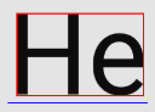

紅色框圈出了包含字串的最小範圍，而藍色線則是其在橫向上實際上會佔用的寬度。

至於高度要看以下的範例圖：

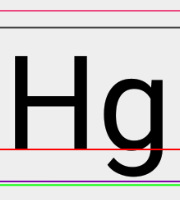

圖中的橫線由上而下依序如下表示：

- Top：較高字型的頂端。
- Ascent：大部分字型的頂端。
- Baseline：所有字型的基準線。
- Decent：大部分字型的底端。
- Bottom：較高字型的底端。

所以可以看出高度是`top`和`bottom`的距離。

接著再決定繪製的基準點要在基準線上的哪個位置，基準點的意義直接看範例如下：

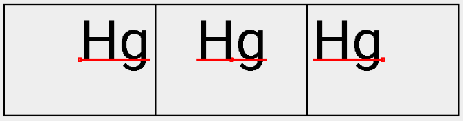

紅線就是基準線，線長等於上述第一張圖的藍線。可以看出基準點是在基準線上移動，移動範圍是基準線的長度。所以依照圖例，基準點在左邊時，文字繪製方向就是左起。反之就是中間或是右起。

最後，在繪製時指定基準點在畫面上的座標位置。如果是右起，字串就會從基準點開始，向右且在基準線上繪製整個字串。

### 對應到程式

上述的繪製三步驟對應到程式碼依序如下：

- `Paint.getTextBounds()`可以取得紅色框。

- `Paint.measureText()`可以取得藍線長度。

- `Paint.getFontMetrics()`可以得到一個FontMetrics：

  ```Java
  public static class FontMetrics {
      public float   top;
      public float   ascent;
      public float   descent;
      public float   bottom;
  }
  ```

  要注意的是這些數值是相對於基準線的位置，所以`top`和`ascent`是負數，反之`descent`和`bottom`是正數。

- `Paint.setTextAlign()`可以指定Align：

  ```Java
  public enum Align {
      LEFT    (0),
      CENTER  (1),
      RIGHT   (2);
      ...
  }
  ```

- 而要繪製字串時，用`Canvas.drawText(text, x, y, Paint paint)`可以給定基準點的位置。

到這先做個總結，從以上的介紹和圖例可以觀察出，如果要繪製字串，其實並不需要全部有介紹到的函示。最後將來介紹如何將字串置中繪製。

### 置中繪製的方法

如果想要將字串繪製在畫面中心，預期的結果是字串的中心點為對準畫面中心。我們會先透過`Canvas.drawText()`將中心點設為基準點的位置，結果如下：

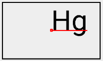

這並不是我們想要的置中。為了達到我們需要的結果，橫向應再往左一些，直向要再向下一些。

#### 橫向

由於基準線已經是在置中位置，所以只要透過`Paint.setTextAlign()`將基準點設定成CENTER即可。結果如下：

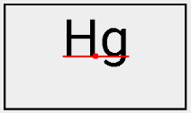

#### 直向

在這需要自行計算字串的中心距離畫面中心多遠，才知道要向下移動多少。所以首先我們先透過`Paint.getFontMetrics()`來取得FontMetrics，並透過`top`和`bottom`來取得字串高度：

```java
高度 = bottom - top // 因為top是負的
```

依照前面圖例，我們可推知要移動的距離就是字串中心和基準線的距離，於是我們可以得到最後的距離公式如下：

```Java
字串中心與基準線距離 = 高度 / 2 - bottom = (bottom - top) / 2 - bottom
```

進一步簡化則是：

```Java
移動距離 = -(bottom + top) / 2 
```

最後呈現結果如下：

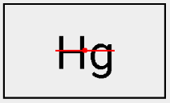

於此我們找到了繪製置中字串的公式。

### What's more

以上我們對於置中提出了解法，但這公式在整個字串只有小寫字母時，產生的結果就不如預期了：

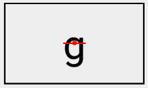

原因是因為FontMetrics所畫出的字串範圍，是字串被繪製的合理範圍，並不是字串真正被繪製的範圍，求出來的中心點有時就不會符合需求。

想法一樣，要將字串的中心移動至畫面的中心點。不過這次我們嘗試另外一個方法來取得字串高度，就是先透過`Paint.getTextBounds()`來取得字串的實際範圍：

```Java
Rect centerRect = new Rect();
Paint.getTextBounds(s, 0, s.length(), centerRect);
```

要特別注意的是，這邊取得的範圍是字串畫在預設起始點(0, 0)時的範圍，所以如果要將其`top`和`bottom`的範圍對齊字串，則還要做調整：

```Java
centerRect.offset(0, rect.centerY());
```

結果如下圖的小黑框：

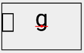

於是我們就可以取得字串的垂直中心，並求出要移動的距離：

```Java
移動距離 = 中心點y - centerRect.centerY()
```

結果如下：

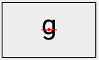

運用這種算法的好處是，可以依照所要繪製的字串，動態調整要移動的距離。於是字串就算大小寫都包含，也可以如預期的置中：

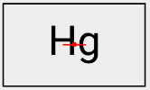

#### 非英文語系

以上介紹的兩種方法都可以使用。如中文此類，每個字的大小和範圍位置都是固定的，則可以直接使用第一個方法較為直接好理解，例圖如下：

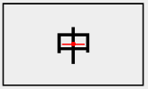


