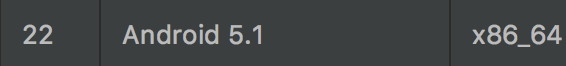
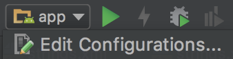
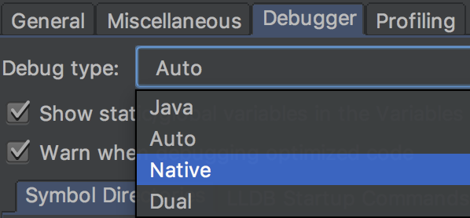
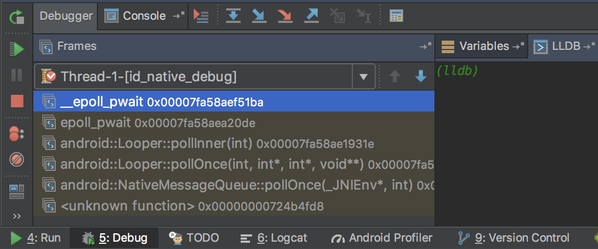
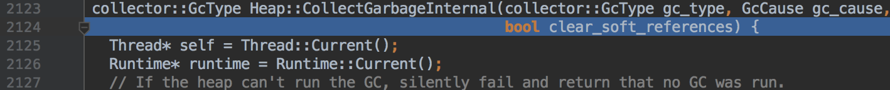

在開發或是解bug的過程中，有時我們需要先理解Android原始碼運作的原理，僅僅是閱讀並不能完全了解運作時的變化。

透過IDE，我們可以在程式碼上設定breakpoint，藉此逐步查看執行時產生的變化，但這僅限於Java層的原始碼。

而將自行編譯AOSP得到的image，掛載在模擬器上，我們也可以順利在Native層設定breakpoint，就如同在Java層一樣。

以下會用MacOS為主要環境，並分成兩大部分介紹從環境設定，到掛載image並設定breakpoint的過程：

* 編譯AOSP。
* 掛載image，設定breakpoint並執行。

其他OS步驟大同小異，請對照[官方文件](https://source.android.com/setup/build/initializing)閱讀

### 編譯AOSP

先列出這邊我的環境設定：

* MacOS 10.13
* Xcode 9.3
* JDK 1.7

而我選用的Android版本是：

* Build name - LMY48X
* AOSP version - android-5.1.1_r25

#### 版本對應

由於最後是要與模擬器產生連結，且IDE針對Android-22所使用的核心版本是android-5.1.1_r25。所以我們在選擇AOSP的branch時也用android-5.1.1_r25的版本。另外，JDK也必須設定成Android-22對應的版本1.7。

其餘版本對應可以參考以下兩個網址：

* https://source.android.com/setup/start/build-numbers#source-code-tags-and-builds
* https://source.android.com/setup/build/requirements

#### 建立編譯環境

##### JDK

是1.8則直接至官網下載安裝。是1.7可以至此[鏡像網站](http://cdn-files.evildayz.com/mirror/java/jdk_7u80/)下載。另外建議可用[jEnv](http://www.jenv.be/)來做版控。

##### Xcode

直接在AppStore上下載即可。

##### Xcode command line

安裝指令：

```
xcode-select --install
```

安裝後簽署同意書：

```Java
sudo xcodebuild -license
```

##### MacPorts

編譯所需套件要透過此軟體安裝，直接到[官網](https://www.macports.org/install.php)下載安裝。安裝後執行：

```
sudo port -v selfupdate
```

這樣就完成MacPorts的設定，可以透過`man port`確認安裝完成。

修改環境變數PATH，並確認`/opt/local/bin`在`/usr/bin`之前：

```
export PATH=/opt/local/bin:$PATH
```

##### Repo

要下載AOSP得用專用的指令，但這指令一般用不到，所以可以選擇建立在帳號的目錄下：

```
mkdir ~/bin
PATH=~/bin:$PATH
```

透過curl下載安裝：

```
curl https://storage.googleapis.com/git-repo-downloads/repo > ~/bin/repo
chmod a+x ~/bin/repo
```

##### 編譯所需套件

```
POSIXLY_CORRECT=1 sudo port install gmake libsdl git gnupg
```

##### 提高檔案開啟上限

編譯時是多條執行緒同步執行，提高預設上限避免產生問題：

```
ulimit -S -n 1024
```

##### Trouble shooting

###### Error: zlib, ncurses: no destroot found

執行以下指令後重試：

```
sudo port clean zlib ncurses
```

###### Error: active failed

依照提示執行相對指令，如zlib則是：

```
port -f activate zlib
```

#### 建立專用磁區

在Mac上編譯AOSP需要case sensitive的磁區，執行以下指令建立：

```
hdiutil create -type SPARSE -fs 'Case-sensitive Journaled HFS+' -size 150g ~/android.dmg
```

執行後會產生android.dmg.sparseimage的檔案。

如要修改磁區大小：

```
hdiutil resize -size <new-size-you-want>g ~/android.dmg.sparseimage
```

由於AOSP整個原始碼佔用空間很大，建議設定150g以上，以避免編譯時產生空間不夠的錯誤。

#### 下載AOSP

先掛載專用磁區：

```
hdiutil attach ~/android.dmg.sparseimage -mountpoint /Volumes/android
```

如果要卸載：

```
hdiutil detach /Volumes/android
```

建立資料夾並進入：

```
mkdir aosp
cd aosp
```

建立git專用的帳號，如本身有在用git這布應是不用，可用`git config -l`確定：

```
git config --global user.name "Your Name"
git config --global user.email "you@example.com"
```

初始化repo和要抓的版本，這邊依照前面介紹選擇android-5.1.1_r25：

```
repo init -u https://android.googlesource.com/platform/manifest -b android-5.1.1_r25
```

接著就可以下載了：

```
repo sync
```

如有遇到網路問題或是需要鏡像給多人使用，請直接參考[官方文件](https://source.android.com/setup/build/downloading)。

#### 編譯AOSP

編譯前最好都先清除上一次編譯產生的檔案：

```
make clobber
```

再透過內建的script做環境設定：

```
source build/envsetup.sh
```

接著需要再選一次編譯類型，這邊要注意CPU類型是x86或x86_64，建議與電腦本身的CPU類型相同，我在編譯時就因此而編譯失敗：

```
lunch aosp_x86_64-eng
```

之後要建立模擬器時，選用的CPU類型也需要與此對應。

接著就可以開始編譯了，執行緒數量建議是CPU核心數乘以2來達到最大效率，乘3以上較無意義：

```
make -j16
```

編譯完成後會全部都放在`/Volumes/android/aosp/out/target/product/generic_x86_64`底下，連同我們所需要的`system.img`。

##### Touble shooting

###### Can not find SDK 10.6

新版本的Xcode並沒有舊版的SDK，可以透過以下兩個途徑取得：

* 如有開發者帳號，可直接至[開發者頁面](https://developer.apple.com/download/more/)下載Xcode 4.1。下載後從`Contents/Developer/Platforms/MacOSX.platform/Developer/SDKs`底下取得MacOSX10.6.sdk。
* 到好心人phracker的[github](https://github.com/phracker/MacOSX-SDKs/releases)下載。

###### FAILED: /bin/bash -c "prebuilts/misc/darwin-x86/bison/bison

錯誤訊息不一定相同，就是和bison相關。解法是自己手動編譯，先到bison的目錄底下：

```
cd /Volumes/android/aosp/external/bison
```

取得修正的commit：

```
git cherry-pick c0c852bd6fe462b148475476d9124fd740eba160
```

執行編譯，使用mma可以自動編譯相依套件：

```
mma
```

將編譯後的bison複製到misc底下：

```
cp /Volumes/android/aosp/out/host/darwin-x86/bin/bison /Volumes/android/aosp/prebuilts/misc/darwin-x86/bison/
```

### 掛載image，設定breakpoint並執行

編出image，最難的部分就結束了。

#### 掛載image

建立Android - 22的模擬器：



接著用指令開啟：

```
emulator -avd <emulator name> -verbose -no-boot-anim -system <path to the system.img>
```

* 如果沒將emulator位置加入環境變數PATH，可以在`~/Library/Android/sdk/tools/emulator`底下找到。

* 需要emlator的名字，可以透過`-list-avds`查到所有目前已建立的模擬器。

  emulator的詳細指令可以用`-help-all`或查看[官方文件](https://developer.android.com/studio/run/emulator-commandline.html)。

修改run config：



將debugger改成native模式：



然後以debug模式編譯並裝載app：


切到debug tab，暫停，並切換到LLDB：



#### 設定breakpoint並執行

在這我們以最常見的GC為範例下breakpoint：

```
br s -n CollectGarbageInternal
// Print out
Breakpoint 4: where = libart.so`art::gc::Heap::CollectGarbageInternal(art::gc::collector::GcType, art::gc::GcCause, bool), address = 0x00007fa58750c8b0
```

輸出結果只看出是斷在libart.so中，並沒有其他有用訊息。所以我們必須要與對應的實際libart.so做連結：

```
add-dsym /Volumes/android/aosp/out/target/product/generic_x86_64/symbols/system/lib64/libart.so
// Print out
symbol file '.../libart.so' has been added to '/Users/ansgarl/.lldb/module_cache/remote-android/.cache/9C85D290-0000-0000-0000-000000000000/libart.so'
```

如此再列出剛下的breakpoint：

```
br list
// Print out
4: name = 'CollectGarbageInternal', locations = 1, resolved = 1, hit count = 0
  4.1: where = libart.so`art::gc::Heap::CollectGarbageInternal(art::gc::collector::GcType, art::gc::GcCause, bool) at heap.cc:2124, address = 0x00007fa58750c8b0, resolved, hit count = 0 
```

此時就會有完整的位址訊息，代表完成建立與檔案的連結，在我們觸發breakpoint時，就會成功定位到檔案內對應的位置：



如果此時還沒有辦法正確跳轉，唯一可能就是AOSP是在其他電腦上編譯。

可以先用`source info`查看在.so內對應的路徑：

```
source info
// Print out
Lines found in module `libart.so
[...): /Volumes/android/aosp/art/runtime/gc/heap.cc:2124
```

應該會看到另一台電腦上的路徑，再透過以下指令完成路徑的連結：

```
settings set target.source-map /Volumes/android/aosp/android-5.1.1_r25/ <local path>/android-5.1.1_r25
```

### Reference

* [The LLDB Debugger](https://lldb.llvm.org/tutorial.html)
* [How to tracked down an AOSP build issue](https://www.alsutton.blog/google-import/current-state-of-building-the-aosp-on-os-x/)