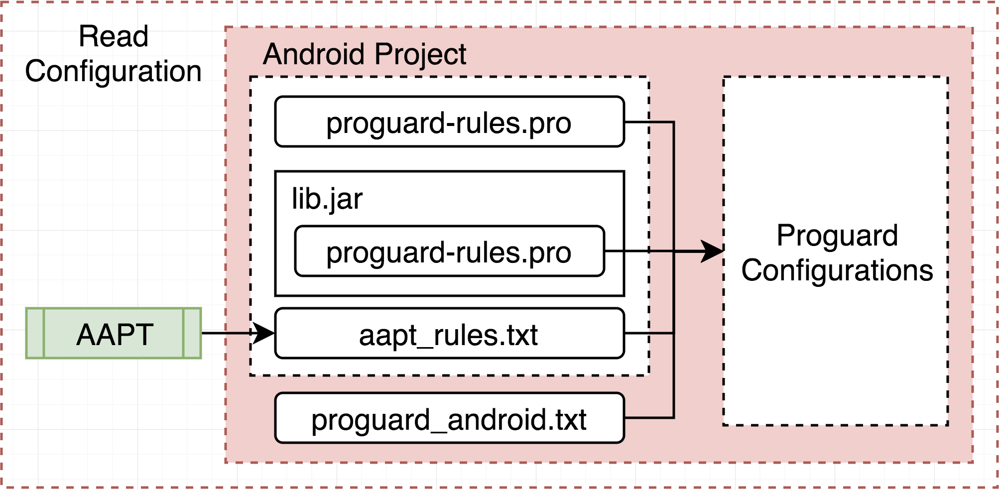
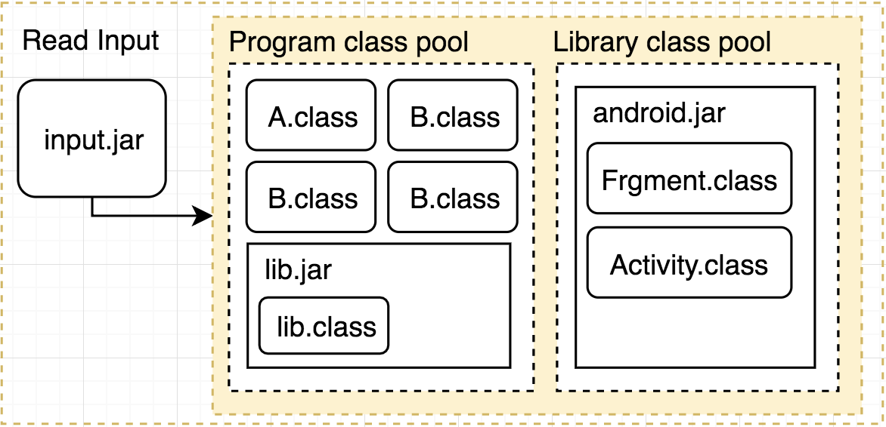
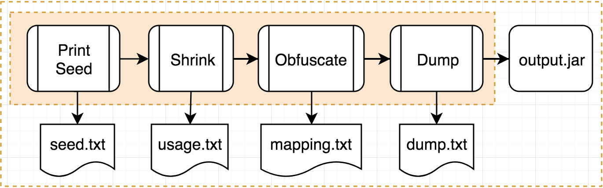
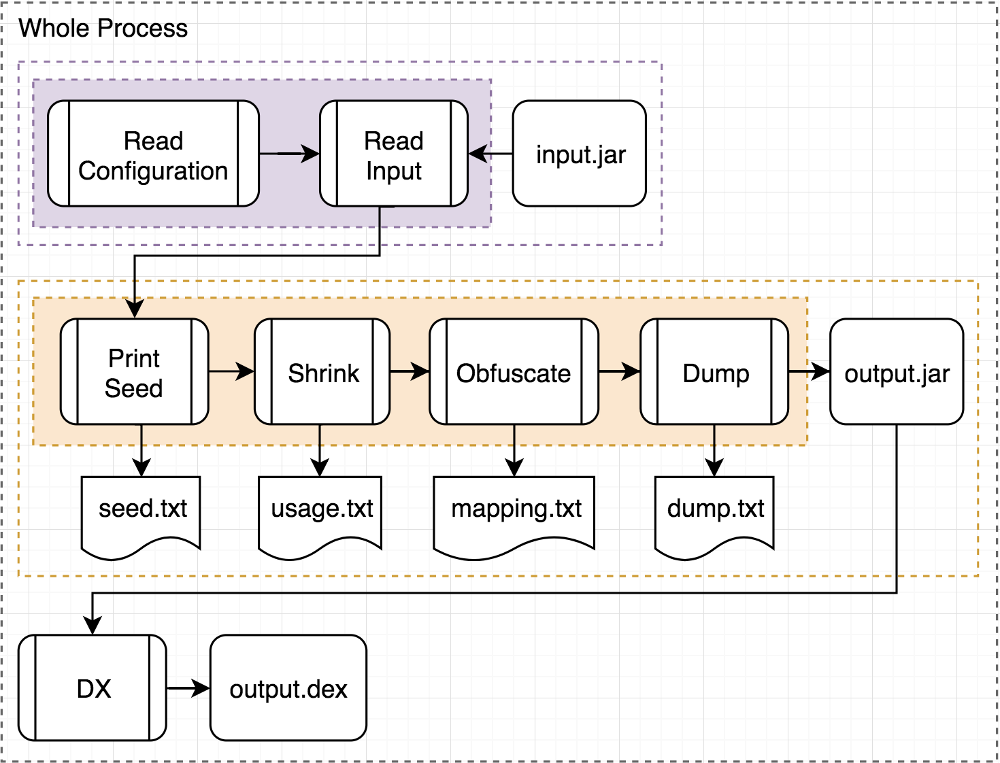
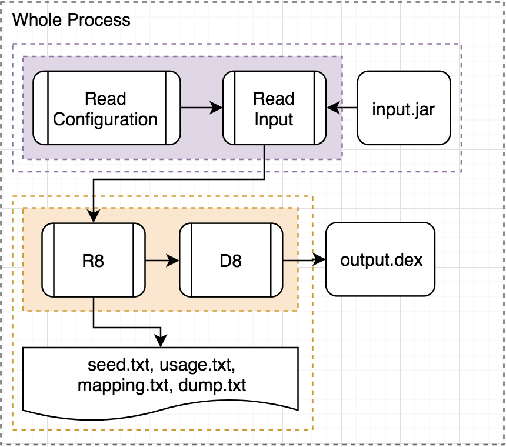

身為一個工程師，我們都會很好奇別人成品是如何實作，於是就會使用工具進行反組譯，一窺其中的內容。對於公司產品的開發者來說，這是最不願意遇到的，因為其中可能有特殊的商業邏輯，所以任何可被查閱的機會都是不被允許的。

對於Java來說，通常都會用ProGuard來進行防禦。ProGuard是一個開源工具，與Android相同由Java撰寫並編譯。ProGuard會刪除不必要的程式碼，和在不影響程式邏輯下，將類別、變數等的名稱，由更短且不具有字面意義的字母代替，以降低產品被反組譯並解讀的機會。

Google透過Gradle，讓開發者可以在編譯中開啟ProGuard。不過由[官方文件](https://developer.android.com/studio/build/shrink-code)可知，Google是將ProGuard當成是降低APK大小的工具。在近期的Google I/O的一場[talk](https://www.youtube.com/watch?v=x9T5EYE-QWQ&t=811s)，主講者也說明了上述兩個動作，只是稍微提高反組譯並解讀的難度。

由於筆者本身是Android工程師，分析都會透過IDE，跟直接使用指令來使用會有些不同，但大致上都大同小異，以下介紹可以當成是Android的ProGuard。

本系列將從ProGuard的運作方式介紹開始，整個ProGuard流程分成兩大部分：

* 前置作業
* ProGuard主流程

### 前置作業

在這一部分，ProGuard需要準備好兩個素材，依照取得順序為：ProGuard設定檔和class檔。

#### ProGuard設定檔



透過設定檔，ProGuard可以決定要如何處理被導入的程式內容。一般來說會有以下幾個來源：

- **proguard-rules.pro**，自訂的ProGuard設定檔。

- **lib/proguard-rules.pro**，library內的ProGuard設定檔。

- **aapt_rule.txt**，由AAPT(Android Asset Packaging Tool)主動在專案內的xml檔尋找引用，然後輸出而成。

  Android Studio編譯後會出現在以下路徑：

  ```
  <project_dir>/build/intermediate/proguard-rules/<flavor>/<buildType>/
  ```

  內容形式如下：

  ```java
  # Referenced at .../res/layout/custom_layout.xml:26
  -keep class android.support.design.internal.BaselineLayout { <init>(...); }
  ```

  此段是在告訴ProGuard：在custom_layout這layout檔內的第26行，有用到BaselineLayout這個View，所以需要保留其Class名稱，和所有Constructor。

  除了layout檔，以下是其他來源和對應類別：

  - **AndroidManifest.xml**，提供引用到的Activity、Service、ContentProvider和BroadcastReceiver。
  - **Preference.xml**，提供引用到的Preference、PreferenceCategory等相關類別。
  - **Menu.xml**，提供用在Menu上引用到的View。
  - **Layout.xml**，提供任何被引用到的View。

- **proguard-default.txt**，這是Android自帶的設定檔，透過Gradle指定，Android Studio編譯後可在以下路徑看到：

  ```
  <project_dir>/build/intermediate/proguard-files/
  ```

  路徑下還會有另外兩種設定檔，分別是：

  * **proguard-android.txt**，proguard-default差異不大。
  * **proguard-android-optimize.txt**，有打開ProGuard優化Java的功能。由此可知Android預設是將優化關閉，

#### class檔



class檔就是java檔被編譯後的文件，在ProGaurd內有分成兩大部分：

* **Program class pool**，主要是程式內容和引用的library內容。

* **Library class poo**l，編譯時會需要的底層library，我們撰寫的應用會架構在其之上。以Android來說就是Framwork層的部分，android.jar。要注意的是，**ProGuard並不會處理Library class pool內的任何類別**。


### ProGuard主流程



#### Print Seed

在載入class檔和ProGuard設定後，可以透過`-printSeed`要求ProGuard輸出seed.txt，內容是符合keep設定所帶的規則的類別、函式或變數。

舉例來說，如果我們現在有以下的ProGuard設定：

```java
-keep class com.example.MainEntry
```

這樣在seed.txt內只會有如下內容，不包含類別內的函式和變數：

```java
// In seed.txt
com.example.MainEntry
```

Android Studio在編譯之後會擺在以下路徑：

```java
<project_dir>/build/outputs/mapping/<flavor>/<buildType>/
```

接著進入分析和處理程式內容的流程，依照順序應有以下幾個步驟：

* **Shrink**，刪除不會被執行到的程式碼。
* ~~Optimize~~，針對JVM的優化，不過如前面所述，Android預設是關閉，所以接下去不會再深入。
* **Obfuscate**，將類別、函式和變數等的名稱，由更短且不具有字面意義的字母代替。
* ~~Preverify~~，針對Java的效驗功能，根據ProGuard[官方文件](https://www.guardsquare.com/en/products/proguard/manual/usage#dontpreverify)的說明，如果是目標平台是Android則不用打開，可以減少編譯時間，於是接下去也不會再深入。

#### Shrink

此階段ProGuard再透過seed.txt的內容為分析的進入點，逐步找出程式執行階段有被使用的類別、函式和變數。

假設目前有兩個類別ClassA和ClassB，加上一個程式執行的起點`main()`，屬於MainEntry類別。`main()`被執行後會先宣告ClassA，再呼叫到`doWork()`，列出如下：

```java
class ClassA {
    void workA {};
}
class ClassB {
    void workB {};
}
class MainEntry {
    ClassA classA;
    void main {
        classA = new ClassA();
        doWork();
    }
    void doWork {
        int value = 0;
        classA.workA();
    }
}
```

一般來說程式的進入點都會被紀錄到seed.txt之中，所以我們可以直接假設seed.txt內有一段如下：

```Java
// In seed.txt
com.example.MainEntry: main()
```

以下我們與Google說法一樣，稱需要被留下的類別、函式或變數為life，所以整段分析如下：

* 依照seed.txt，MainEntry這類別和`main()`為life，但不包含變數classA和函示`doWork()`。接著逐行判斷`main()`裡面的內容。
* ClassA被宣告出來，所以ClassA和變數classA為life，但不包含`workA()`。
* 執行`doWork()`，所以`doWork()`變成life。
* `doWork()`使用classA呼叫`workA()`，所以ClassA內的`workA()`變成life。

由於`doWork()`沒有更多的內容，到此分析就結束了，接著刪掉沒有變成life的部分，留下的如下：

```Java
class ClassA {
    void workA {};
}
class MainEntry {
    ClassA classA;
    void main {
        classA = new ClassA();
        doWork();
    }   
    void doWork {
        classA.workA();
    }
}
```

在這可以透過`-printusage`要求輸出被刪掉的部分至usage.txt：

```Java
// In usage.txt
com.example.ClassB
```

Android Studio在編譯後會放置於以下目錄：

```Java
<project_dir>/build/outputs/mapping/<flavor>/<buildType>/
```

#### Obfuscate

在這個階段，就是要將留下來的類別、函式和變數名稱，用更短的名稱取代。前面我們提到seed.txt是從ProGuard設定檔內容而來，所以可以推斷ProGuard檔內一定有如下內容：

```Java
-keep class com.example.MainEntry { void main(); }
```

keep是ProGuard專有的一個參數，提供在Shrink階段要用的進入點，以及指定在Obfuscate階段，不要被改名的類別、函式或變數。

所以，由上述規則可知，除了MainEntry此類別名稱，和程式執行起點`main()`以外，其他部分的名稱都沒有改名的限制，於是結果如下：

```Java
class A {
    void c {};
}
class MainEntry {
    A a;
    void main {
        a = new A();
        b();
    }   
    void b {
        a.c();
    }
}
```

被改動的部分，可以透過`-printmapping`要求列出至mapping.txt：

```Java
// In mapping.txt
com.example.ClassA -> com.example.A:
	void workA() -> c
com.example.MainEntry -> com.example.MainEntry:
    com.example.ClassA classA -> a
    void main() -> main
    void doWork() -> b
```

Android Studio在編譯後會放置於以下目錄：

```java
<project_dir>/build/outputs/mapping/<flavor>/<buildType>/
```

到這就完成了所有ProGuard包含的流程，接著要進入收尾階段：

* 將改動後的程式碼重新打包成output.jar檔。
* 將class的結構內容輸出成dump.txt。
* 最後會再透過DX將jar檔轉成轉成dex檔，同時也進行優化，因此不需要打開ProGuard的Optimize功能。

總和前面所有流程，可以減縮成一張圖如下：



### What's more

#### R8/D8

Google在2017年已經開始導入[D8](https://android-developers.googleblog.com/2017/08/next-generation-dex-compiler-now-in.html)來替換DX，提供更快速的編譯，以及更有效的優化。接著在[今年](https://android-developers.googleblog.com/2018/04/android-studio-switching-to-d8-dexer.html)淘汰DX，正式將D8導入Android Studio中。

在今年的Google I/O的一場[talk](https://www.youtube.com/watch?v=gGOOkk2y_Ss)，也首次公開介紹了R8。[R8](https://r8.googlesource.com/r8)是一個開源軟體，提供與ProGuard相同的功能，所以依然可以使用相同的ProGuard設定檔。R8內也包含了D8，所以R8執行完後會透過D8直接轉出dex檔，前面介紹的流程可以再簡化如下圖：



順帶一提的是，Google對於原本ProGuard內的Shrink和Obfuscate，用了新的名詞代替，並大量使用在原始碼中：

* **Shrink -> Tree-Shaking**
* **Obfuscate -> Minification**

### Reference

* [ProGuard Introduction](https://www.guardsquare.com/en/products/proguard/manual/introduction)

* [Shrink your code and resources](https://developer.android.com/studio/build/shrink-code)


