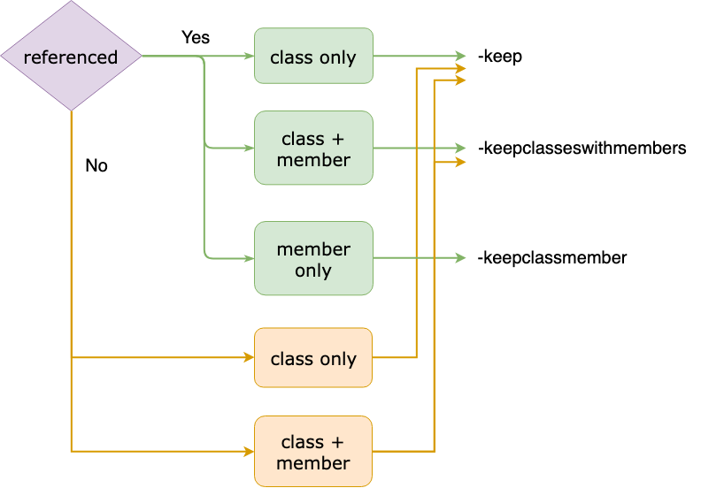

了解ProGuard運作後，接著就是要實際應用。以下是歷經分析和調整專案ProGuard設定的過程中，得到的ㄧ些使用ProGuard設定的概念、歸納，和一些相關探討。

Keep規則的介紹和使用方式，可以查看Android分類中的ProGuard章節，或是直接看[官方文件](https://www.guardsquare.com/en/products/proguard/manual/usage)。

### Concept

#### Keep rule is reference

在使用ProGuard的過程中，會遇過符合keep規則的類別，在程式執行階段都沒有被使用，到最後依然會留下來。但keep只是指定不要被改名，所以沒被使用應是會被刪除。

原因很簡單：**keep設定也算是一種引用**。如果透過`-whyareyoukeeping`來讓ProGuard告訴你被keep的原因，會得到如下提示：

```java
is kept by a directive in the configuration.
```

所以如果是使用第三方library，在使用keep時要注意，是否會在無意間留住library內沒設定keep的類別，卻在你這邊keep住了。

這邊提供另外兩個較為直覺的作法，可以避免此類狀況：

* 加上`allowshrinking`。可以給予被刪除的彈性。
* 使用`-keepnames`。任何keep設定加上`names`，都等於加上`allowshrinking`。

#### Multiple layer extension

當keep住一個有繼承其他類別的子類時，可以發現其父類也會被keep，並且一路向上整串都被keep。當這種情況發生時，根據實作方式不同可以透過`-whyareyoukeeping`看到以下兩種訊息。

- 子類實作沒有參數，如預設的constructor，或沒有任何constructor時是：

```java
is invoked by
```

這是因為預設的constructor會呼叫父類的constructor。

- 子類實作有參數的constructor時是：

```java
is extended by
```

#### Method reference is entendable

前面都是從類別的層級出發，至於函示呢？依照通用的邏輯，即使類別最後沒被刪除，函示在沒使用到的狀況下，也依舊會被刪除。

但繼承Library class的類別則不同，假設現在有個繼承View的類別：

```Java
public class CustomView extends View {
    public CustomView(Context context) {
        super(context);
    }

    @Override
    public void scrollBy(int x, int y) {
        super.scrollBy(x, y);
    }
}
```

如果此類別沒被刪除，則所有覆寫View的函式都會被留下，而且不會被改名：

```Java
// In mapping.txt
com.example.CustomView -> com.example.CustomView:
    void scrollBy(int,int) -> scrollBy
```

這是因為library class不會被ProGuard處理，所以繼承的類別如果被留下，其中的函式會遵循和library class相同的規則。

### Keep Stretage

說了這麼多，依照目前所得的結果，可以歸納出以下簡易的規則，來判斷當前的類別或函示是否會被刪除或改名。如果程式執行階段會直接引用到的，就只要看Ofuscate的部分。

#### Class

|           | keep            | No keep                                 |
| --------- | :-------------- | --------------------------------------- |
| Shrink    | X，keep算是引用 | △，沒子類會；有子類，則子類有keep就不會 |
| Obfuscate | X               | O                                       |

#### Method

如果類別被留下，符合keep規則的函示，則一樣不能被刪和改名。

如果沒有被keep，則分成program class和library class：

|           | Program class | Library class (no @Override) | Library class (with  @Override) |
| --------- | ------------- | ---------------------------- | ------------------------------- |
| Shrink    | O             | O                            | X                               |
| Obfuscate | O             | O                            | X                               |

### Refinement Strategy

如果是想要調整現有的規則，卻又擔心是否會搞壞原本的設定，可以先將keep規則換成`-whyareyoukeeping`，再加上`-printconfiduration`來觀察被keep的原因。

以下是個範例：

```Java
com.example.background.Blur
    is invoked by com.example.background.SelectImageActivity: void onCreate
    implements    android.app.Activity: void onCreate
    is a library method.
```

這表示Blur被keep的原因是：

* Blur在SelectImageActivity有被引用。
* SelectImageActivity會因aapt_rule.txt的規則keep住。
* Activity是library class，所以`Activity.onCreate()`不會被處理。依照前面提到的觀念，這代表`SelectImageActivity.onCreate()`也不會被處理。

結果就是，即使Blur被宣告後沒使用，也會因為引用它的SelectImageActivity有被keep，且繼承了library class而被留下。

除了以上狀況，還有以下幾種可能的訊息：

* **is kept by a directive in the configuration.**
* **is a library class.**
* **is a library field.**

不管是上面哪種，解讀方式都一樣。**在原先的`-keep`已經被`-whyareyoukeeping`取代的狀況下，這些訊息依然出現，代表被keep是由其他原因導致；當前規則是多餘的，可直接移除。**

如果出現的是以下訊息：

* **is not been kept.**

那需要回頭看程式邏輯，確認原本keep的內容是否真的需要。

如果是沒有任何訊息，代表本身就是多餘的，程式執行階段根本沒用到，或是屬於映射等非直接引用的方式；相同的這需要回頭看程式邏輯確認。

#### Decision tree

除了`-keep`，ProGuard還有提供功能類似但功能不太一樣的兩種keep。

* `-keepwithmember <class name> { <members name> }`：如果指定的類別有在Shrink階段被留下，則會留下指定的member。
* `-keepclasseswithmembers <class name> { <members name> }`：效果等同`-keep`，不同的是其需要類別和member都符合才會有作用。

綜觀三種，以下提供一個簡單的決策樹，可以更快的決定要使用哪種：



首先要判斷是否在程式中有直接引用，這裡指的是reference，而不是Reflection的引用：

* 是：單純再決定需要保留的範圍。
* 否：理應會在Shrink階段後被刪除，除非用了`-keep`，因為根據前面介紹，`-keep`也算是一種引用。而另一個`-keepclasseswithmembers`需滿足條件時才等同`-keep`；可把其看成`-keep`加上`-keepclassmember`。

依照Keep規則的設計不同，也可能不同類型keep最後結果相同。建議同時參考[官方文件](https://www.guardsquare.com/en/products/proguard/manual/usage)來寫出最簡潔的規則。

