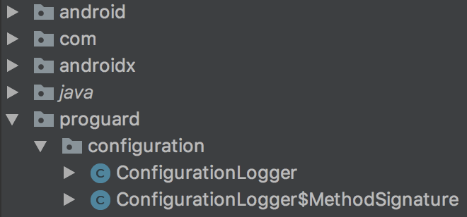
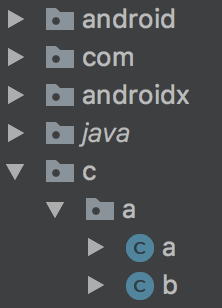
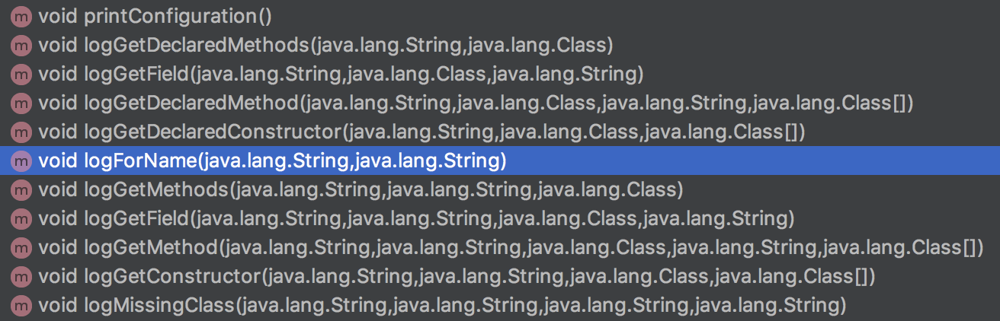

在[ProGuard manual](https://www.guardsquare.com/en/products/proguard/manual/usage)中，有個有趣的設定：`-addconfigurationdebugging`。這設定雖然不算新，但也很少看到其在專案中實際被應用。

`-addconfigurationdebugging`是ProGuard專用於debug的功能之一，官方介紹如下：

```
Specifies to instrument the processed code with debugging statements that print out suggestions for missing ProGuard configuration. This can be very useful to get practical hints at runtime, if your processed code crashes because it still lacks some configuration for reflection.
```

簡單來說就是，他在程式執行到一半crash時，如果是ProGuard處理後可能會造成的錯誤，ProGuard會給予提示，請你在ProGuard中增加相對的設定。

假設現在有一段程式碼如下：

```Java
try {
    Class c = Class.forName("com.exmaple.NoneExistClass");
} catch (ClassNotFoundException e) {
    e.printStackTrace();
}
```

在我的測試專案中並沒有`com.example.NoneExistClass`這個類別，所以在執行時這一段必然會出錯，然候丟出ClassNotFoundExeception的錯誤。

此時，不論有沒有透過ProGuard處理，在Logcat上看到的應該只有`printStackTrace()`印出的stacktrace。但有加入`-addconfigurationdebugging`在ProGuard設定中的話。此時會多了以下內容：

```java
W/ProGuard: The class 'com.example.SampleActivity' is calling Class.forName to retrieve
    the class 'com.exmaple.NoneExistClass', but the latter could not be found.
    It may have been obfuscated or shrunk.
    You should consider preserving the class with its original name,
    with a setting like:
     
    -keep class com.exmaple.NoneExistClass
     
W/System.err: java.lang.ClassNotFoundException: com.exmaple.NoneExistClass at 
	java.lang.Class.classForName(Native Method)
...
```

透過提示訊息，我們就可以知道該加入什麼設定，而不用在不知所謂的錯誤訊息中嘗試找到正確規則。

不過這邊可以注意的不只是ProGuard給的提示，還有這提示訊息出現的位置，是在`printStackTrace()`之前。而在使用breakpoint測試後也證實，這提示訊息是在`Class.forName()`執行後印出。

換句話說，就是此提示訊息憑空出現在`Class.forName()`和`printStackTrace()`之間，而從程式碼看不出中間有任何會額外輸出提示的片段。所以可以直接猜測，是ProGuard在處理時做了一些動作。

### Code injection

既然是程式執行時的輸出，代表程式碼可能有被更動過，所以直接透過Android Studio來查看APK內容：



看來前面的猜想沒錯，ProGuard主動塞了一些類別進入專案中，畢竟我們不會特別去寫`proguard`相關的類別。

接著就是看被塞到哪裡，Android Studio正好提供了一個功能，讓我們可以查看任何一個函式的bytecode，於是來看一下範例程式碼的bytecode：

```Java
.method private static synthetic a(Landroid/view/View;)V
    .registers 3

    .line 78
    :try_start_0
    const-string p0, "com.exmaple.NoneExistClass"
    :try_end_2
    .catch Ljava/lang/ClassNotFoundException; {:try_start_0 .. :try_end_2} :catch_d

    :try_start_2
    invoke-static {p0}, Ljava/lang/Class;->forName(Ljava/lang/String;)Ljava/lang/Class;
    :try_end_5
    .catch Ljava/lang/ClassNotFoundException; {:try_start_2 .. :try_end_5} :catch_6

    .line 81
    goto :goto_11

    .line 78
    :catch_6
    move-exception v0

    :try_start_7
    const-string v1, "com.example.SelectImageActivity"

    invoke-static {v1, p0}, Lc/a/a;->a(Ljava/lang/String;Ljava/lang/String;)V

    throw v0
    :try_end_d
    .catch Ljava/lang/ClassNotFoundException; {:try_start_7 .. :try_end_d} :catch_d

    .line 79
    :catch_d
    move-exception p0

    .line 80
    invoke-virtual {p0}, Ljava/lang/ClassNotFoundException;->printStackTrace()V

    .line 86
    :goto_11
    return-void
.end method
```

乍看之下會讓人摸不著頭緒，所以再來看一下沒有設定`-addconfigurationdebugging`時的bytecode：

```Java
.method private static synthetic a(Landroid/view/View;)V
    .registers 1

    .line 78
    :try_start_0
    const-string p0, "com.exmaple.bb"

    invoke-static {p0}, Ljava/lang/Class;->forName(Ljava/lang/String;)Ljava/lang/Class;
    :try_end_5
    .catch Ljava/lang/ClassNotFoundException; {:try_start_0 .. :try_end_5} :catch_6

    .line 81
    goto :goto_a

    .line 79
    :catch_6
    move-exception p0

    .line 80
    invoke-virtual {p0}, Ljava/lang/ClassNotFoundException;->printStackTrace()V

    .line 86
    :goto_a
    return-void
.end method
```

此時差異就很明顯了，前面幾段都是屬於範例程式碼，多的就是ProGuard塞進來的。**對照後可以看到呼叫`printStackTrace()`的片段都是擺在最後，這也解釋了為什麼提示訊息印出的位置會在錯誤訊息前**。

### Go into deeper

既然都找到ProGuard注入的片段，就來看看是被放入什麼。首先，讓我們聚焦以下由前面bytecode取出的片段：

```Java
invoke-static {v1, p0}, Lc/a/a;->a(Ljava/lang/String;Ljava/lang/String;)V
```

這一段意思是：執行一個接受兩個String為參數，並不帶回傳值的靜態函示。此函式位在`c/a/a`這類別中。於是我們將前面圖片內的名稱轉回ProGuard後的名稱，並找到它的位置：



然後查看裡面的內容，並再轉回ProGuard前的名稱：



這樣我們就順利找到對應的函示：`logForName()`：

```Java
// In ConfigurationLogger
public static void logForName(String callingClassName, String missingClassName) {
    logMissingClass(callingClassName, "Class", "forName", missingClassName);
}

public static void logMissingClass(String callingClassName, String invokedClassName,
                                  String invokedMethodName, String missingClassName) {
    if (!LOG_ONCE || !missingClasses.contains(missingClassName)) {
        missingClasses.add(missingClassName);
        log("The class '" + originalClassName(callingClassName) + "' is calling " + invokedClassName + "." + invokedMethodName + " to retrieve\n" + 
            "the class '" + missingClassName + "', but the latter could not be found.\n" +
            "It may have been obfuscated or shrunk.\n" +
            "You should consider preserving the class with its original name,\n" +
            "with a setting like:\n" +
            EMPTY_LINE +
            keepClassRule(missingClassName) + "\n" +
            EMPTY_LINE);
    }
}
```

### What's more

除了ClassNotFoundException，ProGuard也會在有開啟`-addconfigurationdebugging`時，針對以下幾種錯誤額外注入程式：

```Java
// In ConfigurationLoggingInstructionSequenceConstants
String NAME_CLASS_NOT_FOUND_EXCEPTION = "java/lang/ClassNotFoundException";
String NAME_NO_SUCH_FIELD_EXCEPTION   = "java/lang/NoSuchFieldException";
String NAME_NO_SUCH_METHOD_EXCEPTION  = "java/lang/NoSuchMethodException";
String NAME_RUNTIME_EXCEPTION         = "java/lang/RuntimeException";
String NAME_UNSATISFIED_LINK_ERROR    = "java/lang/UnsatisfiedLinkError";
String NAME_IO_EXCEPTION              = "java/io/IOException";
```

