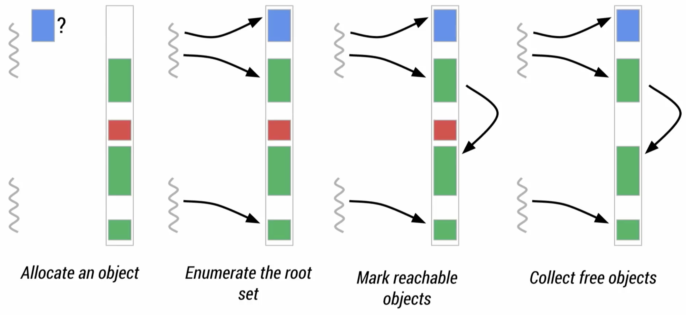
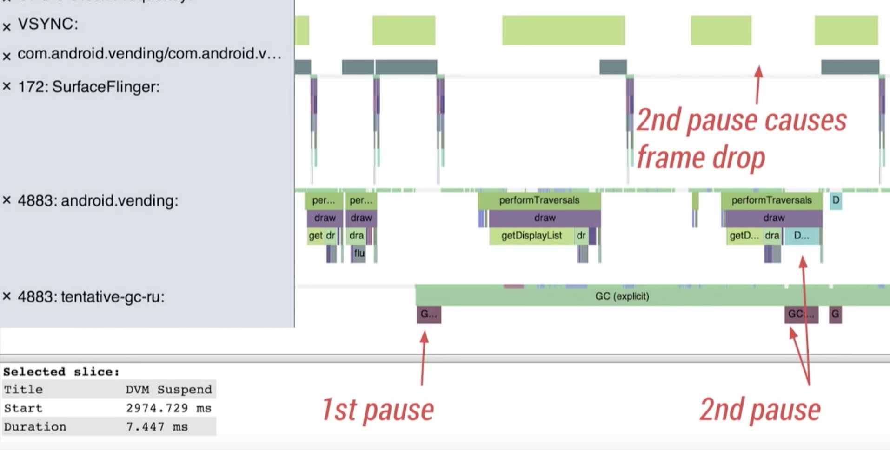
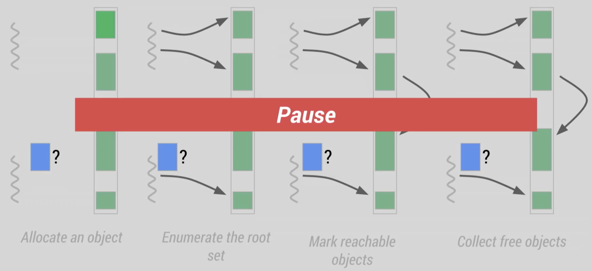
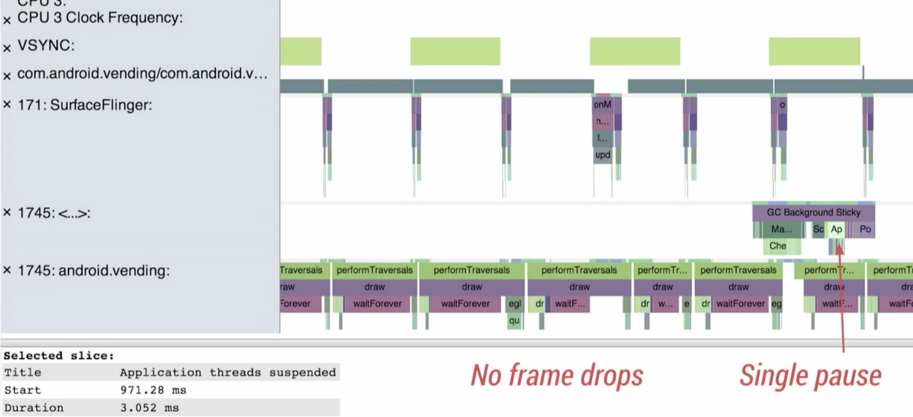
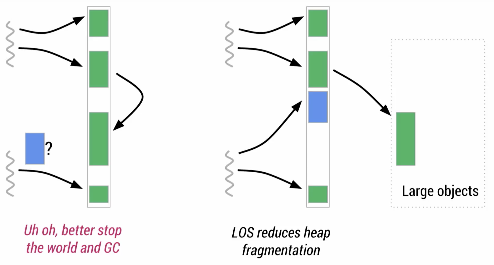
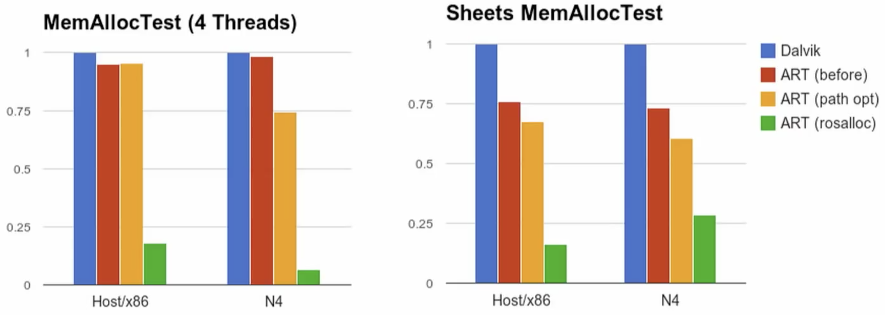
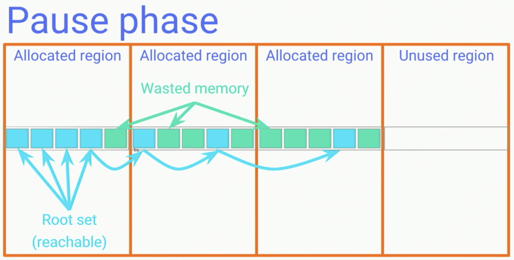
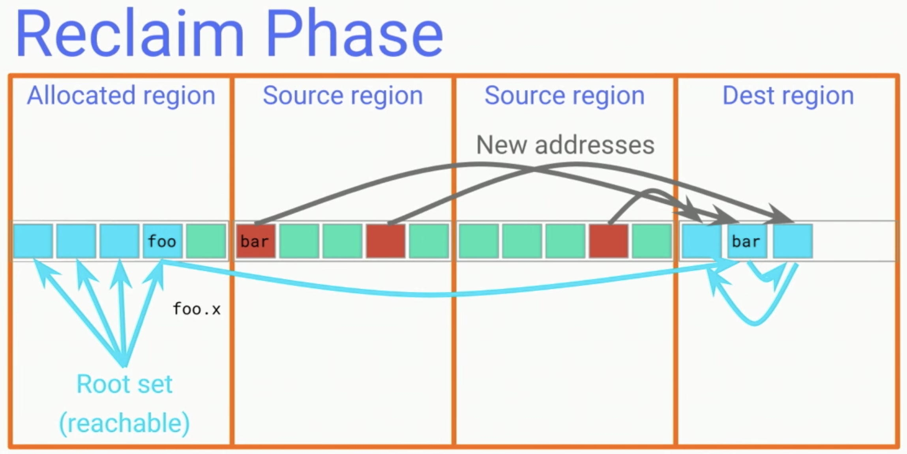
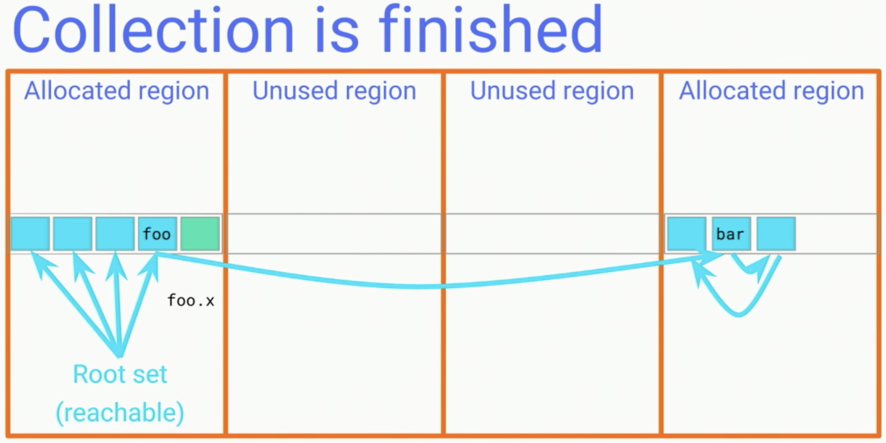

***已經看過《Year End Report - GC - Give me space! (Java)》的讀者，可將此篇當成續篇來看；還未看過的讀者，建議可先看完前篇，再接續此篇的內容。***

>  *目前更新到2008 - 2018年，以下圖片來自不同年份的Google IO或Android Dev Summit。*

前面我們提到ART compiler的演進，接著我們來看從Dalvik到ART，Google做了哪些調整。不過帶出ART GC之前，必須先提Dalvik GC。

### Dalvik GC

#### The GC flow

圖中是Dalvik GC的標準運作流程：

- 產生物件並放入。
- 建立初始標記。
- 從初始標記延伸標記其他物件。
- 刪除未使用的物件。

在這幾個步驟內，會強制停止所有thread的步驟是與標記有關的階段，以下圖為例：

- 第一個pause：在標記初始階段，需要找出所有使用中的物件，以此來建立標記的基準。因此得強制lock所有thread，避免查詢過程中，又有狀態改變的情況。標記完後lock會打開，GC會與程式同時運行，並由前面建立的標記為起點，繼續延伸做標記。
- 第二個pause：透過前面步驟，所有使用中的物件已被標記，但還是需要做一次確認，確保沒有已標記物件的狀態在這過程中又被改變，所以又再次lock所有thread。確認完後進入刪除的階段，此階段與使用中的物件無關，因此可以與程式並行處理。

一般來說，[VSYNC](https://source.android.com/devices/graphics/implement-vsync)會伴隨畫面繪製(深綠色區塊)，但因為GC會lock所有thread，所以看到在第二次pause時，繪製無法順利執行，就產生掉frame的狀況。

#### GCs back to back

Dalvik GC為了有效使用記憶體空間，會彈性的逐步增加記憶體可佔用的空間範圍，直到系統預設的最大值。這些設定存於system內的build.prop，設定的前綴是dalvik.vm。

但這無法避免記憶體過度零散(heap fragmentation)的問題，原因如下：

* **物件佔用記憶體後，就會一直在固定位置；所以歷經GC後，物件之間會有些許未使用片段。**

這使得記憶體屆滿的情況下，大型物件就容易找不到適合的位置放置，就會不斷觸發清除的動作，也就是前面提過先標記後刪除的過程。在畫面呈現上，就會產生長時間的停頓：

到此，我們總結Dlavik GC面臨的幾個問題：

- 每次pause都會lock所有thread。
- 物件存放後不會再移動，產生記憶體過度零散的狀況。
- 大型物件在記憶體零散或吃緊時，會不斷觸發GC，造成長時間延遲。

接著來看ART GC如何來解決這樣的情況。

### [ART GC](https://source.android.com/devices/tech/dalvik/gc-debug#art_gc_overview)

- 第一個pause：ART GC轉由Application自行標記物件，就不需要lock所有thread，省去pause並達到與原本Dalvik GC第一個pause相同的效果。且就官方說法此步驟非常短暫，Application執行完馬上就會繼續其他工作，不會造成有感的延遲。接著會和Dalvik一樣進行延伸標記。
- 第二個pause：原本在Dalvik GC，這邊需要處理已標記物件的狀態又改變的狀況，但ART將此工作移到pause之前，此方法稱作[Concurrent Card Precleaning](https://plumbr.io/handbook/garbage-collection-algorithms-implementations/concurrent-mark-and-sweep)，所以這邊pause時間長度也降低許多。

#### GCs back to back

ART使用LOS(Large Object Heap)，從記憶體切出一個獨立的區塊，只存放大物件，避免大物件不斷的觸發GC。而餘下的記憶體區塊中存放小物件，就可以有效避免記憶體過度零散。

一般來說，大物件會是圖片(bitmap)，此類並不會引用到其他物件的物件。所以可以合理將其分開存放：

### What's more

以上提到的改變，已經從根本上解決Dalvik GC的問題。但Google在ART引入了自訂的allocator和不同類型的GC，更加的極大化ART GC所帶來的效益。

#### Allocator

近年內，Google不斷對allocator進行調整，依照順序介紹如下：

##### Rosalloc (2014 - 2017)

基於Doug Lea的[allocator](http://g.oswego.edu/dl/html/malloc.html)(dlmalloc)，Google自己作了一個allocator，來更有效的分配記憶體。簡單來說，Rosalloc會各別劃分大小物件所能使用的記憶體區塊：小物件在thread local，又稱Thread-Local Allocation Buffers（TLABs），大物件則在共用的區塊內。

##### Thread-Local Allocation Buffers (2014 - present) 

在初始化時，thread會直接被分配各自的記憶體，由於其他thread沒辦法使用，所以不用lock也可以直接存取。而前面提到的大物件則是各自有自己的lock。這兩者搭配起來就能進行同步分配的操作，提升整理效率。

##### Bump-the-pointer allocator (2017 - present)

Rosalloc的資料結構是[free-list](https://en.wikipedia.org/wiki/Free_list)，特色是在宣告或是刪除記憶體時很快，缺點是每個區塊的大小是固定的，如果物件的大小不符，則可能會需要較多的搜尋成本。可以預期的，list的結構多少依然會使得記憶體零散。

Google在2017年使用Bump-the-pointer取代free-list，原因以下兩點，皆出自[Oracle文檔](https://www.oracle.com/technetwork/java/javase/memorymanagement-whitepaper-150215.pdf)：

- Bump-the-pointer只紀錄未被佔用的記憶體區塊的頭尾，這建立在記憶體零散程度很低的前提上。在2017年導入的Concurrent GC，在程式執行過程中就集中記憶體，完成這個前提。
- Bump-the-pointer面臨的問題是無法被使用在多執行緒上，但可以搭配TLABs解決，這TLABs已經有實作在Rosalloc，因此可以順利轉換。

#### Multiple types of GC

除了改變GC的行為外，Google也在ART引入各種不同的GC，依照功能分成Non-moving GC和Moving GC：

##### Non-moving GC

此種GC還可以細分成以下三種類型，並有各自負責的範圍：

- **Concurrent mark sweep**：簡稱CMS，負責所有記憶體區塊，包含Zygote和Application的記憶體區塊。
- **Concurrent partial mark sweep**：負責Application的記憶體區塊。
- **Concurrent sticky mark sweep**：負責前一次沒有被GC的記憶體區塊。

實務上，Google刻意讓Sticky GC執行的頻率高於Partial GC和CMS，因為根據[generational hypothesis](http://www.memorymanagement.org/glossary/g.html#term-generational-hypothesis)，越新佔用的的記憶體，越有可能在下一次GC時回收。而在官方實測後，的確如預期得到更高的效率，但效果不打折。

##### Moving GC

用於集中記憶體區塊，降低記憶體區塊零散的問題，同時代表原本零散區塊間的記憶體可以被有效利用。不過直接移動記憶體區塊，勢必會影響Application的效率。所以依照是否與程式同步又可細分成Concurrent和Non-Concurrent。

###### Concurrent

- **Concurrent copy**

  2017年加入，與其他Moving GC一樣是搬移記憶體，分成幾個步驟如下：

  **Pause phase**

  如同其他Moving GC，一開始會先將所有thread停住([Stop the world](https://en.wikipedia.org/wiki/Tracing_garbage_collection#Stop-the-world_vs._incremental_vs._concurrent))，進行標記的動作，並將記憶體依照一定的大小，做區塊的切分，並分成allocated region和unused region。

  **Coping & reclaim phase**

  
  切分區塊後，接著決定需要調動的region，這邊選用中間兩個當成source region，在[talk](https://youtu.be/iFE2Utbv1Oo?t=409)內是說因為他們零散程度大於20%。

  Concurrent GC會搬移裡面的記憶體到新的region，然後重新進行指標的連結：例如bar的位置被搬移了，所以foo.x將從原本在source region的位置，改為指向dest region內的bar。

  與其他Moving GC不同的是：因為是與程式執行過程同步，所以在此過程中會攔截讀取的動作，並同時完成搬移和指標轉移。

  結束這環節之後，就不會有任何指標會指向source region，就可以將此段記憶體回收。

  

###### Nonconcurrent

- **Semi space**：劃出新的記憶體空間，直接將要集中的記憶體區塊搬過去。
- **[Mark Compact](https://en.wikipedia.org/wiki/Mark-compact_algorithm)**：直接在原地將記憶體區塊集中。

非同步的Moving GC會盡量在不影響使用者的狀況下執行，官方說明是有各種方式判定執行時機，舉例如下：

- Zygote啟動時。
- Application進入背景時。

