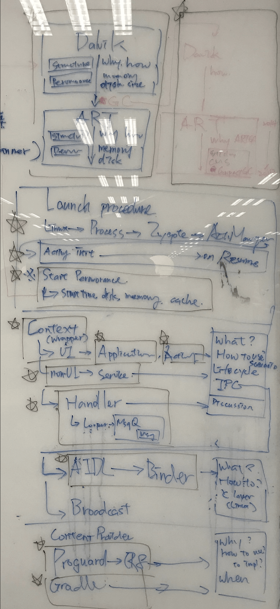

去年12月中，我開始一個中長期計畫：**每週寫一篇文章**，題目沒有限制，單純是將曾經花時間研究的題目做個紀錄。執行後才發現，針對一個議題撰寫一篇文章，尤其是與實作原理有關的，會是非常耗時的事情。由於只能在下班以後動工，一篇文章總是要過一兩週才可以生成。

截至目前為止，總共完成35篇文章（扣掉篇幅太短不應是完整的文章），以一年52週來看，也有完成了67%，自認勉強到達及格邊緣。

另外，因為碰巧看了[ProGuard](https://www.guardsquare.com/en/products/proguard)這類較為特殊的題目，並實際運用在公司的專案內，讓我順利達成另一個目標：**一場正式的分享**。原本目標只是想在公司內做個內部分享，但有幸在主管的幫助下，趕上南台灣的[MOPCON](mopcon.org/2018)，成為其中的一個session的[講者](mopcon.org/2018/speaker.php?id=28)，有興趣歡迎看看[影片](https://www.youtube.com/watch?v=W6s0O3gpahY&list=PL0ny0trU2gnBgBXeh3HCou7k3UAWB3huW)。

這是一場很有趣的體驗，不論是題目挑選、預演、和中間準備的過程，無不感受到資深前輩們在台上一小時的演講，背後蘊含數月甚至數年的累積，才能將複雜的原理，簡述成一個概念。

>  ProGuard也是我這年寫過最長的一個系列文，因為寫的過程中不斷遇到新的問題，也就有延伸的題目。整整耗了我兩個多月才完成。內容涵蓋所有我認為如要深入探究ProGuard的世界，必須要先理解的概念。

一年下來，我並沒特別去確認我的進度，也沒特別的要完成這些目標。因為任何事情，尤其是有意義的事情，越需要時間打磨。我並沒有因為這些目標而失去生活，我將生活融入到這些目標中：**目標即是生活**。

我想我不需要感謝未婚妻給我時間完成這些目標，因為即使我心中有100件事要完成，我依然將她的事情擺在所有任務之前。因為我始終相信：

> 事業只是一時，伴侶是一輩子。只有伴侶的扶持，事業才能走一輩子。

因此，接下來要打開的一個序列文，我命名為**《Year End Report》**，來當成對我自己，同時也是對她的一個交代：**這一年，我們有好好地走過**。

當然對於讀者來說，這是一篇幾乎全新的內容，會這樣說是因為我想寫的內容，有些在之前已經涵蓋過了。但畢竟時空不同，所以會將舊的文章稍作修改，並直接引用。

### Content

本次的內容，先讓我們來看一張圖：

這些涵蓋了不只是今年所研究過的問題，同時也是與團隊討論後，認為身為一個Android開發者，所需要理解的部分。不過Android發展已經10年，很多部分涵蓋的廣度已經不是單篇文章就可講完。因此我將退一步，僅講述每個部分的基礎概念，這也是我對此系列的定位，如有其他深入的題目，我會將其獨立成一篇文章。

簡化後我總共定下了9個題目，依照題目大小可能會不止一篇，像是系列文內的子系列。簡化後的內容將比起系列文更偏向於結論，雖然可能會因此無法理解其中原因，但可以抓到整體概念。

所以9個題目如下：

* ART - From Dalvik to ART
* GC - Give me space!
* Launch Process - That's how everything start
* Activity Init - Bring them to the world
* Context - Application, Activity, and Service
* IPC - Binder, AIDL, and Broadcast
* Handler - Can you do that for me?
* ProGuard - Hey, hands off!
* Gradle - Just click "Start"