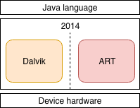
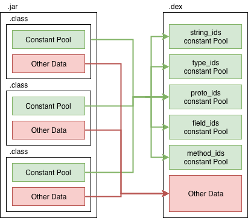
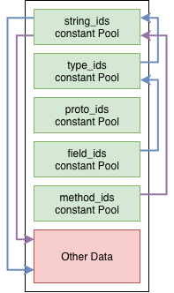
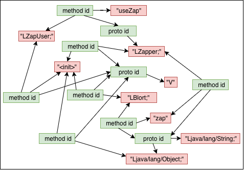
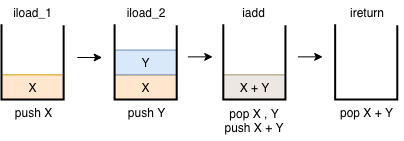
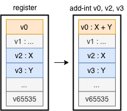
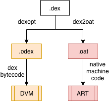

***如果已經看過《About ART - Part 1 - Compilation》的讀者，可將此篇當成前傳來看；還未看過的讀者，可以先看完此篇，再接續前篇的內容。***

> *以下圖片部分出自Google I/O 2008，由於年代久遠而重新繪製。*

Android Runtime，屬於[Android架構](https://developer.android.com/guide/platform/)的中間層，負責將上層的程式內容轉成可由底層執行的native machine code。在Google推出Android初期，這部分是由Dalvik負責，並在2014年改由ART取代：



### Dalvik

什麼是Dalvik？Dalvik是Google自行研發的一個VM，用來代替JVM的位置。在Application編譯的過程中，透過[dx]([register-based architecture](https://en.wikipedia.org/wiki/Register_machine) )將Java bytecode轉成Dalvik bytecode，再交給Dalvik VM，也稱作DVM。

所以，雖然用Java開發，但Android並不執行Java bytecode；而是Dalvik bytecode。

#### Why Dalvik

在Android問世的2008年，手機的硬體不論是硬碟或是記憶體容量都非常吃緊，CPU的效能也不如現在。這樣的規格將不足以應付JVM執行，因此Dalvik為此而生。

Dalvik的主要由兩個方向來分別解決上述問題：檔案結構和指令。

##### 檔案架構



相較於class檔彼此的constant pool相互獨立，dex檔是將其依照類型集中在不同的區塊內。[Constant pool](https://docs.oracle.com/javase/specs/jvms/se7/html/jvms-4.html#jvms-4.4)是class檔案結構中最重要的部分，用於提供Java bytecode執行時所需要的參數。

不同的區塊彼此間的連結是前後跳躍的。例如method_id連到string_id，而string_id連到data來取得函示名稱；field_id連到type_id，再由string_id到data內取得field的類別名稱：



綜合以上，可知在constant pool分類集中的情況下，多個method_id可能會連結到相同的field_id、proto_id。因此多個函式的連結關係圖就會如下：



簡單來說，dex檔就像數個class檔的壓縮檔，減少了許多空間需求，也就解決容量的問題。更詳細的dex檔案結構可以直接參照[官方文件](https://source.android.com/devices/tech/dalvik/dex-format#header-item)。

##### VM架構

###### Java VM

JVM是[Stack machine](https://en.wikipedia.org/wiki/Stack_machine)，也就是需要在stack上進行數值的運算。

這裡用一個簡單的加法運算解釋：

```Java
private int add(int x, int y) {
    return x + y;
}	
```

編譯後的Java bytecode為：

```Java
private int add(int, int);
    Code:
       0: iload_1       
       1: iload_2       
       2: iadd          
       3: ireturn  
```

對照[Java bytecode指令表](https://en.wikipedia.org/wiki/Java_bytecode_instruction_listings)，以上步驟在stack上的操作如下：



可以看到在進行資料運算時，一定會需要使用push和pop來操作stack。

###### Dalvik VM 

DVM是[Register machine](https://en.wikipedia.org/wiki/Register_machine)，也就是不需要stack，資料放在CPU暫存器，操作時直接透過位址存取暫存器的內容。

針對同一段程式碼，來看轉換成Dalvik bytecode會是如何：

```java
[000108] com.ansgar.playgroundk.basic.ten.AddSample.add:(II)I
0000: add-int v0, v2, v3
0002: return v0
```

對照[Dalvik bytecode](https://source.android.com/devices/tech/dalvik/dalvik-bytecode)指令表，以上步驟在暫存器上的操作則如下：



直接透過資料位址存取，就不需要PUSH和POP，相同的程式碼所需要的指令行數就減少許多。於是，Dalvik可以有較高的執行效率。

使用這樣的架構也提升Dalvik優化的空間，舉例來說：重複性高且結果固定的操作，則可將暫存結果，就不用重複運算。其實還有其他原因，如有興趣可以看這篇報導的[ANDROID’S ANSWER](https://www.electronicdesign.com/embedded/operating-environments-emerge-mobile-devices-multiply)的段落。

### Dalvik to ART

Google用ART取代Dalvik的原因，在Google I/O 2014的一個[session](https://www.youtube.com/watch?v=EBlTzQsUoOw)的開頭有特別解釋。簡單來說，就是Dalvik是一個時代下的產物，而在硬體飛速成長的現下，它已經完成其階段性任務。

不過Android發行已久，很多不同版本的設備仍在流通，因此ART也設計成持續接收Dalvik bytecode，只是執行階段並不是以Dalvik bytecode為主，而是native machine code：



### Summery

更多與ART相關的問題，像是Google是為何要用ART取代Dalvik、有什麼轉變，以及帶來的效益，都可以在**《About ART - Part 1 - Compilation》**得到解答。

以上就是Android Runtime相關的介紹，接著要來談談Garbage collection：

* **《Year End Report - GC - Give me space! (Dalvik)》**

### Reference

- [Google I/O 2008 - Dalvik Virtual Machine Internals](https://www.youtube.com/watch?v=ptjedOZEXPM)
- [Presentation-Of-Dalvik-VM-Internals](https://neo.dmcs.pl/podyplomowe_smtm/smob3/Presentation-Of-Dalvik-VM-Internals.pdf)