***如果已經看過《About ART - Part 2 - Garbage Collection》的讀者，可將此篇當成前傳來看；還未看過的讀者，可以先看完此篇，再接續前篇的內容。***

> *為求閱讀順暢，以下不會深入討論詳細的設定和特例。*

眾所皆知，Android是基於Java語言開發，轉成Dalvik bytecode後在Dalvik VM(DVM)執行。就如同JVM，DVM也使用Garbage collection(GC)，來處理記憶體分配和回收的操作，開發者因此可以專注於程式的邏輯和架構設計。即使如此，開發者仍然要理解JVM或DVM如何處理記憶體，畢竟GC不是萬能，其回收的方式仍與程式的撰寫方式緊密相關。

要理解Dalvik GC，得先從Java GC開始了解。而要了解Java GC，又得先從JVM在執行時會使用的記憶體空間架構開始。

### Run-time data areas

所有的空間通稱為Run-time data areas，依照[官方文件](https://docs.oracle.com/javase/specs/jvms/se8/html/jvms-2.html#jvms-2.5)所述，可劃分成以下六類：

-   **Heap space**：存放程式執行中所分配的物件(Object)，並只能透過automatic storage management system，也就是GC來回收，當GC無法提供足夠的空間時，就會產生OutOfMemory(OOM)的錯誤。
-   **Method area**：存放能代表物件的類別(Class)，包含Run-time constant pool、靜態函示和變數名稱還有程式碼。當Method area空間不足時，就會產生OOM的錯誤。
-   **Run-time constant pool**：用於存放bytecode執行時需要的資料，就是反組譯class檔後會看到的的[Constant pool](https://docs.oracle.com/javase/specs/jvms/se8/html/jvms-4.html#jvms-4.4)。此空間屬於Method area，也就可能因Constant pool過大產生OOM的錯誤。
-   \*\*PC(Program counter)\*\*：用於記錄當前正被執行的指令的位址，如果是native的函示則不會設值。
-   \*\*JVM stacks(Java stack)\*\*：用於存放多個Frame的資料結構，並且依照設定的不同，Stack大小可以是固定或是可變動的。如果是固定的，當thread要求增加大小時會產生StackOverflow的錯誤；如果是可變動的，當記憶體不足時會產生OOM的錯誤。
-   **Native method stack**：屬於非Java語言用的stack，有和JVM一樣的限制和錯誤。

其中PC、JVM stacks和Native method stack是跟隨著thread建立而產生或是刪除；因此可將這三個歸類為**Thread**一個大項。

JVM stacks裡的[**Frame**](https://docs.oracle.com/javase/specs/jvms/se8/html/jvms-2.html#jvms-2.6)會在函式呼叫時建立；函示結束時刪除，不論是否有錯誤。其細節內容如下：

-   **Local variable**：一個陣列來存放Frame所代表的函示會用到的Local variable。
-   **Operand stack**：一個last-in-first-out(LIFO)的資料結構，用於bytecode執行時期。
-   **Dynamic reference**：用於連結到Frame所代表的函示，其所屬的class在Method area內的Run-time constant pool。
-   **Return value**：當前函示的回傳值。

#### Generation

Java GC有用到Generation Hypothesis的概念，詳細在後面介紹，因此Heap space的部分又可再區分成：

-   **Young(Nursery)\*\*：存放較為新建的物件。依照GC的設計，這區域又可分成**Eden**、**Survivor(S0, S1)。\*\*
-   \*\*Old(Tenured)\*\*：存放存活時間較長的物件。

這裡要提到一個特殊的generation：\*\*Permanent(PermGen)\*\*。其實原本並沒有這個generation，而是在JVM演進的過程中產生，詳細歷史可以看這篇[官方blog](https://blogs.oracle.com/jonthecollector/presenting-the-permanent-generation)。其在定義上存放的東西和Method area相同，因此大多都將其視為同一個區塊。

由前一段落內的官方blog內文可以知道，PermGen原本是為了效能而產生。不過因為其存放很多跟Class相關的資料，所以程式內使用的類別越多，就越容易吃光系統所分配的記憶體空間，導致OOM的錯誤。有興趣深入看此篇[blog](http://javaeesupportpatterns.blogspot.com/2011/02/outofmemoryerror-permgen-patterns-part1.html)。

於是在2014，Oracle在Java8開始，使用\*\*Metadata space(metaspace)\*\*取代PermGen，並將PermGen原本負責的內容拆分到Heap space或Native space。詳細可看此篇[官方blog](https://blogs.oracle.com/poonam/about-g1-garbage-collector,-permanent-generation-and-metaspace)。

其有以下兩個主要優點：

-   由Heap space移出到Native space中，則其最大空間則是實際的記憶體上限。但開發者仍可透過設定來進行限制。
-   Metadata space滿的時候，主動觸發GC，並決定是否提升上限。

兩個機制交互作用下，就可以有效使用空間，並解決OOM。不過如果設定了Metadata space的最大空間，就依然有機會陷入之前PermGen的問題。

#### Thread Local Allocation Buffer

對於所有在設備上運行的Thread來說，記憶體都是一樣的；給予所有Thread使用相同範圍記憶體的權限，則容易產生競爭(contention)的情形。雖然可以用Lock解決，但這無疑是降低分配空間的速度，影響的是整個程式的執行效率。

所以Thread Local Allocation Buffer(TLAB)被設計來解決此問題，Thread在Eden有自己所屬的區塊，讀寫都不需與其他Thread競爭。TLAB滿的時候，Thread會再要求新的TLAB。如果物件大於TLAB的大小，則可能直接放在Eden或是Old區塊內。

綜合以上，目前Run-time data areas可以總結如下圖：

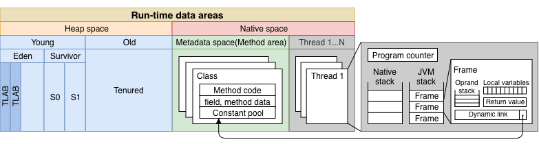

### Basic algorithm

相信大多Android開發者都經歷過C語言等[Low-level programming language](https://en.wikipedia.org/wiki/Low-level_programming_language)的時期，在那時開發者需要自行宣告記憶體，並在不需要時主動釋放。但程式邏輯有時相當複雜，釋放記憶體的時機考驗著開發者的設計能力，以及細心程度。

於是，[High-level programming language](https://en.wikipedia.org/wiki/High-level_programming_language)如Java就透過Garbage Collection(GC)，來主動幫助開發者處理未正確釋放的記憶體空間。主流的GC依照核心概念可以粗略分成[Reference counting](https://en.wikipedia.org/wiki/Reference_counting)和[Tracing](https://en.wikipedia.org/wiki/Tracing_garbage_collection)。

#### Reference counting

顧名思義，就是計算每個物件被引用的次數：

引用次數是0的物件就會被回收，所以上圖由左到右表明三種在GC後會產生的狀況：

-   **Keep**：引用數都大於1，不需要回收。
    
-   **Reclaim**：引用物件為0，可以回收；回收後會導致其引用的物件的引用次數也歸0，於是一起回收。
    
-   **Retain cycle**：物件互相引用，使得引用次數都大於0，則無法被GC判定為該回收的對象。
    

以Java來說，Retain cycle容易發生在non-static inner class或是anonymous inner class/method。一般的解法是用[WeakReference](https://docs.oracle.com/javase/7/docs/api/java/lang/ref/WeakReference.html)來告訴GC其中一個物件是可回收的對象，就可以打破這個cycle。

#### Tracing

此類型的GC會以特定物件為GC root，並由這些物件當成起點找出所有引用關係：

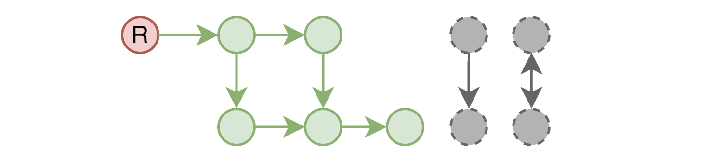

無法從GC root觸及([reachable](https://www.memorymanagement.org/glossary/r.html#reachable))到的物件將視為就會被回收，所以上圖由左到右表明二種在GC後會產生的狀況：

-   **Keep**：可以從GC root直接或間接引用，不需要回收。
-   **Reclaim & Retain cycle**：無法從GC root直接或間接引用，需要回收。

因此，只要Retain cycle內的物件沒被其他cycle外的物件引用，使用Tracing GC就可以順利回收整個Retain cycle內的物件。此類型GC最常見的就是[Mark-Sweep](https://www.memorymanagement.org/glossary/m.html#term-mark-sweep) GC。

##### Mark-Sweep

就如其名，Mark-Sweep GC有分成Mark和Sweep兩大步驟。

###### Mark

依照前面所述的內容，Tracing GC需要先決定好GC root。GC root代表是在GC啟動的當下，就可以確定是不可被回收的物件，以Java來說，通常有以下幾種GC root：

-   **Active thread**
    
-   **Local/Static variable**
    
-   **JNI reference**
    

其中JNI物件是由native code產生，從JVM角度是無法得知，直接當成不可回收。除了這些，依照實作不同可能會有不一樣的GC root，但選出來後的用途都是相同的：**作為查詢引用狀況的起點**。

另外，為了避免引用的狀態在標記過程中改變，使得標記結果與事實不符。在GC啟動後，會停住所有的thread，稱作\*\*[stop-the-world](https://en.wikipedia.org/wiki/Tracing_garbage_collection#Stop-the-world_vs._incremental_vs._concurrent)\*\*，或是GC pauce。此停頓會一直持續到整個GC結束為止，成為Mark-Sweep GC最大的缺點。

###### Sweep

此階段最基本的實作，就是清除後，GC就算是完成，沒有被清除的物件會留在原地：

由圖中可以看出，在長時間使用後，閒置區塊會越來越零散，造成\*\*[External fragmentation](https://www.memorymanagement.org/glossary/e.html#term-external-fragmentation)\*\*：

-   **閒置區塊總和大於要宣告的物件大小，但沒有一個連續的區塊足以容納。**

在這情況下，系統就會發出OutOfMemory的錯誤。

##### Moving

此可透過多一個\*\*Moving(Compact)\*\*步驟來進行修正，並有以下兩種：

-   **Copy**：同時維護兩個相同大小的空間，並在sweep階段將留下來的區塊搬移至另一空間；不論GC前後，都有一個空間是完全閒置的。這也是Copy GC的缺點：永遠會佔用兩倍的空間，且一半空間都處於閒置狀態。

-   **Compact**：則是從基本的實作再多走一步，將留下來的區塊直接往前集中：

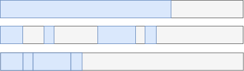

不論是什麼GC，只要有這兩種步驟之一，就也能稱為[**Moving GC**](https://www.memorymanagement.org/glossary/m.html#term-moving-garbage-collector)；反之[**Non-moving GC**](https://www.memorymanagement.org/glossary/n.html#term-non-moving-garbage-collector)。

調整記憶體位置有以下幾種好處：

-   標記成不需要的區塊不用特別處理，可直接覆蓋使用。
-   分配更快，因為不需要從零散的閒置區塊中找到可容納的區塊，只要從目前使用的區塊位置接續放入即可。
-   可在當前空間直接進行移動，避免多餘的空間消耗。
-   Mark階段產生的引用路徑，也會是搬移時的參考，因此彼此關聯的物件有機會被集中在同一個[memory page](https://en.wikipedia.org/wiki/Paging)內，可提升執行效率。

但也有其缺點：

-   搬移記憶體是耗時，且一樣需要stop-the-world的操作，所以勢必會拉長整個GC所需要的時間。

#### Concurrent Mark-Sweep

不論GC後是否需要移動記憶體區塊，stop-the-world都會對程式的執行產生影響。尤其是需要與使用者互動的real-time application，任何一點有感的停頓都會影響整體的使用經驗。對應的解法就是讓GC執行的步驟，調整成與程式同步進行，也就是Concurrent Mark-Sweep(CMS)。

基本的Mark-Sweep GC和thread之間執行的時間軸如下：

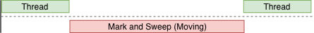

Thread執行間的空白長度，取決於GC的時間長短。根據前面的介紹，可以推測最花時間的是Mark階段。於是步驟調整如下：

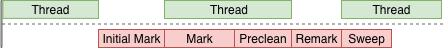

看圖可發現步驟被拆的更細，並且大多步驟都與程式並行。

-   **Initial Mark**：標記GC root直接引用的對象。
-   **Concurrent Mark**：以前一步標記的結果當起點，繼續標記引用到的物件。
-   **Concurrent Preclean**：執行的過程中可能會有新的物件產生，或引用狀態產生變化，則必須要重新從這些產生變化的區塊重啟一次標記。此步驟同時也可以降低下一步的停頓時間。
-   **Remark**：從GC root再重新走一次。由於Preclean有預先重啟標記，這邊所需要的時間就大幅降低。
-   **Sweep**：清除沒有被標記的物件。

由於CMS是針對GC pause而設計，因此**不會再執行Moving操作**。因此CMS繼承Mark-Sweep的主要缺點：

-   **記憶體區塊會在多次GC後逐漸變得零散，造成External fragmentation。**

詳細步驟說明和其他狀況探討，可以參考此[官方文件](https://docs.oracle.com/javase/8/docs/technotes/guides/vm/gctuning/cms.html)和[blog](https://blogs.oracle.com/poonam/understanding-cms-gc-logs)。

##### Mark bitmap

紀錄物件標記狀態的方式實作上有分成以下兩種：

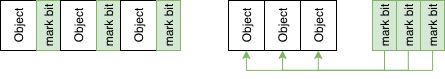

-   **Embedded**：每個物件伴隨著一個mark-bit。
-   **Separated**：使用另一個空間來儲存mark-git。

因為Mark-bit只有在GC時需要，所以Embedded將會在一定的程度上增加多餘的空間消耗，因此CMS選擇用額外的空間來存放Mark-bit，如此就可以在需要時才建立。此空間又可稱作Mark Bitmap。

##### Mark stack

不論是原本的Mark-Sweep或是CMS，都需要有個空間，來記錄已被標記，但尚未用作查詢引用的起點的物件。這空間的資料結構通常是stack，因此也稱作Mark stack。缺點是如果stack太大，反而會引發GC，則大小也必須要控制住。

一個解法是一次只放一個物件，且放入後就將其拿來作查詢，可想而知這會產生很長的GC pause，並不適合用在CMS。

##### Mark bitmap vs Mark stack

對照其存的物件，本質上都是一樣的：**被標記的物件**。因此Mark bitmap可用來接手Mark stack原本的功能，而Mark stack變成Recursive mark中用來追蹤需要進行延伸標記的物件，又稱To-be-scanned stack。

如此就可以實作出以下步驟：

-   **Initial Mark**：將GC root直接引用的物件所對應的Mark bitmap上標記。
-   **Concurrent Mark**：依照順序從Mark bitmap中取出物件，再次進行延伸的標記。

如此就可明確切割標記過程成兩部分，有效降低GC開始的GC pause。

##### Recursive Mark

標記是依照記憶體位址，由小到大來執行。同時，交互引用的物件不會依照順序存放，而是零散在記憶體中。如此在標記時，就有可能遇到新標記物件的記憶體位置，小於當前物件，如此就產生一個問題：

-   **標記結束後，某部分新標記的物件，將無法再被當成起點重新執行標記操作。**

在這樣的問題下，即使標記完成，仍有機會沒標記到一些被標記物件間接引用的物件。雖然可擴增Mark bitmap，讓其多記錄一些資訊，但這無疑會讓操作複雜化。

於是Mark stack就被賦予了新的任務：

-   **存放記憶體位置小於當前物件的新標記物件。**

假設目前有數個物件，依照記憶體位置由小到大分別是ABCDEFG，CE是標記起點：

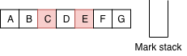

相關步驟如下：

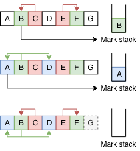

-   **Push**：標記從CE依序出發，首先從C找到B，因為B位置小於C，則將B放入Mark stack；E引用到F，其位置大於E，會在接下來的標記過程被使用到，所以不用加入Mark stack。
-   **Pop**：將B從Mark stack取出，從B開始標記，因此找到A，A因位置小於B而放入Mark stack；D與F同理則不用。

此過程會持續到Mark stack清空為止，如此就可以保證在標記階段結束時，可以標記到所有被引用到的物件。同時也因為是存放間接引用的物件，數量通常較低，於是可以降低所需的額外空間。

### Generation Hypothesis

因為Sweep之前需要先確定引用的狀況，很明顯的，如果GC要處理的區塊越大，Mark所需時間越長；stop-the-world時間會更長。那是否有辦法讓需要處理的範圍縮小？根據[Generation Hypothesis](http://www.memorymanagement.org/glossary/g.html#term-generational-hypothesis)的定義：

-   **新產生的物件有更高機會被回收。**
-   **存活越久的物件有更高機會不被回收。**

套用這理論，Heap space被切分成**Young(Eden、Survivor)\*\*和**Old(Tenured)\*\*：

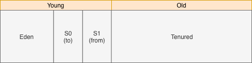

S0和S1又可稱作**from**和**to**，並在GC的過程中不斷交換身份，世代交替的完整步驟如下：

-   一開始，新物件被放在Eden，S0是to，S1是from：

-   一輪GC後，Eden內存活的物件就會被搬移(**promote**)到S0(to)。完成後，S0和S1互換角色，現在S0是from，S1是to：

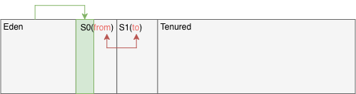

-   新的物件繼續被放在Eden：

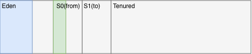

-   再一輪GC後，Eden和S0(from)內存活的物件會被放到S1(to)，然後再一次交換角色：

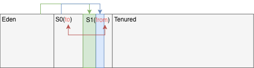

-   持續重複前面步驟，在S0和S1持續替換的過程中，會紀錄持續存活的物件所經歷過的GC次數(cycle)：

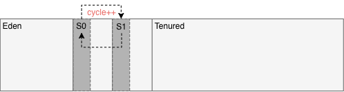

-   達到一定次數(tenuring threshold)後還存活的物件，會被搬移到Old(Tenured)，**JVM預設是15次**：

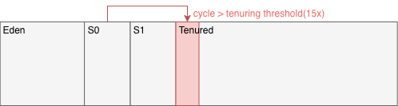

透過這樣的步驟，持續存活的物件會向Old區塊集中。相較之下，Young區塊內的物件通常很快就不再需要，就需要較頻繁的使用GC來立即清除。

有這樣的需求差異，GC可依照範圍切分成**Minor GC、Major GC**，和**Full GC**。

-   \*\*Minor GC(Mark-Copy)\*\*：針對Young區塊，會在Eden漸滿時啟動。依照前面世代交替的步驟，Minor GC至少會執行Mark和Copy的動作。Sweep不需要，因為標記的物件會被搬移到全新的空間(S0或S1)，留在原地的就是不需要的，直接覆蓋即可。
-   **Major GC(Mark-Sweep-Compact)\*\*：針對Old區塊，會在Old漸滿時啟動。Major GC會執行完整的Mark-Sweep，但因為Old物件理論上會持續更久，因此這邊還可再**執行Compact來將區塊集中\*\*，避免External fragmentation。
-   **Full GC**：針對Young和Old區塊，會在整體漸滿時啟動。Full GC會執行跟Major GC相同的操作。**如果特定Class不會再被使用時，也會清除Metadata space裡對應的物件。**

實際上，Major GC通常發生於Minor GC之後，是特別針對Old區塊執行的GC。且Major GC和Full GC並沒有明確定義，簡單分還是只有Minor GC和Full GC。不過為了分開介紹Young和Old區塊的GC，以下還是會繼續使用Major GC。

#### Cross-generation reference

帶入了世代的概念，就得要注意跨區引用，不論是Mark-Sweep或是CMS，**跨區引用都算是GC root**；所以在Mark階段除了原本定義的GC root，還要加上跨區引用。

不過，為了尋找跨區引用，在Minor GC會有效率的問題：

-   **掃過整個Old區塊是不切實際的，因為Old區塊的空間通常大很多。**

於是，[Card table](https://www.memorymanagement.org/glossary/c.html#term-card-marking)被設計來解決Minor GC遇到的效率問題。

而對Major GC來說，Young區塊通常較小，做法上可直接掃過整個Young區塊，因此Major GC會視**Young區塊都是GC root**。

#### Card table

如同Mark bitmap，Card table使用額外的空間，且每張card對應一段記憶體，基本上是512bytes。CMS將其用於Old區塊，當Old區塊物件引用Young區塊物件(Old-Young)，[Write barrier](https://www.memorymanagement.org/glossary/w.html#term-write-barrier)就會擷取此段操作，並標記Old物件對應到的card為dirty：

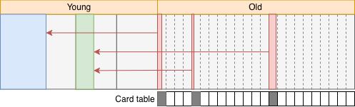

這對不同範圍GC有不同用途：

-   **Minor GC**：在Mark階段可以從Card table找到從Old區塊出發的跨區引用，不用掃過整個Old區塊。
-   **Major GC**：CMS在Concurrent Mark操作時，可以用來記錄跨區引用的變化，就可在Preclean階段預先處理，降低Remark要處理的量。

每次GC後重置Card table，如此可確保GC時都是新增的跨區引用。

##### Mod unit table

Minor GC在透過dirty card來找Old到Young的引用時，如果都沒有，會將card標成clean，避免下次Minor GC重複掃過，產生無謂的操作。但Minor GC可能與CMS的Concurrent marking同時執行，代表dirty card的狀態有機會被翻轉，也即是：**對CMS來說是dirty card，對Minor GC來說則已經不是**。

解法是讓Minor GC標記dirty card到Mod union table，然後掃描其中紀錄的dirty card。這樣當CMS走到Remark階段時，就可以依照原本的設計來繼續往下執行。且Mod union table紀錄的只有dirty card，所需要的資料結構將更小，可以不必在意其對記憶體使用效率的影響。

Java GC雖然沒有特別在文件中介紹此table，但依然可以在JDK的原始碼內找到相關的[定義](https://github.com/openjdk-mirror/jdk7u-hotspot/blob/50bdefc3afe944ca74c3093e7448d6b889cd20d1/src/share/vm/gc_implementation/concurrentMarkSweep/concurrentMarkSweepGeneration.hpp#L619)。

#### Promotion failed

依照generation切割記憶體區塊，目的是為了降低單次GC所處理的範圍，從而減少GC pause長度。但如果Full GC時常被觸發，那就失去分世代的意義，所以必須要了解Full GC啟動的原因。

首先必須要知道的是，在1.4.2，Minor GC在執行時，\*\*會預期Old區塊會有一塊連續空間([Young Generation Guarantee](https://www.oracle.com/technetwork/java/gc1-4-2-135950.html#3.2.1.%20Young%20Generation%20Guarantee|outline))\*\*，可以容納Eden加上一個Survivor：

於是，Full GC啟動時，GC log可能會看到以下兩種訊息：

-   **Promotion fail**：代表GC認為Old區塊沒有足夠的連續空間放。Promotion failed也有可能是因為External fragmentation；此時Major GC還不會啟動，但Minor GC會認為沒有足夠的連續區塊來使用。
-   **Concurrent mode failure**：CMS執行過程中執行了Minor GC，而此時的Old空間不足；表示CMS來不及清出足夠的連續空間，於是直接中斷CMS並執行Full GC。

簡言之就是當下的GC認為Old區塊無法提供所需的空間時。

除了Promotion failed，以下還有幾個其他會觸發Full GC的原因：

-   **Metadata space**：此啟動機制是與Heap space分開運作，因此也有Heap space沒滿，但Metadata space已滿的情況下觸發Full GC。
-   開發者主動呼叫\*\*`System.gc()`**，或是執行**Heap dump\*\*來抓取當前記憶體使用狀態。

根據[官方blog](https://blogs.oracle.com/jonthecollector/when-the-sum-of-the-parts)，在5.0之後，Young Generation Guarantee做了調整：

-   預期的空間為前幾次promote物件總空間的平均值，且此平均值通常遠小於Eden加上一個Survivor，於是降低Minor GC失敗的機會。依賴平均值也有可能因為前幾次promote空間較多，造成平均值偏高，超過剩餘可使用的空間，因此也具備還原到Minor GC執行前狀態的功能。
-   不再強制需要連續的空間，降低External fragmentation發生的機會。

以上就是與Generation Hypothesis相關的介紹。**雖然GC依照處理範圍分成三種，但不代表彼此之間是分開執行**。Minor GC也可以觸發Full GC，或是Major GC會與Minor GC交互運行。

### Algorithm with generation

Java現有的GC都有世代的概念，因此現有的GC在不同世代上使用不同的algorithm組合：

-   **Serial & Parallel GC**：Young和Old區塊的GC可等同於前面所述Minor GC和Major GC，不同的是使用的Thread數量。
-   **CMS GC**：CMS與Serial和Parallel GC搭配使用，所以只有Old區塊會用CMS。

### Garbage-First

Garbage-First(G1)是針對多核心，且大記憶體的設備所設計，目的是追求效率的同時，也能有較低的GC pause。

G1依然保留著世代的概念，並將Heap space切割成相同大小的**region**，數量預設是2048個，且每個region都可以是Eden、Survivor或是Old。而TLAB原本是一段連續的記憶體區塊，在G1就是以region為單位。

透過設定，region大小可在1至32MB之間，也可以指定Young region在整個Heap space內佔有的比例：

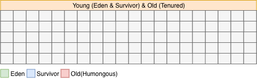

G1的GC，並沒有各自一個完整流程，而是彼此交錯。不同於CMS用generation來切分出三種範圍的GC，G1的GC粗略地分有兩個操作：**Concurrent Marking**和**Evacuation**。

-   **Evacuation**：包含標記(**Mark**)和搬移(**Copy**)，所以會stop-the-world，又稱**Evacuation pause**，並依照處理的region類型分成**Young GC**和**Mixed GC**。

由於G1和CMS一樣可以執行同步標記，且多了Copy步驟來解決CMS會有的External fragmentation。於是在Java 9之後取代CMS，詳細可看[相關文件](https://docs.oracle.com/javase/9/migrate/toc.htm#JSMIG-GUID-1F270BDA-50B0-49C8-807E-0B727CCC5169)。

各類型Evacuation和Concurrent Marking如果接連出現，順序會是Young GC、Concurrent Marking phase然後Mixed GC。

#### Young GC

與CMS的Minor GC類似，只處理Young region：

-   新物件都會被放在被選為Eden的region內；如果物件大小超過一個region，則直接放在被選為Old的region，又稱**Humongous region**：

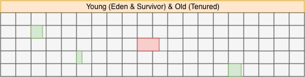

-   當Young region總大小即將達到設定好的佔比時，就會進行**Young GC**。在這期間內，G1必需要標記Young region內還存活的物件，然後搬到被選為Survivor的region；Survivor region中存活次數已達tenuring threshold的物件，則被搬入被選為Old的region：

#### Concurrent Marking phase

當Old region總大小到達一定佔比時，就會伴隨(piggybacked)Young GC一起開始Concurrent Marking的操作：

-   **Initial marking**：紀錄當下可以被GC root引用到的物件。由於這一步是與Young GC一起，於是其可以從Young GC取得引用的狀態，並與Young GC共用一段pause。
-   **Root region scan**：以Initial mark得到的Survivor當作**Root region**，並標記所有被Root region內物件直接引用到的物件。
-   **Concurrent mark**：從前面已標記的物件繼續標記有引用到的物件。
-   **Remark**：標記引用的最後一個階段，由於使用了\*\*Snapshot at the begining(SATB)\*\*，這邊只重新處理SATB紀錄的物件，於是所需要的時間就大幅降低。
-   **Cleanup**：依照region內的物件引用狀況，計算各個region的回收率並排序。有了回收率，這邊也可以先回收完全會是空的region。

##### Snapshot at the beginning

試想在CMS時代，一個物件A引用C，物件A在Initial Mark階段被紀錄，但有可能在Concurrent Mark過程中被替換，導致A到C的引用被刪除，於是物件C就這樣被誤刪了。

CMS使用Card table/Mod unit table來處理類似問題，但換成region後，就不適合使用Card table。因此G1使用[Snap at the beginning](https://www.memorymanagement.org/glossary/s.html#term-snapshot-at-the-beginning)來處理這樣的問題，主要作法如下：

-   **Take snapshot**：紀錄GC一開始，所有存活的物件，連同之後在Concurrent mark產生的新物件。
-   **Write barrier**：以snapshot為基礎，擷取寫入操作，並記錄被更改引用的物件。

透過這兩個操作，可達到以下幾個好處：

-   避免漏接。
-   不需從GC root重複做標記動作，降低Remark階段所需時間。

而缺點是：

-   **過程中失效的引用有可能是真的不需要的，而SATB會使這些引用留到下一次GC。**

#### Mixed GC

Concurrent marking後，就可以開始回收Old region。不同於CMS一次回收所有Old region，G1採用漸進式的方式，也就是啟用Young GC的同時，帶入一定數量的Old region，所以才稱作Mixed GC。

Mixed GC不一定都會跟在Concurrent Marking後面。根據前面介紹，在Concurrent Marking階段就有機會可以回收大部分的Old region，那就沒必要再將Old region帶入另一輪的GC。因此較高的機會是再一輪Young GC後才是Mixed GC。

Mixed GC會一直不斷執行，直到G1認為不再需要同時回收Old region時。

#### Collection Set

G1用Mark階段會透過Collection Set(CSet)來決定要GC的region。程式執行一開始因為物件都是新的，所以CSet只會有Young region，此時GC就是Young GC。

在Old region到達一定佔比，並觸發Concurrent Marking之後，Old region就有回收率來作為放入CSet的參考值：

-   **回收率較高的代表存活的物件少，回收效益較高，需要先被回收。**

這也是為什麼稱作(Garbage first)，而此時的GC是Mixed GC。除了回收率，加入CSet的條件還與設定值相關，詳細可以看這篇[官方文件](https://www.oracle.com/technetwork/articles/java/g1gc-1984535.html)。

#### Remembered Set

如同CMS，G1也有Card table來處理跨region的引用，並以Card table為基礎，建立了Remembered Set(RSet)。與Card table不同，RSet紀錄region間的外部引用，這表示RSet存的內容可能是Young-Young、Young-Old、Old-Old等不同世代間的引用。

使用RSet帶來的好處如下：

-   Young GC：效果類似CMS的Minor GC，但RSet可以精準的找出彼此間的引用，而不是如掃過整個Card。
-   Mixed GC：有了外部引用，就不用掃過整個Young region來找Young-Old的引用。Old-Old的引用也可以直接從RSet取得，就不用掃過整個Old region。

#### Pause prediction model

與之前的GC相同，如果Promotion failed或是Metadata space已滿，還是會觸發Full GC。因此G1透過CSet縮小要收集的region範圍，然後搭配RSet再從region內直接定位跨區引用，就可以將每次要收集的數量和時間量化。

如此就可以用Pause prediction model來預測當前CSet所需要的時間，提供開發者依照需求限制GC Pause的時間。

#### Full GC

G1觸發Full GC的條件和CMS一樣，能避免就應避免。但G1使用多次小而高效的Young GC，中間穿插幾次Mixed GC，搭配Pause prediction model可讓每次選取的CSet，帶來的GC效果都是較好的。如此就降低觸發Full GC的機會。

### Allocation

本篇介紹了很多Java用到的GC，依照是否會再移動記憶體可以分成兩種：

-   **Non-moving**：Mark-Sweep、CMS、G1。
-   **Moving**：Mark-Copy、Mark-Sweep-Compact、G1。

也因此記憶體在GC後，Non-moving會呈現不連續的區塊；反之Moving則會是連續的。這樣的記憶體區塊分佈也影響著分配空間的方式：分成Free-list和Bump-point。

#### Free-list

用於**不連續**記憶體空間，用Linked-list的方式，將所有可用的記憶體區塊串連。要分配空間時，就依照要宣告的物件大小，從list一個個找過。如果Memory fragmentation的問題太嚴重，則會拖慢分配空間的效率。

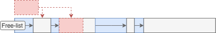

#### Bump-point

用於**連續**空間，只有紀錄最後一個插入物件的位置。分配空間時，只要看物件的位置就可推算剩餘空間，並直接將物件接在前一個物件後面。

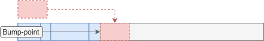

最長與Bump-point搭配使用的是**TLAB**，沒有Lock的干擾，加上簡潔的記憶體分配方式，可提高整體宣告物件的效率。只有在Thread用到多個TLAB時，要共同使用會有多餘的操作影響效率。

所以，所有GC對照以上兩種方式則如下：

-   **Serial & Parallel GC**：Eden區塊使用Free-list，Survivor區塊使用使用Bump-point。
-   **CMS**：CMS與Serial和Parallel GC搭配使用，CMS會用於Old區塊為Free-list；Young區塊如上。
-   **G1**：整體Region由Free-list管理，region內為Bump-point。

### Summery

到這就是Java GC的相關介紹，接著由於Android也已經發展一段時間，GC相關的內容較多。如果只是要概略知道GC的發展過程，可以直接看：

-   **《About ART - Part 2 - Garbage Collection》**

如果想從細節開始了解，則可以往下繼續看到GC系列的第二篇：

-   **《Year End Report - GC - Give me space! (Dalvik)》**

### References

-   [A Generational Mostly-concurrent Garbage Collector](http://citeseerx.ist.psu.edu/viewdoc/download?doi=10.1.1.30.3953&rep=rep1&type=pdf)
-   [Garbage-First Garbage Collection](http://citeseerx.ist.psu.edu/viewdoc/download?doi=10.1.1.63.6386&rep=rep1&type=pdf)
-   [Java HotSpot Garbage Collection](https://www.oracle.com/technetwork/java/javase/tech/index-jsp-140228.html)
-   [Java Platform, Standard Edition HotSpot Virtual Machine Garbage Collection Tuning Guide](https://docs.oracle.com/en/java/javase/11/gctuning/index.html)
-   [Changes to Garbage Collection](https://docs.oracle.com/javase/9/migrate/toc.htm#JSMIG-GUID-1F270BDA-50B0-49C8-807E-0B727CCC5169)
-   [Java Garbage Collection Basics](https://www.oracle.com/webfolder/technetwork/tutorials/obe/java/gc01/index.html)
-   [Understanding G1 GC Logs](https://blogs.oracle.com/poonam/understanding-g1-gc-logs)
-   [Minor GC vs Major GC vs Full GC](https://plumbr.io/blog/garbage-collection/minor-gc-vs-major-gc-vs-full-gc)
