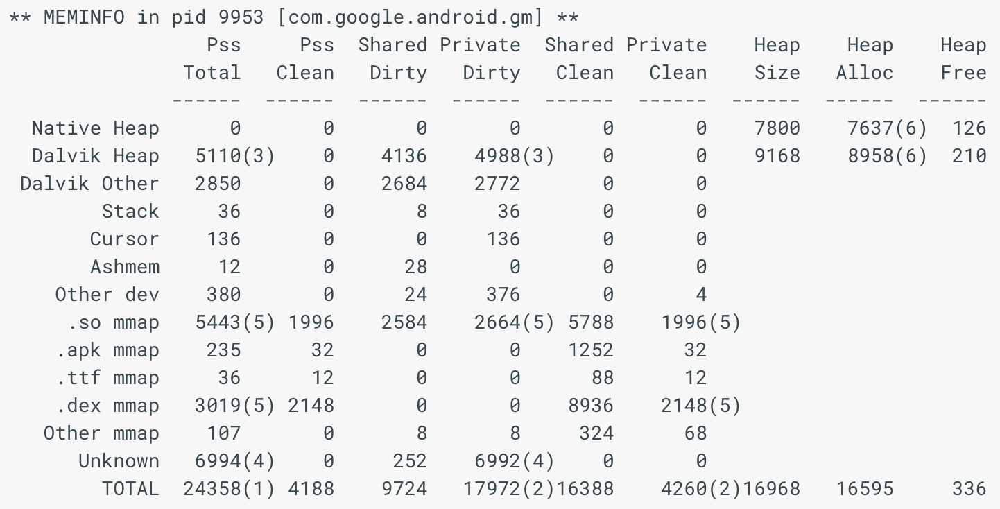
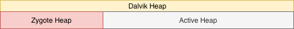
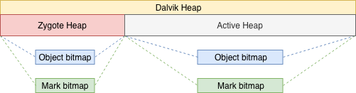
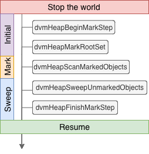
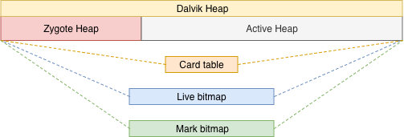
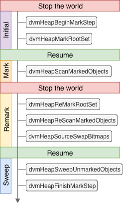

Process的Memory一般會有以下幾種分類：

* **Clean**：實體檔案或記憶體被映射或分配([mmap](https://en.wikipedia.org/wiki/Mmap#Memory_visibility))給Process，還沒被寫入修改過。
* **Dirty**：實體檔案或記憶體被映射或分配(mmap)給Process，已被寫入修改過。
* **Private**：限單一Process存取。
* **Shared**：給多個Process存取。

在Android上，就分成以下情況：

* **Share clean**：Library的uncompressed Dex檔映射到的記憶體區塊。

* **Private clean**：APK的uncompressed Dex檔映射到的記憶體區塊。 

* **Share dirty**：Zygote Heap；和Zygote預載的類別和資源。
* **Private dirty**：Active Heap，就是程式執行時主要使用的記憶體區塊。

因此，執行`dumpsys meminfo`將執行時的記憶體資訊，會得到以下訊息：

明顯的，檔案映射的部分都會屬於clean，除了so檔有進行一些修正的動作而做了寫入變dirty。

VM在用的[Virtual memory](https://www.memorymanagement.org/glossary/v.html#term-virtual-memory)並不完全是實體記憶體([Physical memory](https://www.memorymanagement.org/glossary/p.html#term-physical-memory-1))，所以由分類上來看，dirty部分是使用實體記憶體。

### Dalvik Heap

Application在執行時，需要載入要使用的類別和資源到記憶體，而這其中勢必有相同的部分。於是，為了減少記憶體的使用，這些部分被拆出來，並由Zygote預載後讓Application共用；同理，Zygote Heap也是共用的。

因此，Dalvik Heap不只是Active Heap，還有Zygote Heap：

####  Mark bitmap

在Java篇提到有Separated和Embedded，兩種紀錄Mark-bit的方式，Android只能選擇使用Separated，除了避免干擾程序的執行效率外，原因還有以下幾個：

* **System design**：用Embedded，就必須在Zygote Heap上進行寫入，這不屬於GC該做的。
* **Memory**：不是所有Process隨時都需要執行GC，就可以在需要時才宣告mark-bit專屬空間。

綜合以上，根據原始碼內主要建立Heap的[函示](http://androidxref.com/1.6/xref/dalvik/vm/alloc/HeapSource.c#393)，所有結構關係如下：

### Mark-Sweep

與Java GC相同，Dalvik GC也是從最基本的Mark-Sweep開始，會在GC開始時stop-the-world，一直到GC完成。啟動GC的函示稱作[dvmCollectGarbageInternal](http://androidxref.com/1.6/xref/dalvik/vm/alloc/Heap.c#718)。	

#### Steps

程式執行一開始時，只有Dalvik Heap([HeapSource](http://androidxref.com/1.6/xref/dalvik/vm/alloc/HeapSource.c#124))，和每個Heap自己的[HeapBitmap](http://androidxref.com/1.6/xref/dalvik/vm/alloc/HeapBitmap.h#51)。[分配記憶體](http://androidxref.com/1.6/xref/dalvik/vm/alloc/HeapSource.c#653)給物件時，會順便在HeapBitmap上做[標記](http://androidxref.com/1.6/xref/dalvik/vm/alloc/HeapSource.c#252)(bit = 1)，因此稱作**Object bitmap**。

[GC開始](http://androidxref.com/1.6/xref/dalvik/vm/alloc/Heap.c#718)後的步驟如下：

**Stop the world**

* [dvmHeapBeginMarkStep](http://androidxref.com/1.6/xref/dalvik/vm/alloc/Heap.c#870)：建立另一個[Mark Stack](http://androidxref.com/1.6/xref/dalvik/vm/alloc/MarkSweep.c#146)和[HeapBitmap](http://androidxref.com/1.6/xref/dalvik/vm/alloc/MarkSweep.c#159)。
* [dvmHeapMarkRootSet](http://androidxref.com/1.6/xref/dalvik/vm/alloc/Heap.c#875)：標記GC root到新的HeapBitmap，也就是**Mark bitmap**。
* [dvmHeapScanMarkedObjects](http://androidxref.com/1.6/xref/dalvik/vm/alloc/Heap.c#901)：標記從GC Root可以引用到的物件，新標記的物件被[放入Mark stack](http://androidxref.com/1.6/xref/dalvik/vm/alloc/MarkSweep.c#208)。Mark stack內的物件會被當成新的起點來[執行標記](http://androidxref.com/1.6/xref/dalvik/vm/alloc/MarkSweep.c#773)，新標記的物件會再放入Mark stack，直到清空為止。
* [dvmHeapSweepUnmarkedObjects](http://androidxref.com/1.6/xref/dalvik/vm/alloc/Heap.c#969)：比較Object和Mark bitmap，當前者是1後者是0，表示對應的物件可以進行回收。
* [dvmHeapFinishMarkStep](http://androidxref.com/1.6/xref/dalvik/vm/alloc/Heap.c#975)：此階段的Mark bitmap對應的就是下次GC前存活的物件，因此將Mark與Object bitmap交換，並清除GC階段衍生的物件。

**Resume**

### CMS

由於Mark-Sweep會產生長時間的GC pause，所以從**Gingerbread(2.3)**開始，Dalvik GC也開始使用CMS，降低所需要的GC pause。

#### Dalvik Heap

與原本的結構相比，Gingerbread開始有以下不同之處：

* HeapBitmap從Heap搬了出去，變成直接在[HeapSource](http://androidxref.com/2.3.6/xref/dalvik/vm/alloc/HeapSource.c#142)內，並分別有[Live bitmap](http://androidxref.com/2.3.6/xref/dalvik/vm/alloc/HeapSource.c#203)和[Mark bitmap](http://androidxref.com/2.3.6/xref/dalvik/vm/alloc/HeapSource.c#208)。Live bitmap等同於前面提到的Object bitmap。
* 多了[WriteBarrier](http://androidxref.com/2.3.6/xref/dalvik/vm/alloc/WriteBarrier.h)和[CardTable](http://androidxref.com/2.3.6/xref/dalvik/vm/alloc/CardTable.h)，與Java CMS不同的是，由於Dalvik並沒有實作世代(Generation)的概念，因此只要是引用狀態有改變，就會被記錄到CardTable。

新的結構關係如下：

除了這些變化，也有[GcReason](http://androidxref.com/2.3.6/xref/dalvik/vm/alloc/Heap.h#68)來更明確表示GC的原因：

* **GC_FOR_MALLOC**：沒有足夠空間來存放物件時。

- **GC_CONCURRENT**：當使用空間達到一定佔比時自動啟動。
- **GC_HPROF_DUMP_HEAP**：執行Heap dump建立HPROF(heap/CPU profile)檔案時。
- **GC_EXPLICIT**：透過`System.gc()`、`VMRuntime.gc()`主動啟動。
- **GC_EXTERNAL_ALLOC**：減少Heap的大小，來讓Native memory有更多空間可以存放物件。

#### Steps

程式一開始，所有會用到的結構都會被建立。[分配記憶體](http://androidxref.com/2.3.6/xref/dalvik/vm/alloc/HeapSource.c#814)給物件時，會在Live bitmap上做[標記](http://androidxref.com/2.3.6/xref/dalvik/vm/alloc/HeapSource.c#315)。

[GC開始](http://androidxref.com/2.3.6/xref/dalvik/vm/alloc/Heap.c#574)後的步驟如下：

**Stop the world**

* [dvmHeapBeginMarkStep](http://androidxref.com/2.3.6/xref/dalvik/vm/alloc/Heap.c#706)：這邊會傳入[GcMode](http://androidxref.com/2.3.6/xref/dalvik/vm/alloc/Heap.h#61)來[決定GC範圍](http://androidxref.com/2.3.6/xref/dalvik/vm/alloc/HeapSource.c#1884)，分成整個Dalvik Heap([FULL](http://androidxref.com/2.3.6/xref/dalvik/vm/alloc/Heap.h#63))或是只有Active Heap([PARTIAL](http://androidxref.com/2.3.6/xref/dalvik/vm/alloc/Heap.h#65))。
* [dvmHeapMarkRootSet](http://androidxref.com/2.3.6/xref/dalvik/vm/alloc/Heap.c#714)：標記GC root到Mark bitmap。

**Resume**

* [dvmHeapScanMarkedObjects](http://androidxref.com/2.3.6/xref/dalvik/vm/alloc/Heap.c#739)：標記從GC Root可以引用到的物件，新標記的物件會被[放入Mark stack](http://androidxref.com/2.3.6/xref/dalvik/vm/alloc/MarkSweep.c#127)。Mark stack內的物件會被當成新的起點來[執行標記](http://androidxref.com/2.3.6/xref/dalvik/vm/alloc/MarkSweep.c#648)，新標記的物件會再放入Mark stack，直到清空為止。

**Stop the world again**

* [dvmHeapReMarkRootSet](http://androidxref.com/2.3.6/xref/dalvik/vm/alloc/Heap.c#754)：重新標記GC root到Mark bitmap，新的GC root會被放入Mark stack。
* [dvmHeapReScanMarkedObjects](http://androidxref.com/2.3.6/xref/dalvik/vm/alloc/Heap.c#766)：從CardTable中[找dirty card](http://androidxref.com/2.3.6/xref/dalvik/vm/alloc/MarkSweep.c#662)，將Card上紀錄的物件加入Mark stack。接著以Mark stack中的物件為新的起點[執行標記](http://androidxref.com/2.3.6/xref/dalvik/vm/alloc/MarkSweep.c#663)，直到清空為止。

* [dvmHeapSourceSwapBitmaps](http://androidxref.com/2.3.6/xref/dalvik/vm/alloc/Heap.c#820)：將Live和Mark bitmap交換。

**Resume**

* [dvmHeapSweepUnmarkedObjects](http://androidxref.com/2.3.6/xref/dalvik/vm/alloc/Heap.c#832)：比較Live和Mark bitmap，當前者是0後者是1；就是交換前，前者是1後者是0，表示對應的物件可以進行回收。
* [dvmHeapFinishMarkStep](http://androidxref.com/2.3.6/xref/dalvik/vm/alloc/Heap.c#835)：此階段的Mark bitmap對應的就是下次GC前存活的物件，因此將Mark與Object bitmap交換，並清除GC階段衍生的物件，結束GC。

### Summery

以上就是Dalvik GC介紹，與Java GC的差異不大，因此儘管減少了GC pause，也繼承了[External fragmentation](https://www.memorymanagement.org/glossary/e.html#term-external-fragmentation)的缺點。如此在長時間使用後，仍然會造成OOM的問題，於是在Dalvik換成ART後，GC也做了大幅度的更新。

接著來談談ART GC：

* **《Year End Report - GC - Give me space! (ART - Basic)》**

### Reference

* [View memory allocations - meminfo](https://developer.android.com/studio/command-line/dumpsys#meminfo)
* [Investigate Ram](https://developer.android.com/studio/profile/investigate-ram?hl=zh-cn)