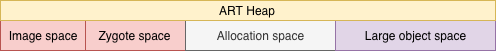
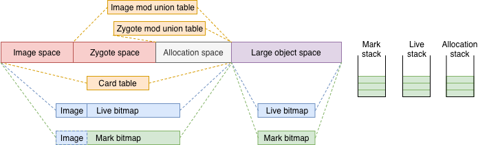
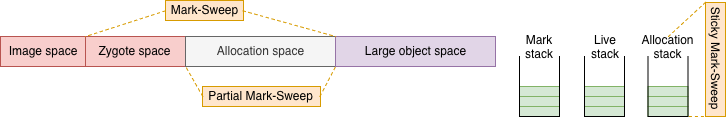

2013年，為了追上硬體效能演進的腳步，Google另外設計了ART來取代Dalvik，並在KitKat(4.4)版本進行實驗性的導入，讓使用者可以選擇性使用。直到2015年Lollipop(5.0)才正式導入系統。

為了相容，ART依然支援Dex檔，但不是執行Dex檔而是Oat檔。詳細在此篇不再重述，可以參照以下兩篇：

* **《About ART - Part 1 - Compilation**》
* **《Year End Report - ART - From Dalvik to ART》**

由於ART在KitKat後也歷經多次優化，因此接下來的內容將先以Kitkat版本為主，與Dalvik GC篇一樣，一切都要從Heap開始說起。

### ART Heap

與Dalvik相同，從建立Heap的[函示](http://androidxref.com/4.4_r1/xref/art/runtime/gc/heap.cc#69)，可以依序知道有：

* **Space**：[Image space](http://androidxref.com/4.4_r1/xref/art/runtime/gc/heap.cc#151)、[Zygote space](http://androidxref.com/4.4_r1/xref/art/runtime/gc/heap.cc#165)、[Alloc space](http://androidxref.com/4.4_r1/xref/art/runtime/gc/heap.cc#165)、[Large object space](http://androidxref.com/4.4_r1/xref/art/runtime/gc/heap.cc#175)。



其他結構還有：

- **Bitmap**：[Live bitmap](http://androidxref.com/4.4_r1/xref/art/runtime/gc/heap.cc#144)、[Mark bitmap](http://androidxref.com/4.4_r1/xref/art/runtime/gc/heap.cc#145)。
- **Table**：[Card table](http://androidxref.com/4.4_r1/xref/art/runtime/gc/heap.cc#191)、[Image mod union table](http://androidxref.com/4.4_r1/xref/art/runtime/gc/heap.cc#194)、[Zygote mod union table](http://androidxref.com/4.4_r1/xref/art/runtime/gc/heap.cc#197)。
- **Stack**：[Mark stack](http://androidxref.com/4.4_r1/xref/art/runtime/gc/heap.cc#205)、[Allocation stack](http://androidxref.com/4.4_r1/xref/art/runtime/gc/heap.cc#206)、[Live stack](http://androidxref.com/4.4_r1/xref/art/runtime/gc/heap.cc#208)。

相較於Dalvik，ART多了兩個space：

* **Image space**：從ART導入AOT開始，Dex檔會在安裝時被系統預先編譯成Oat檔，並存放在`data/dalvik-cache`。Oat檔會在啟動Application時用於產生Image space，同時將Oat檔內容mmap進記憶體。
* **Large object space**：繼承自[DiscontinuousSpace](http://androidxref.com/4.4_r1/xref/art/runtime/gc/space/space.h#234)，有自己的[Live bitmap](http://androidxref.com/4.4_r1/xref/art/runtime/gc/heap.cc#144)、[Mark bitmap](http://androidxref.com/4.4_r1/xref/art/runtime/gc/space/space.h#250)。由此可知前面其他space就屬於[ContinuousSpace](http://androidxref.com/4.4_r1/xref/art/runtime/gc/space/space.h#181)，不同的是這些space的bitmap是[串連](http://androidxref.com/4.4_r1/xref/art/runtime/gc/heap.cc#382)起來的。

其他與Heap結構有關的重點還有：

* **Mod union table**：兩個table繼承自不同的Mod union table類別，有著不同的處理範圍。Image mod union table屬於[ModUnionTableToZygoteAllocspace](http://androidxref.com/4.4_r1/xref/art/runtime/gc/accounting/mod_union_table-inl.h#29)，紀錄從Image space出發到Zygote space和Allocation space的引用；而Zygote mod union則是[ModUnionTableCardCache](http://androidxref.com/4.4_r1/xref/art/runtime/gc/accounting/mod_union_table.h#125)，紀錄Zygote space到Allocation space的引用。
* **GC scope**：Image space在[建立](http://androidxref.com/4.4_r1/xref/art/runtime/gc/space/image_space.cc#40)時，同時也會傳入一個參數[kGcRetentionPolicyNeverCollect](http://androidxref.com/4.4_r1/xref/art/runtime/gc/space/space.h#54)，依照定義，就是不會被GC，因此Image space不需要Mark bitmap；需要時，[會以Live bitmap代替](http://androidxref.com/4.4_r1/xref/art/runtime/gc/space/image_space.h#71)。Zygote space則是在[fork](http://androidxref.com/4.4_r1/xref/art/runtime/gc/heap.cc#1129)時才會指定[kGcRetentionPolicyFullCollect](http://androidxref.com/4.4_r1/xref/art/runtime/gc/space/space.h#59)，就是只接受Full GC。剩下的Space就是每次GC都會處理的部分，[kGcRetentionPolicyAlwaysCollect](http://androidxref.com/4.4_r1/xref/art/runtime/gc/space/space.h#56)。

函示最後GC的[建立](http://androidxref.com/4.4_r1/xref/art/runtime/gc/heap.cc#233)：

```c++
for (size_t i = 0; i < 2; ++i) {
    const bool concurrent = i != 0;
    mark_sweep_collectors_.push_back(new collector::MarkSweep(this, concurrent));
    mark_sweep_collectors_.push_back(new collector::PartialMarkSweep(this, concurrent));
    mark_sweep_collectors_.push_back(new collector::StickyMarkSweep(this, concurrent));
}
```

迴圈設計表示有兩組GC，分成同步與不同步，都由[MarkSweep](http://androidxref.com/4.4_r1/xref/art/runtime/gc/collector/mark_sweep.cc)、[PartialMarkSweep](http://androidxref.com/4.4_r1/xref/art/runtime/gc/collector/partial_mark_sweep.cc)、[StickyMarkSweep](http://androidxref.com/4.4_r1/xref/art/runtime/gc/collector/sticky_mark_sweep.cc)組成。

綜合以上，所有結構的關係如下：



不同於Dalvik，產生GC的原因少了兩個，一樣在[GcCause](http://androidxref.com/4.4_r1/xref/art/runtime/gc/heap.h#84)定義：

- **kGcCauseForAlloc**：沒有足夠空間來存放物件時。

- **kGcCauseBackground**：當使用空間達到一定佔比時自動啟動。
- **kGcCauseExplicit**：透過`System.gc()`主動啟動。

GC的啟用點並無變化，一樣是從[`CollectGarbageInternal()`](http://androidxref.com/4.4_r1/xref/art/runtime/gc/heap.cc#1192)。

### Multiple GC

ART將GC分成三種類型，可預期會有繼承架構，依序分別是：

```c++
GarbageCollector -> MarkSweep -> PartialMarkSweep -> StickyMarkSwee
```

從邏輯上來看可知Partial GC回收的範圍比Sticky還大；代表繼承順序也代表回收範圍大小：

```c++
MarkSweep > PartialMarkSweep > StickyMarkSweep
```

不同GC與[GcType](http://androidxref.com/4.4_r1/xref/art/runtime/gc/collector/gc_type.h#28)的關係如下：

* **kGcTypeFull**：MarkSweep。
* **kGcTypePartial**：PartialMarkSweep。
* **kGcTypeSticky**：StickyMarkSweep

依照GC type從前面建立的GC列表中[取出對應GC物件](http://androidxref.com/4.4_r1/xref/art/runtime/gc/heap.cc#1252)，然後呼叫[`Run()`](http://androidxref.com/4.4_r1/xref/art/runtime/gc/heap.cc#1263)執行。根據繼承，`Run()`內的GC步驟應是定義在最上層的[GarbageCollector](http://androidxref.com/4.4_r1/xref/art/runtime/gc/collector/garbage_collector.cc#63)：

```c++
// garbage_colletor.cc
void GarbageCollector::Run() {
    ...
    InitializePhase();
    if (!IsConcurrent()) {
        ...
    	thread_list->SuspendAll();
        MarkingPhase();
        ReclaimPhase();
        thread_list->ResumeAll();
        ...
    } else {
        ...
        {
          ...
          MarkingPhase();
        }
        bool done = false;
        while (!done) {
            ...
            thread_list->SuspendAll();
            ...
            done = HandleDirtyObjectsPhase();
            ...
            thread_list->ResumeAll();
            ...
        }
        {
            ...
            ReclaimPhase();
        }
    }
    ...
    FinishPhase();
}
```

流程只有分同步和非同步，沒有進一步依照GC類型來區分，代表三種GC的主要步驟大同小異。依照繼承順序，MarkSweep等於是主要步驟的直接實作，如此可直接從ParticialMarkSweep和StickyMarkSweep的內容來看三種GC有什麼差異。

### Collection range

#### Mark-Sweep

三個GC都有實作的一個函式是`bindBitmap()`，其在MarkSweep內用於代表標記步驟的[MarkingPhase](http://androidxref.com/4.4_r1/xref/art/runtime/gc/collector/mark_sweep.cc#240)：

```c++
// In mark_sweep.cc
void MarkSweep::BindBitmaps() {
    ...
    // Mark all of the spaces we never collect as immune.
    for (const auto& space : GetHeap()->GetContinuousSpaces()) {
        if (space->GetGcRetentionPolicy() == space::kGcRetentionPolicyNeverCollect) {
            ImmuneSpace(space);
        }
    }
    ...
}
```

[`ImmuneSpace()`](http://androidxref.com/4.4_r1/xref/art/runtime/gc/collector/mark_sweep.cc#88)會將space的Live bitmap和Mark bitmap交換，代表傳入的space不在回收範圍內。根據判斷式，這邊傳入的是Image space；**MarkSweep不處理Image space。**

#### Partial Mark-Sweep

```c++
// In partial_sweep.cc
void PartialMarkSweep::BindBitmaps() {
    MarkSweep::BindBitmaps();
    ...
    for (const auto& space : GetHeap()->GetContinuousSpaces()) {
        if (space->GetGcRetentionPolicy() == space::kGcRetentionPolicyFullCollect) {
            CHECK(space->IsZygoteSpace());
            ImmuneSpace(space);
        }
    }
}
```

這裡透過MarkSweep將Image space標記為不回收外，也標記Zygote space；**PartialMarkSweep不處理Image space和zygote space。**

#### Sticky Mark-Sweep

```c++
// In sticky_sweep.cc
void StickyMarkSweep::BindBitmaps() {
    PartialMarkSweep::BindBitmaps();
    ...
    for (const auto& space : GetHeap()->GetContinuousSpaces()) {
        // For sticky GC, we want to bind the bitmaps of all spaces as the allocation 
        // stack lets us know what was allocated since the last GC. A side-effect of 
        // binding the allocation space mark and live bitmap is that marking the objects 
        // will place them in the live bitmap.
        if (space->GetGcRetentionPolicy() == space::kGcRetentionPolicyAlwaysCollect) {
            BindLiveToMarkBitmap(space);
        }
    }
    GetHeap()->GetLargeObjectsSpace()->CopyLiveToMarked();
}
```

StickyMarkSweep除了呼叫PartialMarkSweep標記Image space和Zygote space，也標記Allocation space還有Large object space；**StickyMarkSweep不處理任何Space**。

透過註解，原因是新物件會記錄在Allocation stack，這可以從[`RecordAllocation()`](http://androidxref.com/4.4_r1/xref/art/runtime/gc/heap.cc#774)得到驗證：

```c++
// In heap.cc
inline void Heap::RecordAllocation(size_t size, mirror::Object* obj) {
    ...
    while (!allocation_stack_->AtomicPushBack(obj)) {
        CollectGarbageInternal(collector::kGcTypeSticky, kGcCauseForAlloc, false);
    }
}
```

`RecordAllication()`會在物件建立後由[`AllocObject()`](http://androidxref.com/4.4_r1/xref/art/runtime/gc/heap.cc#557)呼叫，並記錄在Allocation stack。當stack塞不下時，則會呼叫GC，並指定為StickyMarkSweep，如此反證StickyMarkSweep負責範圍是Allocation stack，也就是前一次GC後產生的新物件。

綜合以上，三個GC的處理範圍如下：



### Timing

不同的GC範圍，有著不同的啟動時機，各類型的主要時機點如下：

* **Full GC**：[將Zygote fork出去前](http://androidxref.com/4.4_r1/xref/art/runtime/gc/heap.cc#1132)。

* **Sticky GC**：[Allocation stack快滿的時候](http://androidxref.com/4.4_r1/xref/art/runtime/gc/heap.cc#792)。
* **Partial GC**：用於替代Sticky GC以求更大的回收量。如在啟用Sticky GC前，會依照剩餘可用空間[判定](http://androidxref.com/4.4_r1/xref/art/runtime/gc/heap.cc#1240)，和GC後根據成效的[設定](http://androidxref.com/4.4_r1/xref/art/runtime/gc/heap.cc#1812)下個GC類型。

另外，在無法順利取得空間時，就會依照GcType內的順序[啟動各類GC](http://androidxref.com/4.4_r1/xref/art/runtime/gc/heap.cc#882)，以求取得更多可用空間。

大部分情況下，Sticky GC頻率較高，這可在[`FinishPhase()`](http://androidxref.com/4.4_r1/xref/art/runtime/gc/collector/mark_sweep.cc#1619)所呼叫的函示[`GrowForUtilization()`](http://androidxref.com/4.4_r1/xref/art/runtime/gc/heap.cc#1792)看出來：

```c++
// In heap.cc
void Heap::GrowForUtilization(collector::GcType gc_type, uint64_t gc_duration) {
  ...
  if (gc_type != collector::kGcTypeSticky) {
      ...
      next_gc_type_ = collector::kGcTypeSticky;
  } else {
      ...
      if (bytes_allocated + min_free_ <= max_allowed_footprint_) {
          next_gc_type_ = collector::kGcTypeSticky;
      } else {
          next_gc_type_ = collector::kGcTypePartial;
      }
      ...
  }
}
```

每次GC後，都必須要決定下一個GC的類型，因此在記憶體使用並不吃緊的情況下，連續Sticky GC的機會較高。

### Sequential

雖然三種GC都可以與Application同步執行，但一次只會有一個GC，這點可從[`CollectGarbageInternal()`](http://androidxref.com/4.4_r1/xref/art/runtime/gc/heap.cc#1205)看到：

```c++
// In heap.cc
collector::GcType Heap::CollectGarbageInternal(collector::GcType gc_type, 
                                               GcCause gc_cause,
                                               bool clear_soft_references) {
    ...
    // Ensure there is only one GC at a time.
    while (!start_collect) {
        MutexLock mu(self, *gc_complete_lock_);
        if (!is_gc_running_) {
            is_gc_running_ = true;
        	start_collect = true;
        }
        if (!start_collect) {
            WaitForConcurrentGcToComplete(self);
        }
        ...
    }
}
```

### Specification in Sticky

StickyMarkSweep不回收space空間，則其他步驟也和其他GC有所不同，例如`MarkReachableObjects()`，此函式用於標記從GC root直接或間接引用到的物件，主要的實作是在[MarkSweep](http://androidxref.com/4.4_r1/xref/art/runtime/gc/collector/mark_sweep.cc#275)：

```c++
// In mark_sweep.cc
void MarkSweep::MarkReachableObjects() {
    // Mark everything allocated since the last as GC live so that we can sweep 
    // concurrently, knowing that new allocations won't be marked as live.
	...
	heap_->MarkAllocStack(heap_->alloc_space_->GetLiveBitmap(),
                          heap_->large_object_space_->GetLiveObjects(), live_stack);
	...
}
```

這邊要先注意到**此時的Live stack等於交換前Allocation stack**。因為在標記階段，會將Live stack和Allocation stack進行[交換](http://androidxref.com/4.4_r1/xref/art/runtime/gc/collector/mark_sweep.cc#253)。這樣新的物件可繼續標記到Allocation stack中，也不會影響接下來的操作。

由於新物件會被紀錄在Allocation stack，此段的用途是將Allocation stack標記到Live bitmap或Live Object(Large object space的Live bitmap)。這樣就可以在最後，直接與Mark bitmap比較來決定是否回收。

PartialMarkSweep沒覆寫此函式，所以作法和MarkSweep相同。而StickyMarkSweep則因為不回收space，因此需要改寫[`MarkReachableObjects()`](http://androidxref.com/4.4_r1/xref/art/runtime/gc/collector/sticky_mark_sweep.cc#49)來跳過在space上標記的操作：

```c++
// In sticky_mark_sweep.cc
void StickyMarkSweep::MarkReachableObjects() {  
    mark_stack_->Reset();  
    RecursiveMarkDirtyObjects(false, accounting::CardTable::kCardDirty - 1);  
} 
```

由其他部分的介紹可知標記物件的起點，除了GC root外，還有dirty card。且從Java篇對於Card table的介紹可知，Card table在每次GC後會清空；代表所記錄的改變某部分會與新物件有關，也就是Allocation stack紀錄的物件。

如此透過dirty card所產生的Mark bitmap，就可以與Allocation stack搭配來找出需要回收的物件，因[`sweep()`](http://androidxref.com/4.4_r1/xref/art/runtime/gc/collector/sticky_mark_sweep.cc#57)也得與另外兩種GC不同：

```c++
// In sticky_mark_sweep.cc
void StickyMarkSweep::Sweep(bool swap_bitmaps) {
    accounting::ObjectStack* live_stack = GetHeap()->GetLiveStack();
    SweepArray(live_stack, false);
}
```

[`SweepArry()`](http://androidxref.com/4.4_r1/xref/art/runtime/gc/collector/mark_sweep.cc#1143)就是判斷Allocation stack紀錄的物件有無標記在Mark bitmap或Large object space內，沒有則可以回收。

### Mod unit table

在Dalvik GC篇有提到Dalvik還沒有世代(Generation)的概念，實際上直到4.4的版本也還沒有，且如前面所述，GC彼此間是會互相等待，似乎都沒有符合使用Mod union table的情境。

不過直接看[ModUnionTable](http://androidxref.com/4.4_r1/xref/art/runtime/gc/accounting/mod_union_table.h#51)的註解：

```c++
// The mod-union table is the union of modified cards. It is used to allow the card table 
// to be cleared between GC phases, reducing the number of dirty cards that need to be
// scanned.
class ModUnionTable {
    ...
}
```

根據註解，Mod union table在這邊的工作是為了減少dirty card的數量。由前幾篇介紹，Dirty card的處理是在CMS Remark階段，在這對應的函示是[`HandleDirtyObjectsPhase()`](http://androidxref.com/4.4_r1/xref/art/runtime/gc/collector/mark_sweep.cc#194)。而不論何種類型GC，都會在stop-the-world下進行，因此停頓長度決定於dirty card的數量。

#### Collect cleared card

Mod union table會在標記階段呼叫[`ProcessCards()`](http://androidxref.com/4.4_r1/xref/art/runtime/gc/collector/mark_sweep.cc#248)執行，並透過[Image mod union table](http://androidxref.com/4.4_r1/xref/art/runtime/gc/heap.cc#1646)和[Zygote mod union table](http://androidxref.com/4.4_r1/xref/art/runtime/gc/heap.cc#1649)呼叫各自的`ClearCard()`。實際上，兩者的`ClearCard()`是類似的：

```c++
// In mod_union_table.cc
void ModUnionTableReferenceCache::ClearCards(space::ContinuousSpace* space) {
    CardTable* card_table = GetHeap()->GetCardTable();
    ModUnionClearCardSetVisitor visitor(&cleared_cards_);
    // Clear dirty cards in the this space and update the corresponding mod-union bits.
    card_table->ModifyCardsAtomic(space->Begin(), space->End(), AgeCardVisitor(), visitor);
}
```

`ModifyCardsAtomic()`簡單說就是將所有card傳入[AgeCardVisitor](http://androidxref.com/4.4_r1/xref/art/runtime/gc/heap.h#72)和[ModUnionClearCardSetVisitor](http://androidxref.com/4.4_r1/xref/art/runtime/gc/accounting/mod_union_table.cc#39)處理。

##### AgeCardVisitor

如果是dirty card，會以[kCardDirty](http://androidxref.com/4.4_r1/xref/art/runtime/gc/accounting/card_table.h#51)標記，是一個8 bit的unsigned int，而[AgeCardVisitor](http://androidxref.com/4.4_r1/xref/art/runtime/gc/heap.h#72)內做的事情就是將此數值減1，可以想成是dirty - 1：

```c++
// In heap.h
class AgeCardVisitoclass AgeCardVisitor {
    public:
    byte operator()(byte card) const {
        if (card == accounting::CardTable::kCardDirty) {
            return card - 1;
        } else {
            return 0;
        }
    }
};
```

如此dirty card就會有三種狀態：`dirty`、`dirty-1`和`0`。這樣做是因為在標記階段預先處理dirty card後，要讓接下來真正處理dirty card的Remark知道哪些card不用再處理，就降低了Remark的GC pause的時間。

##### ModUnionClearCardSetVisitor

```c++
// In mod_union_table.cc
class ModUnionClearCardSetVisitor {
    public:
    explicit ModUnionClearCardSetVisitor(ModUnionTable::CardSet* const cleared_cards)
        : cleared_cards_(cleared_cards) {}
    inline void operator()(byte* card, byte expected_value, byte new_value) const {
        if (expected_value == CardTable::kCardDirty) {
            cleared_cards_->insert(card);
        }
    }
    ...
};
```

[ModUnionClearCardSetVisitor](http://androidxref.com/4.4_r1/xref/art/runtime/gc/accounting/mod_union_table.cc#39)建立時會收到Mod union table傳入的`cleared_cards`，用來存被AgeCardVisitor從`dirty`改成`dirty-1`的dirty card，表示Mod union在當下能處理到的dirty card。

#### Mark cleared card

取得`cleared_cards`後，接著用到的地方就是`MarkPhase()`內的[UpdateAndMarkModUnion](http://androidxref.com/4.4_r1/xref/art/runtime/gc/collector/mark_sweep.cc#267)：

```c++
// In heap.cc
void Heap::UpdateAndMarkModUnion(collector::MarkSweep* mark_sweep, 
                                 base::TimingLogger& timings,  
                                 collector::GcType gc_type) {  
    if (gc_type == collector::kGcTypeSticky) {
        return;
    }
    // Update zygote mod union table.  
    if (gc_type == collector::kGcTypePartial) {  
        ...
        zygote_mod_union_table_->Update();  
        ...
        zygote_mod_union_table_->MarkReferences(mark_sweep);  
    }  
    ...
    image_mod_union_table_->Update();  
    ... 
    image_mod_union_table_->MarkReferences(mark_sweep);  
}  
```

Sticky GC就會直接跳過這步，因為接下來的步驟，會在不屬於Sticky GC負責的space上進行。且原本dirty card的狀態也變成`dirty-1`。因此前面StickyMarkSweep的`MarkReachableObjects()`內才得用`dirty-1`，如此也能在同步的情況下，盡量標記到更多的dirty card。  

##### Image mod union table

Image mod union table的類別ModUnionTableToZygoteAllocspace繼承於[ModUnionTableReferenceCache](http://androidxref.com/4.4_r1/xref/art/runtime/gc/accounting/mod_union_table.h#88)，不過只有其父類有實作[`Update()`](http://androidxref.com/4.4_r1/xref/art/runtime/gc/accounting/mod_union_table.cc#236)：

```c++
// In mod_union_table.cc
void ModUnionTableReferenceCache::Update() {
    ...
    ModUnionReferenceVisitor visitor(this, &cards_references)
    for (const auto& card : cleared_cards_) {
        // Clear and re-compute alloc space references associated with this card.
        uintptr_t start = reinterpret_cast<uintptr_t>(card_table->AddrFromCard(card));
        uintptr_t end = start + CardTable::kCardSize;
        auto* space = heap->FindContinuousSpaceFromObject(reinterpret_cast<Object*>
                                                          (start), false);
        SpaceBitmap* live_bitmap = space->GetLiveBitmap();
        live_bitmap->VisitMarkedRange(start, end, visitor);    
        // Update the corresponding references for the card.
        ...
        references_.Put(card, cards_references);
        ...
    }
    cleared_cards_.clear();
}
```

Image mod union table紀錄的是從Image space到Zygote space和Allocation space兩個space的引用，這邊就是將這些引用全都集合到`references`裡面。

接著再走到[`MarkReference()`](http://androidxref.com/4.4_r1/xref/art/runtime/gc/accounting/mod_union_table.cc#268)，將`references_`所記錄到的引用所指向的物件標記起來：

```c++
// In mod_union_table.cc
void ModUnionTableReferenceCache::MarkReferences(collector::MarkSweep* mark_sweep) {
    for (const auto& ref : references_) {
        for (const auto& obj : ref.second) {
            mark_sweep->MarkRoot(obj);
            ++count;
        }
    }
    ...
}
```

##### Zygote mod union table

Zygote mod union table的類別ModUnionTableCardCache的[`Update()`](http://androidxref.com/4.4_r1/xref/art/runtime/gc/accounting/mod_union_table.h#134)是空的，直接到[`MarkReference()`](http://androidxref.com/4.4_r1/xref/art/runtime/gc/accounting/mod_union_table.cc#290)：

```c++
// In mod_union_table.cc
void ModUnionTableCardCache::MarkReferences(collector::MarkSweep* mark_sweep) {
	...
    ModUnionScanImageRootVisitor visitor(mark_sweep);
    ...
    for (const byte* card_addr : cleared_cards_) {
        auto start = reinterpret_cast<uintptr_t>(card_table->AddrFromCard(card_addr));
        auto end = start + CardTable::kCardSize;
        auto obj_start = reinterpret_cast<Object*>(start);
        if (UNLIKELY(space == nullptr || !space->Contains(obj_start))) {
            space = heap_->FindContinuousSpaceFromObject(obj_start, false);
            bitmap = space->GetLiveBitmap();
        }
        bitmap->VisitMarkedRange(start, end, visitor);
    }
}
```

看起來就是ModUnionTableReferenceCache的`Update()`和`MarkReferences`綜合，不多詳細介紹。

回到`UpdateAndMarkModUnion()`，這樣就完成Mod union table在標記階段對dirty card預先標記的動作。減少後續處理dirty card的數量。

到此就是KitKat的ART GC的基本介紹，接著下一篇要來看Lollipop正式套用ART後，又有新增哪些內容：

- **《Year End Report - GC - Give me space! (ART - Advance)》**


