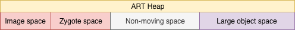
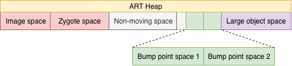
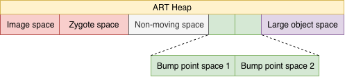
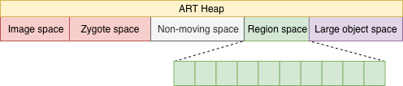

在Basic部份介紹了KitKat內初步的GC模型，但其僅僅只是實驗性質，第一版正式的ART GC模型直到2015年Lollipop才發佈。不過有些部分仍然是從前一版的GC直接繼承而來，建議先看過前一篇：

* **《Year End Report - GC - Give me space! (ART - Basic)**》

根據《About ART - Part 2 - Garbage Collection》的內容，Lollipop版本多了Semi space GC和Mark-Compact GC，通稱為**Moving GC**，會搬移物件降低[External fragmentation](https://www.memorymanagement.org/glossary/e.html#term-external-fragmentation)的問題。Moving GC相關介紹可以看《Year End Report - GC - Give me space! (Java)》。

與前面的分析相同，從Heap開始看起。

### ART Heap

從建立Heap的[函示](http://androidxref.com/5.0.0_r2/xref/art/runtime/gc/heap.cc#106)，可以看到除了[Image space](http://androidxref.com/5.0.0_r2/xref/art/runtime/gc/heap.cc#216)和[Large object space](http://androidxref.com/5.0.0_r2/xref/art/runtime/gc/heap.cc#348)很明顯沒有變化外，本應有建立Zygote space和Allocation space的部分已經其他類型space被取代，此可以從[註解](http://androidxref.com/5.0.0_r2/xref/art/runtime/gc/heap.cc#228)看出是Non-moving space和Main alloc space。

* **Non-moving space**：由於與Class相關的物件會長時間存在，不需要特別被移動，將這些物件集中放在同一space，可降低Moving GC要處理的範圍。
* **Main alloc space**：在Heap建立完成後，用來存放新物件的區域，等同Basic篇介紹的Allocation space。

而根據GC的類型不同可以分成以下幾種形式：

* **Mark-Sweep & CMS**：

  

* **Semi-space & Mark-Compact**：

  

* **Generational Semi-space**：

  

總和上述三張圖，可以發現沒有Main alloc space，這是因為其在不同的GC設定下，會在Heap建立時，依照需求轉換成其他名稱的space。

* **Mark-Sweep & CMS**：在此類GC下，不會有更動位置的操作，因此Main alloc space被直接[指派](http://androidxref.com/5.0.0_r2/xref/art/runtime/gc/heap.cc#315)成Non-moving space。

* **Semi-space & Mark-Compact**：Semi-space GC操作會需要用到兩個相同大小的空間，來執行異地壓縮的操作，因此Main alloc space被拆分成[Bump point space 1](http://androidxref.com/5.0.0_r2/xref/art/runtime/gc/heap.cc#301)和[Bump point space 2](http://androidxref.com/5.0.0_r2/xref/art/runtime/gc/heap.cc#305)；Mark-Compact是原地壓縮的設計，但依然會拆成兩個Bump point space，同為Moving GC，這樣做法可以簡化程式部份。

  這邊特別的是Bump point space的起始點被固定在[300M](http://androidxref.com/5.0.0_r2/xref/art/runtime/gc/heap.cc#269)，因此會與Non-moving space產生間隔，這是為了預留空間，讓Non-moving space在需要時將範圍進行延伸。

* **Generational Semi-space**：執行Generational GC需要有Young和Old世代物件的空間。Young世代自然使用的是Bump-point space ；Old世代存活時間較長，較不會因頻繁GC產生External fragmentation的問題，因此可直接使用Non-moving space。

不論何種GC，流程基本上就是標記，然後刪除，也就是Mark-Sweep的延伸。而為了提升效率而加入的輔助結構，如Stack、Card table和Mod unit table也都會繼續存在，此篇就不再重複論述。

### Moving GC specification

對於之前介紹過的GC來說，Sweep代表需要直接釋放記憶體，因此會在底層直接用到malloc等相關的函示。但對於Moving GC來說就不用作主動釋放的動作，因其作用就是將使用中的物件集中，這樣剩餘的部分就是可以直接覆寫的區域，被覆寫也就等於是被回收。

#### Semi-space GC

根據[原始論文](https://www.cs.purdue.edu/homes/hosking/690M/p611-fenichel.pdf)，此類型主要特點是會有兩個相同大小的空間：**from**和**to**。執行的操作並不複雜：**就是將使用中的物件，從from搬移到to**，搬運過程就可以將物件照順序放置，達到壓縮的目的。

此做法的缺點是，由於是要從from搬移到to，因此同時得有兩個相同大小的空間。新的物件都會放在from上面，to只有GC時才會使用到，如此就會造成空間的浪費。

#### [Mark-Compact GC](https://en.wikipedia.org/wiki/Mark-compact_algorithm)

根據[原始論文](https://academic.oup.com/comjnl/article-pdf/10/2/162/963555/10-2-162.pdf)，此GC與Semi-space GC目的相同，但更加單純：**在當前空間將物件集中**。也因為是在當前空間進行壓縮，因此不會有Semi-space需要多餘空間的問題。

不論是Semi-space或是Mark-Compact，其操作都是要在stop-the-world下執行，因此通常會放在程式進入背景後才執行。而記憶體在經過這樣的處理後，只要注意已使用空間的開始和結束位置，就可計算出剩餘空間和實際放入的位置。

#### Generational Semi-space

根據本篇開頭介紹，Generational Semi-space GC的Heap形式滿足一個Generational GC所需要的兩個基本的空間：Young和Old。也因此其可以執行世代的操作：

* **Bump-point space為Survivor區塊，記錄物件存活的GC次數。**
* **Non-moving space為Old區塊，存活超過一定次數的物件Promote到此空間**。

至此，Android正式有Generational GC。

### Compact

雖然都是搬移檔案，但因為是否是在同一個空間壓縮，導致實作的方式有些許不同。

#### Semi-space

由於是要搬移到另外一個空間，所以較有效率的做法是：**在標記同時進行搬移**。這樣就不用在標記後，還需要從頭掃過記憶體區塊，只為了做搬移動作。

因此，在標記物件時就會[判斷](http://androidxref.com/5.0.0_r2/xref/art/runtime/gc/collector/semi_space-inl.h#67)是否在from，是的話透過[`GetForwardingAddressInFromSpace()`](http://androidxref.com/5.0.0_r2/xref/art/runtime/gc/collector/semi_space-inl.h#68)嘗試取得在to的新位址，有的話就會直接將指向物件的指標[定位](http://androidxref.com/5.0.0_r2/xref/art/runtime/gc/collector/semi_space-inl.h#80)到新的位址上；沒有就會使用[`MarkNonForwardedObject()`](http://androidxref.com/5.0.0_r2/xref/art/runtime/gc/collector/semi_space.cc#480)進行搬移的操作：

```c++
// In semi_space.cc
mirror::Object* SemiSpace::MarkNonForwardedObject(mirror::Object* obj) {
    if (generational_ && reinterpret_cast<byte*>(obj) < last_gc_to_space_end_) {
        ...
    } else {
        // If it's allocated after the last GC (younger), copy it to the to-space.
        forward_address = to_space_->AllocThreadUnsafe(self_, object_size, 
                                                       &bytes_allocated, nullptr);
        ...
    }
    ...
    CopyAvoidingDirtyingPages(reinterpret_cast<void*>(forward_address), obj, object_size);
    ...
    return forward_address;
}
```

不論是否是Generational都大同小異：

* **使用`AllocThreadUnsafe()`從to取得空間，並得到新位址`forward_address`。**
* **使用`CopyAvoidingDirtyingPages()`複製物件到`forward_address`。**
* **回傳`forward_address`。**

取得的`forward_address`會[存在LockWord](http://androidxref.com/5.0.0_r2/xref/art/runtime/gc/collector/semi_space-inl.h#75)，這樣前面`GetForwardingAddressInFromSpace()`才有辦法從中[取得](http://androidxref.com/5.0.0_r2/xref/art/runtime/gc/collector/semi_space-inl.h#44)取得新位址，進行重新指向的操作。

#### Mark-Compact

標記是依照記憶體順序進行，因此如果是同一空間進行壓縮，就不適合在標記時搬移。於是Mark-Compact直到回收階段才透過[`Compact()`](http://androidxref.com/5.0.0_r2/xref/art/runtime/gc/collector/mark_compact.cc#273)執行搬移的動作，並又細分成三階段：

```c++
// In mark_compact.cc
void MarkCompact::Compact() {
	...
	CalculateObjectForwardingAddresses();
    UpdateReferences();
    MoveObjects();
    ...
}
```

**CalculateObjectForwardingAddresses**

其用[`CalculateObjectForwardingAddressVisitor`](http://androidxref.com/5.0.0_r2/xref/art/runtime/gc/collector/mark_compact.cc#105)來呼叫[`ForwardObject()`](http://androidxref.com/5.0.0_r2/xref/art/runtime/gc/collector/mark_compact.cc#ForwardObject)：

```c++
// In mark_compact.cc
void MarkCompact::ForwardObject(mirror::Object* obj) {
    const size_t alloc_size = RoundUp(obj->SizeOf(), space::BumpPointerSpace::kAlignment);
    LockWord lock_word = obj->GetLockWord(false);
    // If we have a non empty lock word, store it and restore it later.
    if (lock_word.GetValue() != LockWord().GetValue()) {
        // Set the bit in the bitmap so that we know to restore it later.
        objects_with_lockword_->Set(obj);
        lock_words_to_restore_.push_back(lock_word);
    }
    obj->SetLockWord(LockWord::FromForwardingAddress(reinterpret_cast<size_t>(bump_pointer_)), false);
    
    bump_pointer_ += alloc_size;
    ++live_objects_in_space_;
}
```

由前面介紹知道新的位址會被放在物件的LockWord中。根據LockWord的[結構](http://androidxref.com/5.0.0_r2/xref/art/runtime/lock_word.h#53)，可知其不只用於記錄新位址，還有一些其他狀態，所以如果物件已經有LockWord，就得先暫存起來，以便在之後操作放回。

取得新位址的LockWord後，把`bump_point`依照物件大小移動，這樣下一個物件的新位址就會跟著前一個物件。

**UpdateReferences**

由於GC處理的只有Bump-point space，前面處理過的物件，都可能有來自其他space的引用，因此也要將這些引用重新定位到新位址。雖然現在還沒真的進行物件移動，但Moving GC是在stop-the-world下進行，所以不用擔心重新定位後，會存取到空物件。

不論是用[UpdateObjectReferencesVisitor](http://androidxref.com/5.0.0_r2/xref/art/runtime/gc/collector/mark_compact.cc#361)或[UpdateHeapReferenceCallback](http://androidxref.com/5.0.0_r2/xref/art/runtime/gc/collector/mark_compact.cc#355)，都會走到[`Updatereference()`](http://androidxref.com/5.0.0_r2/xref/art/runtime/gc/collector/mark_compact.cc#408)：

```c++
// In mark_compact.cc
inline void MarkCompact::UpdateHeapReference(mirror::HeapReference<mirror::Object>* reference) {
    ...
    if (obj != nullptr) {
        mirror::Object* new_obj = GetMarkedForwardAddress(obj);
        if (obj != new_obj) {
            ...
            reference->Assign(new_obj);
        
        }
    }
}
```

透過[`GetMarkedForwardAddress`](http://androidxref.com/5.0.0_r2/xref/art/runtime/gc/collector/mark_compact.cc#411)拿到新物件位址，並指定給傳入的`reference`，完成重新指向的操作。

**MoveObjects**

最後一步是真正將物件搬移，透過[`MoveObjects()`](http://androidxref.com/5.0.0_r2/xref/art/runtime/gc/collector/mark_compact.cc#522)使用[MoveObjectVisitor](http://androidxref.com/5.0.0_r2/xref/art/runtime/gc/collector/mark_compact.cc#492)呼叫[`MoveObject`](http://androidxref.com/5.0.0_r2/xref/art/runtime/gc/collector/mark_compact.cc#505)：

```c++
// In mark_compact.cc
void MarkCompact::MoveObject(mirror::Object* obj, size_t len) {
    ...
    uintptr_t dest_addr = obj->GetLockWord(false).ForwardingAddress();
    mirror::Object* dest_obj = reinterpret_cast<mirror::Object*>(dest_addr);
    ...
    // Use memmove since there may be overlap.
    memmove(reinterpret_cast<void*>(dest_addr), reinterpret_cast<const void*>(obj), len);
    // Restore the saved lock word if needed.
    LockWord lock_word;
    if (UNLIKELY(objects_with_lockword_->Test(obj))) {
        lock_word = lock_words_to_restore_.front();
        lock_words_to_restore_.pop_front();
    }
    dest_obj->SetLockWord(lock_word, false);
}
```

透過`memmove()`使用新舊位址進行複製，並如前面所述，再從`lock_words_to_restore_`取回暫存的LockWord。

以上就是KitKat版本所有Moving GC的介紹，Moving GC雖然可以提昇記憶體使用效率，但為了降低stop-the-world帶來的影響，大多放在背景執行；這樣就減少壓縮的機會，無法最大化壓縮記憶體帶來的效益。

因此，之後延伸設計出可以與程式一起運行的Concurrent-Compact GC。

### Concurrent-Compact GC

其實在KitKat發表前述Moving GC的同時，Concurrent-Compact GC也已經被[定義](http://androidxref.com/5.0.0_r2/xref/art/runtime/gc/collector_type.h#42)在CollectorType中，但並沒有實作，其在各個版本中都有不同的開發進度：

* **Lollipop**：[定義檔](http://androidxref.com/5.0.0_r2/xref/art/runtime/gc/collector/concurrent_copying.h)。
* **Marshmallow**：[實作](http://androidxref.com/6.0.0_r1/xref/art/runtime/gc/collector/concurrent_copying.cc)。
* **Oreo**：正式公開[介紹](https://youtu.be/iFE2Utbv1Oo?t=323)。

查看個版本程式碼，此GC在Lollipop就已[投入使用](http://androidxref.com/5.1.1_r6/xref/art/runtime/gc/heap.cc#430)，但沒有實作所以無法運行。不過從Marshmallow有實作後，此GC就已開始運作，推測在Oreo公開介紹前應都是在試用開發階段。

以下將以Oreo的原始碼來做介紹。

#### Heap

由於[屬於Moving GC](http://androidxref.com/8.0.0_r4/xref/art/runtime/gc/heap.h#868)，所以有獨立的Non-moving space。不同的是多了[Region space](http://androidxref.com/8.0.0_r4/xref/art/runtime/gc/space/region_space.cc)來[取代](http://androidxref.com/8.0.0_r4/xref/art/runtime/gc/space/region_space.cc)原本Bump-point space的位置：



* **Region space**：在建立同時[切割](http://androidxref.com/8.0.0_r4/xref/art/runtime/gc/space/region_space.cc#86)成多個region，並以[陣列](http://androidxref.com/8.0.0_r4/xref/art/runtime/gc/space/region_space.cc#90)的形式存放，每個region固定大小為[256KB](http://androidxref.com/8.0.0_r4/xref/art/runtime/gc/space/region_space.h#170)。	

#### GC Flow

根據《About ART - Part 2 - Garbage Collection》的介紹，Concurrent-Compact GC需在執行標記前，決定哪些Region是要被處理的；也就是source Region，此操作實際上是在[FlipThreadRoots](http://androidxref.com/8.0.0_r4/xref/art/runtime/gc/collector/concurrent_copying.cc#FlipThreadRoots)內。

Source Region內的物件會在GC過程中，被搬移至新的位置。因此source Region也稱作[FromSpace](http://androidxref.com/8.0.0_r4/xref/art/runtime/gc/space/region_space.cc#187)，反之就是ToSpace。

##### Decide from space

搬移這個動作又稱作evacuate，因此可以在函示[`ShouldBeEvacuated`](http://androidxref.com/8.0.0_r4/xref/art/runtime/gc/space/region_space.cc#ShouldBeEvacuated)找到判斷的公式：

```c++
// region_space.cc
result = live_bytes_ * 100U < kEvaculateLivePercentThreshold * bytes_allocated;
```

其中`kEvaculateLivePercentThreshold`為`75U`，將算式整理一下後如下：

```c++
result = live_bytes_ < 0.75 * bytes_allocated;
```

代表當前存活的物件，已經小於已占用範圍的7成5，就會被當成要處理的source Regoin。`live_bytes_`只有在標記步驟才會被[修改](http://androidxref.com/8.0.0_r4/xref/art/runtime/gc/collector/concurrent_copying.cc#1488)，因此新的Region不會被[判斷](http://androidxref.com/8.0.0_r4/xref/art/runtime/gc/space/region_space.cc#161)成Source Region，而一直被處理到。

##### Compact

記憶體切割成Region，搬移的動作是從FromSpace到ToSpace，這機制就像Semi-space。可以推測其是在標記時直接做搬移，因此找到[Mark()](http://androidxref.com/8.0.0_r4//xref/art/runtime/gc/collector/concurrent_copying-inl.h#99)：

```c++
// In concurrent_copying-inl.h
template<bool kGrayImmuneObject, bool kFromGCThread>
inline mirror::Object* ConcurrentCopying::Mark(mirror::Object* from_ref,
                                               mirror::Object* holder,
                                               MemberOffset offset) {
    space::RegionSpace::RegionType rtype = region_space_->GetRegionType(from_ref);
    switch (rtype) {
        ...
        case space::RegionSpace::RegionType::kRegionTypeFromSpace: {
            mirror::Object* to_ref = GetFwdPtr(from_ref);
            if (to_ref == nullptr) {
                // It isn't marked yet. Mark it by copying it to the to-space.
                to_ref = Copy(from_ref, holder, offset);
            }
            ...
            return to_ref;
        }        
    }
}
```

如果要被標記的Region是FromSpace，就透過[`GetFwdPtr()`](http://androidxref.com/8.0.0_r4//xref/art/runtime/gc/collector/concurrent_copying-inl.h#GetFwdPtr)嘗試取得新位置，無法取得時就用[`Copy()`](http://androidxref.com/8.0.0_r4/xref/art/runtime/gc/collector/concurrent_copying.cc#2164)從ToSpace[取得](http://androidxref.com/8.0.0_r4/xref/art/runtime/gc/collector/concurrent_copying.cc#2183)新的空間，並作[搬移](http://androidxref.com/8.0.0_r4/xref/art/runtime/gc/collector/concurrent_copying.cc#2236)的操作。

#### Bump-point allocator

GC類型會影響Heap結構，如果前景背景的GC不同，不只影響Allocator的類型，也會產生結構轉換上overhead。有了Concurrent-Compact GC，就可以全面使用Moving GC，就可以整體都使用Google在[2017 I/O介紹](https://youtu.be/iFE2Utbv1Oo?t=581)的Bump-point allocator，但從其他GC類型的Heap結構可以知道，早在KitKat就已經開始使用了。

### Summary

到此為止的篇章，可以看出Android的GC在多次修改後，都不斷在趨近於Java現有的GC：

* 一般的Mark-Sweep GC。
* 類似CMS有世代概念的Generational Semi-space GC。
* 類似G1GC有Region切割Concurrent-Compact GC。

還有其他相關輔助用的結構。即使到現在，Java在GC上仍然持續在更新中，如2018年正式發表的[ZGC](https://wiki.openjdk.java.net/display/zgc/Main)，因此可預期Google會有更新類型的GC，在之後的版本發佈。

關於記憶體還有另一個很常被討論的議題就是Bitmap，因為App最重要的元素之一就是圖片，而用來呈現圖片的Bitmap通常會因解析度提升而放大，如果記憶體無法有效回收，就會產生OOM。

因此有效地使用記憶體來存放Bitmap是個重要的議題，Google I/O 2011甚至有一個[session](https://www.youtube.com/watch?v=_CruQY55HOk)專門在介紹Android如何處理Bitmap。

因此，接著將會用Bitmap記憶體的相關介紹作為GC系列文的最後一篇：

* **《Year End Report - GC - Give me space! (Bitmap)》**

### Reference

* [A LISP Garbage-Collector for Virtual-Memory Computer Systems](https://www.cs.purdue.edu/homes/hosking/690M/p611-fenichel.pdf) 
* [A compaction procedure for variable-length storage elements](https://academic.oup.com/comjnl/article-pdf/10/2/162/963555/10-2-162.pdf)

