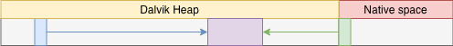
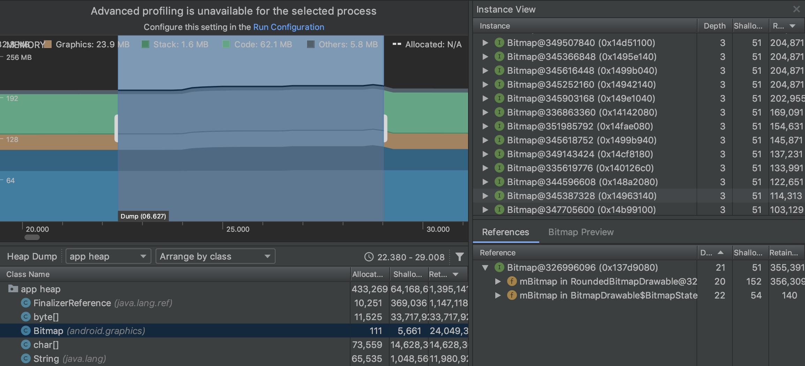
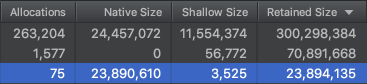
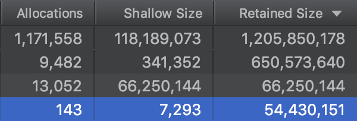
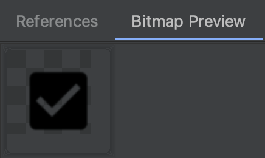
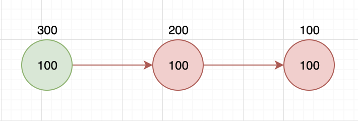

Bitmap的存放一直是Android的主要問題之一，因為其通常是記憶體中佔比最大的物件。在2011年的Google IO上的[session](https://www.youtube.com/watch?v=_CruQY55HOk)有提到Bitmap存放方式的改變。

[官方文件](https://developer.android.com/topic/performance/graphics/manage-memory)上也有提到不同版本間的變化，並切割成以下幾個分水嶺：

* **Gingerbread and lower(1.0 - 2.3)**
* **Honeycomb to Nought(3.0 - 7.0)**
* **Oreo and after**

存放位置的差異，也會影響其GC的方式，以下將簡單介紹個版本在這些方面的差異，以及其帶來的影響。

### Gingerbread and lower(1.0 - 2.3)

由Gingerbread的[Bitmap建構式](http://androidxref.com/2.3.6/xref/frameworks/base/graphics/java/android/graphics/Bitmap.java#80)可看出Bitmap不存有pixel資料，而是透過一個變數來紀錄pixel資料的實際位址：

```java
// In Bitmap.java
private Bitmap(int nativeBitmap, boolean isMutable, byte[] ninePatchChunk, int density) {
    mNativeBitmap = nativeBitmap;
    ...
}
```

至於這個值在哪裡，就得從Bitmap如何建立開始介紹。

#### Create

Bitmap物件是由接受不同參數的`createBitmap()`來取得，而不論哪一個，都會走到`nativeCreate()`。

根據[native函示註冊表](http://androidxref.com/2.3.6/xref/frameworks/base/core/jni/android/graphics/Bitmap.cpp#586)，可知在Java層呼叫`nativeCreate()`，會呼叫到[`Bitmap_creator()`](http://androidxref.com/2.3.6/xref/frameworks/base/core/jni/android/graphics/Bitmap.cpp#208)：

```cpp
// In Bitmap.cpp
static jobject Bitmap_creator(JNIEnv* env, jobject, jintArray jColors,
                              int offset, int stride, int width, int height,
                              SkBitmap::Config config, jboolean isMutable) {
	...
    SkBitmap bitmap;
    ...
    if (!GraphicsJNI::setJavaPixelRef(env, &bitmap, NULL, true)) {
        return NULL;
    }
    ...
    return GraphicsJNI::createBitmap(env, new SkBitmap(bitmap), isMutable, NULL);
}
```

在這函示中會做幾件事：

* 建立[SkBitmap](http://androidxref.com/2.3.6/xref/external/skia/include/core/SkBitmap.h)。

* 透過[`setJavaPixelRef()`](http://androidxref.com/2.3.6/xref/frameworks/base/core/jni/android/graphics/Bitmap.cpp#227)呼叫[`sk_malloc_flags()`](http://androidxref.com/2.3.6/xref/frameworks/base/core/jni/android/graphics/Graphics.cpp#493)。根據函示名稱，知道是用[`malloc()`](http://androidxref.com/2.3.6/xref/external/skia/src/core/SkMemory_stdlib.cpp#262)來宣告記憶體，所以是取得**Native memory**，此空間將用於存放pixel資料。
* 將此空間位址記錄在[SkPixelRef](http://androidxref.com/2.3.6/xref/external/skia/include/core/SkPixelRef.h)物件，並[存在](http://androidxref.com/2.3.6/xref/frameworks/base/core/jni/android/graphics/Graphics.cpp#511)前面建立的SkBitmap。
* 最後呼叫到[`createBitmap()`](http://androidxref.com/2.3.6/xref/frameworks/base/core/jni/android/graphics/Graphics.cpp#363)：

```cpp
// In Graphics.cpp
jobject GraphicsJNI::createBitmap(JNIEnv* env, SkBitmap* bitmap, bool isMutable,
                                  jbyteArray ninepatch, int density) {
    ...
    jobject obj = env->AllocObject(gBitmap_class);
    if (obj) {
        env->CallVoidMethod(obj, gBitmap_constructorMethodID,
                            (jint)bitmap, isMutable, ninepatch, density);
        ...
    }
    return obj;
}
```

透過`CallVoidMethod()`呼叫Bitmap的Java建構式取得Bitmap物件，並傳入前面取得的SkBitmap等參數。

綜合以上，**Bitmap是透過SkBitmap來間接引用到實際的pixel資料**：


如此將pixel資料放在native space會造成以下幾個狀況：

- **Hard to Debug**：用Memory Analyzer查看HPROF檔案時，不會顯示Native memory內的物件。且Bitmap沒有pixel資料，因此不論什麼圖片，Bitmap物件都是一樣大，與其他物件相較起來容易被忽略。
- **Unpredictable collection**：為了避免沒有呼叫[`recycle()`](http://androidxref.com/2.3.6/xref/frameworks/base/graphics/java/android/graphics/Bitmap.java#156)，Bitmap有實作[`finalize()`](http://androidxref.com/2.3.6/xref/frameworks/base/graphics/java/android/graphics/Bitmap.java#1012)來藉由[Finalizer](https://en.wikipedia.org/wiki/Finalizer)機制回收pixel資料。但這有個潛在問題：**`finalize()`被呼叫的時機不定，記憶體不會即時被回收，就容易造成OutOfMemory的問題。**

#### Recycle

當呼叫`recycle()`時，實際上是由`nativeRecycler()`完成，對應的native函示是[`Bitmap_recycle()	`](http://androidxref.com/2.3.6/xref/frameworks/base/core/jni/android/graphics/Bitmap.cpp#257)：

```cpp
// In Bitmap.cpp
static void Bitmap_recycle(JNIEnv* env, jobject, SkBitmap* bitmap) {
    bitmap->setPixels(NULL, NULL);
}
```

[`setPixels()`](http://androidxref.com/2.3.6/xref/external/skia/src/core/SkBitmap.cpp#319)的設計是：**不論傳入的參數是否為NULL，都會先清空目前的pixel資料。**

而這邊傳入的是NULL，所以直接看用於清空pixel資料的函示，[`freePixels()`](http://androidxref.com/2.3.6/xref/external/skia/src/core/SkBitmap.cpp#336)：

```cpp
// In SkBitmap.cpp
void SkBitmap::freePixels() {
    ...
    if (NULL != fPixelRef) {
        ...
        fPixelRef->unref();
        ...
    }
    ...
}
```

`fPixleRef`就是前面提到，存有實際pixel資料位址的SkPixelRef，其實際上是[AndroidPixelRef](http://androidxref.com/2.3.6/xref/frameworks/base/core/jni/android/graphics/Graphics.cpp#434)，並繼承了好幾層父類，但只有[SkRefCnt](http://androidxref.com/2.3.6/xref/external/skia/include/core/SkRefCnt.h#32)內有[`unref()`](http://androidxref.com/2.3.6/xref/external/skia/include/core/SkRefCnt.h#58)：

```cpp
// In SkRefCnt
void unref() const {
	...
    SkDELETE(this);    
}
```

`SkDELETE`是一個執行`delete`來銷毀當前物件的macro，此會觸發從AndroidPixelRef開始一連串的解構式，其中比較重點的解構式是屬於SkMallocPixelRef的[解構式](http://androidxref.com/2.3.6/xref/external/skia/src/core/SkBitmap.cpp#385)：

```cpp
// In SkBitmap.cpp
SkMallocPixelRef::~SkMallocPixelRef() {
	...
	sk_free(fStorage);
}
```

`fStorage`就是pixel資料的記憶體位址，對應前面`sk_malloc_flag()`使用`malloc()`來宣告記憶體，最後必須用`sk_free()`來呼叫`free()`來釋放。

由`recycle()`執行的過程，可知在呼叫的當下就會進行記憶體的回收，而不用等待GC或是Finalizer機制；因此官方會強烈建議**主動呼叫`recycle()`來進行回收**。

### Honeycomb to Nought(3.0 - 7.0)

為了解決前版的問題，減少因為開發者忘記呼叫`recycle()`，導致memory leak引發OOM的機會。Android對於pixel資料處理的方式有所改變。

由Honeycomb的[Bitmap建構式](http://androidxref.com/4.0.3_r1/xref/frameworks/base/graphics/java/android/graphics/Bitmap.java#96)可看出多了一個`mBuffer`，估計就是用來存放pixel資料。一樣也是有一個變數來指向實際位址：

```java
// In Bitmap.java
private Bitmap(int nativeBitmap, boolean isMutable, byte[] ninePatchChunk, int density) {
    mBuffer = buffer;
    mNativeBitmap = nativeBitmap;
    ...
}
```

#### Create

依照前面的經驗，這邊可以直接看到[`Bitmap_creator()`](http://androidxref.com/4.0.3_r1/xref/frameworks/base/core/jni/android/graphics/Bitmap.cpp#213)：

```cpp
// In Bitmap.cpp
static jobject Bitmap_creator(JNIEnv* env, jobject, jintArray jColors,
                              int offset, int stride, int width, int height,
                              SkBitmap::Config config, jboolean isMutable) {
	...
    SkBitmap bitmap;

    jbyteArray buff = GraphicsJNI::allocateJavaPixelRef(env, &bitmap, NULL);
    ...
    return GraphicsJNI::createBitmap(env, new SkBitmap(bitmap), buff, isMutable, NULL);
}
```

操作步驟與前面版本類似：

* 建立[SkBitmap](http://androidxref.com/4.0.3_r1/xref/external/skia/include/core/SkBitmap.h)。
* 透過[`allocateJavaPixelRef`](http://androidxref.com/4.0.3_r1/xref/frameworks/base/core/jni/android/graphics/Graphics.cpp#481)呼叫`NewByteArray()`來取得一個`jbyteArray`：

```cpp
// In Graphics.cpp
jbyteArray GraphicsJNI::allocateJavaPixelRef(JNIEnv* env, SkBitmap* bitmap,
                                             SkColorTable* ctable) {
    ...
    jbyteArray arrayObj = env->NewByteArray(size);
    if (arrayObj) {
        jbyte* addr = jniGetNonMovableArrayElements(&env->functions, arrayObj);
        if (addr) {
            SkPixelRef* pr = new AndroidPixelRef(env, (void*) addr, size, arrayObj, 
                                                 ctable);
            bitmap->setPixelRef(pr)->unref(); 
        }
    }
    return arrayObj;
}
```

* 由`NewByteArray()`得到的[`jbyteArray`](http://androidxref.com/4.0.3_r1/xref/frameworks/base/core/jni/android/graphics/Graphics.cpp#400)，根據[JNI定義](http://androidxref.com/4.0.3_r1/xref/dalvik/libnativehelper/include/nativehelper/jni.h#81)：**`jbyteArray`實際上是指標變數，代表取得的空間位址，也代表Java的`byte[]`。**
* 透過`jniGetNonMovableArrayElements()`取得native操作需要的指標變數。
* 將這些參數都放入[AndroidPixelRef](http://androidxref.com/4.0.3_r1/xref/frameworks/base/core/jni/android/graphics/Graphics.cpp#400)並交給SkBitmap。
* 回傳`jbyteArray`。

實際上，直接用名稱是找不到`NewByteArray()`的，因為其是由[macro產生](http://androidxref.com/4.0.3_r1/xref/dalvik/vm/Jni.cpp#2313)：

```cpp
// In Jni.cpp
#define NEW_PRIMITIVE_ARRAY(_artype, _jname, _typechar) 
    static _artype New##_jname##Array(JNIEnv* env, jsize length) {
        ...
        ArrayObject* arrayObj = dvmAllocPrimitiveArray(_typechar, length, ALLOC_DEFAULT);
        ...
        _artype result = (_artype) addLocalReference(ts.self(), (Object*) arrayObj);
        dvmReleaseTrackedAlloc((Object*) arrayObj, NULL);
        return result;
    }
NEW_PRIMITIVE_ARRAY(jbyteArray, Byte, 'B');
```

從`New##_jname##Array`可知此函式名稱是拼出來的，而`dvmAllocPrimitiveArray()`會呼叫[`allocArray()`](http://androidxref.com/4.0.3_r1/xref/dalvik/vm/oo/Array.cpp#38)，然後走到[`dvmMalloc`](http://androidxref.com/4.0.3_r1/xref/dalvik/vm/alloc/Heap.cpp#349)：

```java
// In Heap.cc
/*
 * Allocate storage on the GC heap.  We guarantee 8-byte alignment.
 ...
 * Returns NULL and throws an exception on failure.
 */
void* dvmMalloc(size_t size, int flags){
    void *ptr;
    ...
    /* Try as hard as possible to allocate some memory. */
    ptr = tryMalloc(size);
    ...
    return ptr;
}
```

根據註解，確定`dvmMalloc`是在GC Heap上取得記憶體空間，也就是在**Dalvik Heap**。

回到`Bitmap_creator()`，將收到的`jbyteArray`傳入[`createBitmap()`](http://androidxref.com/4.0.3_r1/xref/frameworks/base/core/jni/android/graphics/Graphics.cpp#347)，透過Bitmap的建構式，完成Bitmap的建立。

因此，**從Honeycomb開始，Pixel資料被搬進Dalvik Heap**，但操作依然是透過SkBitmap：



#### Recycle

回收操作在Honeycomb沒有太大的變化，一樣是執行到[SkRefCnt](http://androidxref.com/4.0.3_r1/xref/external/skia/include/core/SkPixelRef.h)的[`unref()`](http://androidxref.com/4.0.3_r1/xref/external/skia/include/core/SkRefCnt.h#58)，並執行`delete`觸發一連串解構式，但此次的重點是AndroidPixelRef的[解構式](http://androidxref.com/4.0.3_r1/xref/frameworks/base/core/jni/android/graphics/Graphics.cpp#418)：

```cpp
// In Graphics.cpp
AndroidPixelRef::~AndroidPixelRef() {
    if (fOnJavaHeap) {
        ...
        // Set this to NULL to prevent the SkMallocPixelRef destructor
        // from freeing the memory.
        fStorage = NULL;
    }
}
```

將`fStorage`設成NULL來阻止SkRefCnt的[解構式](http://androidxref.com/4.0.3_r1/xref/external/skia/include/core/SkRefCnt.h#58)嘗試回收記憶體，回收的任務將交給GC，`recycle()`只是單純讓Bitmap無法再被使用	。

搬到Dalvik Heap就可以有以下好處：

* **Easily to find**：由Bitmap物件直接引用，所以透過Memory Analyzer查看HPROF檔案時也可以看到，pixel資料通常大於其他物件，就不容易被忽略。
* **Collectable by GC**：在Dalvik Heap，就在GC回收範圍內，即使不呼叫`recycler()`，也可以保證在Bitmap回收後，pixel資料也一併回收。同時因為位置的變動，在Dalvik篇提到的GC_EXTERNAL_ALLOC，就不會再出現。

### Oreo and after

雖然將pixel資料放進Dalvik Heap可以讓GC在不需要時主動回收，但Dalvik Heap的大小有限，圖檔的大小和建立的速度如果處理不當，仍會很快就佔滿Dalvik Heap。

從Bitmap的[建構式](http://androidxref.com/8.0.0_r4/xref/frameworks/base/graphics/java/android/graphics/Bitmap.java#108)可以看到不再有`mBuffer`，而是和Gingerbread一樣，只有一個紀錄實際位址的變數：

```Java
// In Bitmap.java
private Bitmap(int nativeBitmap, boolean isMutable, byte[] ninePatchChunk, int density) {
    mNativePtr = nativeBitmap;
    ...
}
```

#### Create

直接看到[`Bitmap_creator()`](http://androidxref.com/8.0.0_r4/xref/frameworks/base/core/jni/android/graphics/Bitmap.cpp#713)：

```cpp
// In Bitmap.cpp
static jobject Bitmap_creator(JNIEnv* env, jobject, jintArray jColors,
                              offset, jint stride, jint width, jint height,
                              jint configHandle, jboolean isMutable,
                              jfloatArray xyzD50, jobject transferParameters) {
    SkBitmap bitmap;
    ...
    sk_sp<Bitmap> nativeBitmap = Bitmap::allocateHeapBitmap(&bitmap, NULL);
    ...
    return createBitmap(env, nativeBitmap.release(),
                        getPremulBitmapCreateFlags(isMutable));
}
```

主要步驟依然沒有特別改變：

* 建立[SkBitmap](http://androidxref.com/8.0.0_r4/xref/external/skia/include/core/SkBitmap.h)。
* 透過[`allocateHeapBitmap`](http://androidxref.com/8.0.0_r4/xref/frameworks/base/libs/hwui/hwui/Bitmap.cpp#265)呼叫[`allocateBitmap`](http://androidxref.com/8.0.0_r4/xref/frameworks/base/libs/hwui/hwui/Bitmap.cpp#56)取得[`sk_sp<Bitmap>`](http://androidxref.com/8.0.0_r4/xref/external/skia/include/core/SkRefCnt.h#246)。`sk_sp<Bitmap>`可當成是Native Bitmap的Wrapper，為了簡化說明，以下將直接稱作skspBitmap：

```cpp
// In Bitmap.cpp
sk_sp<Bitmap> Bitmap::allocateHeapBitmap(SkBitmap* bitmap, SkColorTable* ctable) {
   return allocateBitmap(bitmap, ctable, &android::allocateHeapBitmap);
}

typedef sk_sp<Bitmap> (*AllocPixeRef)(size_t allocSize, const SkImageInfo& info, size_t rowBytes, SkColorTable* ctable);

static sk_sp<Bitmap> allocateBitmap(SkBitmap* bitmap, SkColorTable* ctable, AllocPixeRef alloc) {
    const SkImageInfo& info = bitmap->info();
    ...
    auto wrapper = alloc(size, info, rowBytes, ctable);
    if (wrapper) {
        wrapper->getSkBitmap(bitmap);
        ...
    }
    return wrapper;
}
```

根據傳入參數，和typedef對AllocPixelRef的[定義](http://androidxref.com/8.0.0_r4/xref/frameworks/base/libs/hwui/hwui/Bitmap.cpp#53)，可知`alloc`其實是另一個[`allocateHeapBitmap`](http://androidxref.com/8.0.0_r4/xref/frameworks/base/libs/hwui/hwui/Bitmap.cpp#86)：

```cpp
// In Bitmap.cpp
static sk_sp<Bitmap> allocateHeapBitmap(size_t size, const SkImageInfo& info, size_t rowBytes, SkColorTable* ctable) {
    void* addr = calloc(size, 1);
    ...
    return sk_sp<Bitmap>(new Bitmap(addr, size, info, rowBytes, ctable));
}
```

看到`calloc`確定空間就是宣告在Native Heap上，此空間位址會被傳入Native Bitmap的[建構式](http://androidxref.com/8.0.0_r4/xref/frameworks/base/libs/hwui/hwui/Bitmap.cpp#362)：

```cpp
// In Bitmap.cpp
Bitmap::Bitmap(void* address, size_t size, const SkImageInfo& info, size_t rowBytes, SkColorTable* ctable) : SkPixelRef(info), mPixelStorageType(PixelStorageType::Heap) {
    ...
}
```

這邊可以看到兩個重點：

* Native Bitmap繼承於[SkPixelRef](http://androidxref.com/8.0.0_r4/xref/external/skia/include/core/SkPixelRef.h)，而不是與前面版本一樣是單純實作JNI介面的檔案。
* `mPixelStorageType`給予的參數是`PixelStorageType::Heap`，代表是Native Heap。

回到`allocateBitmap()`，`alloc`取得skspBitmap後，繼續看到[`getSkBitmap()`](http://androidxref.com/8.0.0_r4/xref/frameworks/base/libs/hwui/hwui/Bitmap.cpp#484)：

```cpp
// In Bitmap.cpp
void Bitmap::getSkBitmap(SkBitmap* outBitmap) {
    outBitmap->setHasHardwareMipMap(mHasHardwareMipMap);
    ...
    outBitmap->setInfo(info(), rowBytes());
    outBitmap->setPixelRef(this);
}
```

`outBitmap`就是前面建立的SkBitmap，用`setPixelRef()`將`this`，也就是Native Bitmap(SkPixelRef)傳入，但不回傳。所以`allocateBitmap`是回傳skspBitmap；**與之前是包在SkBitmap中回傳不同**。

回到`Bitmap_creator`，`nativeBitmap`接收BitmapWrapper後，會先呼叫`release()`將包在其中的Native Bitmap取出才傳入[`createBitmap()`](http://androidxref.com/8.0.0_r4/xref/frameworks/base/core/jni/android/graphics/Bitmap.cpp#199)：

```cpp
// In Bitmap.cpp
jobject createBitmap(JNIEnv* env, Bitmap* bitmap,
                     int bitmapCreateFlags, jbyteArray ninePatchChunk, jobject
                     ninePatchInsets, int density) {
   ...
    BitmapWrapper* bitmapWrapper = new BitmapWrapper(bitmap);
    jobject obj = env->NewObject(gBitmap_class, gBitmap_constructorMethodID,
            reinterpret_cast<jlong>(bitmapWrapper), bitmap->width(), bitmap->height(), 
            density, isMutable, isPremultiplied, ninePatchChunk, ninePatchInsets);
    return obj;
}
```

這邊Native Bitmap放到[BitmapWrapper](http://androidxref.com/8.0.0_r4/xref/frameworks/base/core/jni/android/graphics/Bitmap.cpp#49)，並傳入Java Bitmap的建構式，完成Java Bitmap的建立。

雖然回傳的型態不同，但實際上的結構和Gingerbread類似，因為Native Heap依然是在Native space：


雖然回傳的不是SkBitmap，但使用上沒有太多變化。以[`setPixel()`](http://androidxref.com/8.0.0_r4/xref/frameworks/base/graphics/java/android/graphics/Bitmap.java#1724)為例，其native函示為[`Bitmap_setPixel`](http://androidxref.com/8.0.0_r4/xref/frameworks/base/core/jni/android/graphics/Bitmap.cpp#1434)：

```cpp
// Bitmap.cpp
static void Bitmap_setPixel(JNIEnv* env, jobject, jlong bitmapHandle,
                            jint x, jint y, jint colorHandle) {
    SkBitmap bitmap;
    reinterpret_cast<BitmapWrapper*>(bitmapHandle)->getSkBitmap(&bitmap);
    ...
    proc(bitmap.getAddr(x, y), &color, 1, x, y);
    bitmap.notifyPixelsChanged();
}
```

這裏的`getSkBitmap()`和前面的類似但有些不同，這裏是BitmapWrapper的[`setSkBitmap`](http://androidxref.com/8.0.0_r4/xref/frameworks/base/core/jni/android/graphics/Bitmap.cpp#77)：

```cpp
// Bitmap.cpp
void getSkBitmap(SkBitmap* outBitmap) {
	mBitmap->getSkBitmap(outBitmap);
}
```

沒什麼特別，就是呼叫到前面介紹過的`Bitmap.getSkBitmap()`，將BitmapWrapper裡面存的Bitmap塞給外部的SkBitmap然後回傳。這樣外部的操作就會跟之前一樣：**透過SkBitmap來操作Pixel**。

#### Recycle

既然Pixel操作變化不大，那`recycle()`也可以預期會差不多：

```cpp
// In Bitmap.cpp
static jboolean Bitmap_recycle(JNIEnv* env, jobject, jlong bitmapHandle) {
	...
    bitmap->freePixels();
    return JNI_TRUE;
}
```

然後呼叫BitmapWrapper的[`freePixels()`](http://androidxref.com/8.0.0_r4/xref/frameworks/base/core/jni/android/graphics/Bitmap.cpp#54)：

```cpp
// In Bitmap.cpp
void freePixels() {
	...
    mBitmap.reset();
}
```

這裏的`mBitmap`是skspBitmap，所以看到[`reset()`](http://androidxref.com/8.0.0_r4/xref/external/skia/include/core/SkRefCnt.h#337)：

```cpp
// In SkRefCnt.h
void reset(T* ptr = nullptr) {
	...
    T* oldPtr = fPtr;
    fPtr = ptr;
    SkSafeUnref(oldPtr);
}

template <typename T> static inline void SkSafeUnref(T* obj) {
    if (obj) {
        obj->unref();
    }
}
```

`reset()`進行指標變數還原的動作；`SkSafeUnref()`則是用`unref()`，透過`delete`來啟動從Bitmap開始的一連串解構式。這邊的重點是Bitmap的[解構式](http://androidxref.com/8.0.0_r4/xref/frameworks/base/libs/hwui/hwui/Bitmap.cpp#398)：

```cpp
// In Bitmap.cpp
Bitmap::~Bitmap() {
    switch (mPixelStorageType) {
		...
        case PixelStorageType::Heap:
    		free(mPixelStorage.heap.address);
    		break;
    	...
    }
}
```

因為`mPixelStorageType`在Native Bitmap建立時是用`calloc`宣告空間載`Heap`上。與之相對，就要用`free()`來釋放記憶體。

##### NativeAllocationRegistry

Pixel資料放在Native Heap，一樣是在不屬於GC管理的Native space，因此會如Gingerbread一樣有記憶體無法即時回收的問題。於是，從Oreo開始，**建立Java Bitmap時就會[套用NativeAllocationRegistry機制](http://androidxref.com/8.0.0_r4/xref/frameworks/base/graphics/java/android/graphics/Bitmap.java#128)**：

```cpp
// In Bitmap.java
Bitmap(long nativeBitmap, int width, int height, int density,
       boolean isMutable, boolean requestPremultiplied,
       byte[] ninePatchChunk, NinePatch.InsetStruct ninePatchInsets) {
    ...
    NativeAllocationRegistry registry = new NativeAllocationRegistry(
        Bitmap.class.getClassLoader(), nativeGetNativeFinalizer(), nativeSize);
    registry.registerNativeAllocation(this, nativeBitmap);
}
```

* `nativeGetNativeFinalizer()`回傳的是一個函式指標，指向[`Bitmap_destruct()`](http://androidxref.com/8.0.0_r4/xref/frameworks/base/core/jni/android/graphics/Bitmap.cpp#864)，裡面**直接使用`delete`來啟動如`recycle()`一樣的操作來回收記憶體。**
* 建立NativeAllocationRegistry，並傳入前面得到的函式指標。
* [`registerNativeAllocation`](http://androidxref.com/8.0.0_r4/xref/libcore/luni/src/main/java/libcore/util/NativeAllocationRegistry.java#113)會接收傳入的Bitmap物件，和代表BitmapWrapper的指標變數：

```cpp
// In NativeAllocationRegistry.java
public Runnable registerNativeAllocation(Object referent, long nativePtr) {
	...
	Cleaner cleaner = Cleaner.create(referent, new CleanerThunk(nativePtr));
	...
}
```

至於[Cleaner](http://androidxref.com/8.0.0_r4/xref/libcore/ojluni/src/main/java/sun/misc/Cleaner.java)則是一種[PhantomReference](http://androidxref.com/8.0.0_r4/xref/libcore/ojluni/src/main/java/java/lang/ref/PhantomReference.java)，當其接收的Bitmap物件只剩下Cleaner本身有引用到，就會執行回收並呼叫[`clean()`](http://androidxref.com/8.0.0_r4/xref/libcore/ojluni/src/main/java/sun/misc/Cleaner.java#138)：

```java
// In Cleaner.java
public void clean() {
	...
	thunk.run();
	...
}
```

[ClearTrunk](http://androidxref.com/8.0.0_r4/xref/libcore/luni/src/main/java/libcore/util/NativeAllocationRegistry.java#181)執行會呼叫[`applyFreeFunction()`](http://androidxref.com/8.0.0_r4/xref/libcore/luni/src/main/native/libcore_util_NativeAllocationRegistry.cpp#21)來呼叫`Bitmap_destruct()`釋放BitmapWrapper物件。這樣即使記憶體存在GC無法直接處理的地方，也可以透過註冊的方式建立Bitmap物件與BitmapWrapper的連結，讓GC可以間接觸發BitmapWrapper的回收機制。

### Summery

不論哪個版本的作法，Bitmap都是透過**SkBitmap**來間接操作pixel。而一路演化而來，到Oreo開始才同時解決不同版本所遇到的問題：

* **記憶體在Native space，可以增長到實體記憶體塞滿為止。**
* **GC可在Bitmap物件需要回收時，主動回收Native Heap內的pixel資料。**

### What's more

#### Native Memory vs Native Heap

由JNI產生的物件都會存放到此兩種空間，其都不屬於Java Heap，所以前面才通稱為Native space，但在本質上還是有些微差異。

##### Native Memory

不論是Dalvik或ART，在Process建立後都有分配專屬的空間，Native Memory會與Java Heap一起計算。以總分配空間為32M來說，如果free用了10M，則external則是22M。彼此不夠用時都會嘗試要去執行GC，並取得更多空間。如果Bitmap沒有被有效清除，就很容易用光分配的額度而產生OOM。

##### Native Heap

Native Heap不會被算入總分配空間，所以理論上將可不受限制的增長。但考量到系統穩定，大多應還是有個上限，只是會大得多，因此在Android 8以上比較難碰到Bitmap造成的OOM。

#### Profile

Google有在Android Studio上提供一個好用的工具，[Profile](https://developer.android.com/studio/profile/memory-profiler.html)，可以用來觀察Runtime的記憶體使用狀況。



依照觀察設備的不同，其所顯示的欄位也會有些差異：

* Android 8



* Android 6



明顯可見，Pixel資料會分別歸類於Native和Shallow，就如同前面的介紹所述。另外由於Pixel資料儲存位置差異，也使Bitmap預覽的功能，只有在Android 8以前才有以下功能：



因此，如果需要檢測Bitmap的使用狀況，最好還是使用Android 3到7之間的設備，才能確切知道每張圖的用途。

#### Retain size

看到Profile介面時，可能會好奇為何明明Shallow size很小，Retained size卻是最大。在2011年那場session，講者也有提到何謂Retained size。簡短來說兩者差異是是：

* Shallow是指物件本身記憶體大小，Retained表示其所連結到的所有物件記憶體總和。

示意圖如下：



圈內的是Shallow，圈外的是Retained。所以Ratained等同代表今天物件被回收時，可以被回收的記憶體總和。當然，物件在使用過程中的引用狀況一定比這還要複雜，針對被多重引用的物件，要如何計算其Retained，可以直接看那場session。

到此，GC系列文結束，接著要看到的是App開啟流程：

* **《Launch Process - That's how everything start》**

### Reference

* [Google I/O 2011: Memory management for Android Apps](https://www.youtube.com/watch?v=_CruQY55HOk)